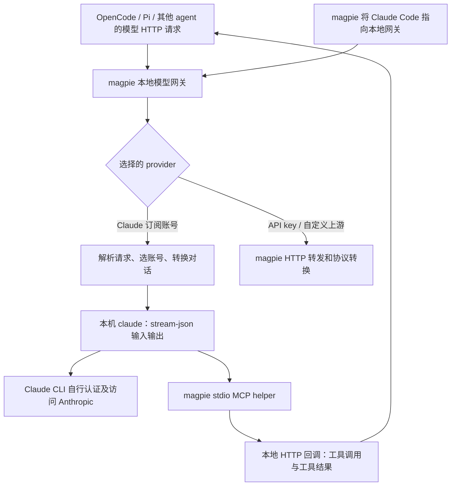

# T-041：provider 登录条款与 magpie 调研

核实日期：2026-10-08。性质：日期研究记录，供主控判断接入边界；不是运行验收或发布批准。

**研究交付：PASS；采用 magpie 的 Claude 订阅网关：NO_GO；Synara 全 provider 的订阅合规结论：INCOMPLETE。** 本次已完成规定的只读调查，无法从公开资料确认的事项明确列为 unknown。ticket 保持 open，待主控关闭。

## 结论

1. **observed / inferred：不建议将 magpie 的 Claude 订阅桥接移入 fork。** 当前 magpie 确实启动本机 `claude`，不是直接拿 Claude OAuth token 调用 Messages API；但它接收其他 agent 的模型请求，转换对话、桥接工具，并读取、保存和复制订阅凭据。Synara 已经通过 Agent SDK 启动本机 Claude CLI。增加通用网关和账号库没有取得新的官方授权依据，也没有封号率对照证据。源码依据见 M1～M8；判断标准是允许的使用方式，不是请求看起来是否像官方客户端。
2. **observed：OpenAI 对现有本地或开源 app-server 认证给出了明确延续许可。** 同一段明确排除商用或托管服务，并建议迁移到新的 Sign in with ChatGPT。这个限制针对 app-server 认证，不能扩大成所有 ChatGPT 登录集成都禁止商用。[官方 app-server 文档，Auth endpoints](https://developers.openai.com/codex/app-server/#auth-endpoints)
3. **observed / unknown：Anthropic 的 SDK 产品限制与官方 CLI 例外需要分别核对，具体见下文。** 现有 Synara 兼有 SDK、自己的登录入口和凭据状态读取；是否完整满足例外，公开文档不足以确认。[Agent SDK overview](https://code.claude.com/docs/en/agent-sdk/overview)，[Legal and compliance](https://code.claude.com/docs/en/legal-and-compliance)
4. **observed / inferred：Antigravity 普通用户条款是另一个明确限制。** 其第 6 条禁止第三方软件访问该服务，并举 Antigravity OAuth 为例。普通订阅经第三方工作台使用不宜判为 PASS；企业和 API key 路径需按各自合同另核实。[Antigravity Additional Terms](https://www.antigravity.google/terms)

## 范围、身份与证据边界

授权输入为 [brief-T-041.md](../brief-T-041.md) 和 [T-041 ticket](../../../.project-map/tickets/T-041-provider-auth-policy.md) 的问题及 magpie 补充。只修改本报告、同目录调查证据和 T-041 的认领/Resolution；不修改 intent、地图、术语表或任何产品代码。

| 项目 | 固定版本或状态 |
| --- | --- |
| a2a 调查起点 | `a80292cc5a2aac052c3e42c23ab2e6374dd0bd56` |
| Synara fork | `3566ef4eb34b18c480c7a49e4b5d741681b72426`；checkout 只读，原有未跟踪 `.grok/` 未触碰 |
| magpie | `de3b1c646afb156b6b35c1dd7a13b5c11187421b`；外置盘 `--depth 1` 克隆，只读研究 |
| magpie 临时 checkout | `/Volumes/WD-Elements/dev-cache/t041-magpie-bpARFyOF/magpie`；保留现场，未登记为 a2a gitlink |
| Synara 声明依赖 | Claude Agent SDK `0.3.259`；OpenCode SDK `1.18.31`，见源码摘录中的 `apps/server/package.json:30,37` |
| worker 请求配置 | 批次 `launch-argv.txt` 记录 `s3-t041`、pane `wF:p15`、`gpt-6.1-sol`、xhigh、`service_tier="fast"`、关闭启动更新检查；这是请求配置，供应商实际 tier 和 CLI 可执行版本均为 unknown |
| 受管执行身份 | brief 未提供 attempt、session_id、fence 或门禁收据；本报告不宣称 claim/submit/acceptance/integration 已发生 |

`observed` 表示在固定源码或已打开的官方原文中直接看到；源码 observed 只证明静态路径。`inferred` 表示基于这些事实的解释或建议；`unknown` 表示资料不足、实际配置未读取或未运行核实。

没有安装、编译或启动 magpie，没有执行 provider 登录、读取用户 `~/.claude` / `~/.codex` 凭据或查询 Keychain，没有发送模型推理请求，没有运行 fork、修改构建输出、push、发送消息或联系供应商。本次网络访问只有 GitHub 源码和公开文档。封号概率、实际 TLS 流量和账号权限均未测量。

固定源码和行号保存在 [source-excerpts.txt](source-excerpts.txt)，版本、摘录范围和未运行项保存在 [inspection.json](inspection.json)。该摘录包含两个仓库的 MIT 许可声明，不包含用户数据。后面的 M/S 编号对应以下源码索引。

## magpie 接入 Claude 的实际调用链

以下链路均为 **observed（静态源码）**，不是运行抓包结果。



图中的订阅分支与 API 转发分支必须区分。Claude Code 也可以是网关的调用者；这与网关内部为 Claude 订阅启动的另一个 CLI 进程是两回事。

| 编号 | observed 结论 | 固定源码证据 |
| --- | --- | --- |
| M1 | 网关注册 Chat Completions、Responses、Messages 等入口。命中 `p.Account.Agent == "claude"` 时进入订阅桥，而不是继续通用 HTTP 转发。 | `internal/gateway/gateway.go:500–515,2502–2508`，[固定版本入口](https://github.com/yetone/magpie/blob/de3b1c646afb156b6b35c1dd7a13b5c11187421b/internal/gateway/gateway.go#L2502) |
| M2 | 通过 `proc.FindTool("claude")` 找本机程序；没有本机程序时可找 WSL。`binary.command` 实际创建子进程，启动时指定模型、stream-json 和 MCP。未见该分支修改 CLI 文件的代码，但没有校验用户所装二进制的真实性。 | `internal/gateway/claude_subscription.go:429–443,509–528,557–563,1645–1664`，[启动代码](https://github.com/yetone/magpie/blob/de3b1c646afb156b6b35c1dd7a13b5c11187421b/internal/gateway/claude_subscription.go#L557) |
| M3 | caller 的工具被暴露为 MCP；CLI 启动 `magpie claude-mcp-helper`，helper 经本地回调传递工具调用/结果。CLI 内置工具默认禁用，可保留 WebSearch；传入 `--dangerously-skip-permissions` 和空 setting sources。 | `claude_subscription.go:509–522,1645–1658`；`internal/claudebridge/mcp.go:1–4,53–68,123–176`，[MCP helper](https://github.com/yetone/magpie/blob/de3b1c646afb156b6b35c1dd7a13b5c11187421b/internal/claudebridge/mcp.go#L132) |
| M4 | 外部 system 文本经过 billing 行删除后，包在 `external_system_instructions` 中，作为 user 内容交给 CLI；历史转成 Human/Assistant 文本。CLI 自己的系统提示仍由 CLI 产生。并不是原样转发外部 system 消息。 | `claude_subscription.go:2240–2274,2296–2310`，[提示转换](https://github.com/yetone/magpie/blob/de3b1c646afb156b6b35c1dd7a13b5c11187421b/internal/gateway/claude_subscription.go#L2240) |
| M5 | 订阅 CLI 环境清除 `ANTHROPIC_BASE_URL`、API key、auth token、`CLAUDE_CODE_OAUTH_TOKEN` 和 `CLAUDE_CODE_ENTRYPOINT` 等；指定账号 config dir，并设置缓存/自动压缩等开关。可通过 `HTTP_PROXY` / `HTTPS_PROXY` 使用网络代理。Safeguards 可通过 `ANTHROPIC_BETAS` 和 CLI 控制设置传入。 | `claude_subscription.go:559–563,618–648,1672–1709`；`internal/netproxy/netproxy.go:174–184,235–243`，[环境构造](https://github.com/yetone/magpie/blob/de3b1c646afb156b6b35c1dd7a13b5c11187421b/internal/gateway/claude_subscription.go#L1687) |
| M6 | 订阅推理分支没有自行设置 Anthropic 请求的 UA；它让 CLI 发送请求，并明确拒绝用订阅 token 走普通签名转发。另一个 API 转发分支默认设 `magpie/<version>` UA；若 caller 是 Claude CLI、上游不是订阅账号，则复制 caller 的 UA、x-app、anthropic-* 等 headers。不能把后者误写成订阅分支伪造 UA。 | `internal/provider/account.go:656–670`；`gateway.go:2747–2780,2842–2862`，[分支与 headers](https://github.com/yetone/magpie/blob/de3b1c646afb156b6b35c1dd7a13b5c11187421b/internal/gateway/gateway.go#L2753) |
| M7 | 对已有登录，读取 `.credentials.json`，在 macOS 可执行 `security find-generic-password` 读取 Claude Code Keychain 项。新登录在临时 config dir 运行官方 `claude auth login --claudeai`；登录后 magpie 读取凭据，解析 access/refresh token。 | `account.go:332–360,400–441`；`internal/provider/claude_signin.go:141–162,289–324`，[凭据读取](https://github.com/yetone/magpie/blob/de3b1c646afb156b6b35c1dd7a13b5c11187421b/internal/provider/account.go#L411) |
| M8 | 凭据 blob 保存于自己的 `logins.json`，目录通常为 `~/.config/magpie`，文件权限 0600；账号目录通常在同级 `claude-accounts`。保存账号会把凭据写入独立 `.credentials.json`，CLI 在这个目录运行；刷新后的凭据可读回账号库。权限 0600 不等于加密，也不等于不保存 token。 | `internal/provider/logins.go:75–84,151,217–283`；`internal/provider/claude_dirs.go:29–61,96–142,159–185`；`internal/appdir/appdir.go:175–185`，[账号凭据落盘](https://github.com/yetone/magpie/blob/de3b1c646afb156b6b35c1dd7a13b5c11187421b/internal/provider/claude_dirs.go#L96) |
| M9 | 可把外层 Claude Code 的 `ANTHROPIC_BASE_URL` 和 auth token 改为网关地址/网关凭据。这是“Claude Code 用其他模型”的另一条路径；网关 token 不是 Anthropic 订阅 token。 | `internal/agent/claude.go:857–885`，[Claude Code 指向网关](https://github.com/yetone/magpie/blob/de3b1c646afb156b6b35c1dd7a13b5c11187421b/internal/agent/claude.go#L882) |

**inferred：** 订阅桥属于“外部模型请求 → Claude Code 原生会话”的适配层，包含模型协议转换和工具执行权转交；不能仅描述成“展示官方 CLI 的界面”。源码注释关于内容分类、Extra Usage 或保持 CLI 身份的解释是作者的判断，不是 Anthropic 的授权。作者自己也在 `internal/provider/google.go:109–111` 提示账号可能暂停或封禁；这同样不能量化实际概率。

**unknown：** 本机所装 `claude` 是否未修改、每个环境变量实际怎样影响当前 CLI 请求、配置代理是否检查/修改 TLS、是否存在特殊批准以及实际封号概率。本次未运行这些路径，也没有检验整个 magpie 对所有 provider 的全部网络行为。

## Synara 现有路径与差异

| 编号 | observed 结论 | 固定源码证据 |
| --- | --- | --- |
| S1 | Claude adapter 默认 `query()`，通过 Agent SDK 设置 `pathToClaudeCodeExecutable` 为配置路径或 `claude`；owned spawn 用该命令、argv、env 建进程。使用 `claude_code` preset 并追加工作台说明、MCP 和权限回调；还通过 SDK 选项排除部分动态提示段。 | `apps/server/src/provider/Layers/ClaudeAdapter.ts:579–590,2086–2095,6171–6190,6214–6248`，[SDK 接入](https://github.com/a1024053774/synara/blob/3566ef4eb34b18c480c7a49e4b5d741681b72426/apps/server/src/provider/Layers/ClaudeAdapter.ts#L6171) |
| S2 | Claude 默认路径使用本机账号环境；独立 provider instance 可设 home/config 环境。代码会读取凭据文件判断 OAuth 是否可用，并在有本地登录、未配置外部认证时清除未显式保留的 API key/token 环境值。不是“工作台完全不读凭据”。 | `provider/claudeEnvironment.ts:88–185`；`provider/claudeProcessEnv.ts:175–268`，[优先本地 OAuth 的代码](https://github.com/a1024053774/synara/blob/3566ef4eb34b18c480c7a49e4b5d741681b72426/apps/server/src/provider/claudeProcessEnv.ts#L242) |
| S3 | Claude 登录入口运行官方 `claude auth login`。macOS keepalive 仅显式开启时调用 `claude auth status`，由 CLI 管理认证；不能仅凭注释证明该命令一定会刷新当前 CLI 的 token。 | `packages/shared/src/providerCliProfiles.ts:66–76`；`provider/claudeCredentialKeepalive.ts:47–67,88–102`，[登录命令](https://github.com/a1024053774/synara/blob/3566ef4eb34b18c480c7a49e4b5d741681b72426/packages/shared/src/providerCliProfiles.ts#L66) |
| S4 | Codex adapter 把会话交给 manager，manager 启动本机 `codex app-server`，stdio 通信。强制 `cli_auth_credentials_store="file"`，并给共享 continuation 设置 sqlite home。 | `provider/Layers/CodexAdapter.ts:2140–2185,2191–2204`；`codexAppServerManager.ts:868–884,1412–1428`；`codexProcessEnv.ts:185–196`，[app-server 启动](https://github.com/a1024053774/synara/blob/3566ef4eb34b18c480c7a49e4b5d741681b72426/apps/server/src/codexAppServerManager.ts#L868) |
| S5 | CODEX_HOME overlay 在工作台状态目录。默认可链接或复制源 `auth.json`；独立账号不静默继承默认账号的 auth，可使用专用 home/shadow home。auth 状态仍有文件读取与变化检测，不能表述为“不接触 token 文件”。这些同用户目录中的链接不等于向其他人共享账号。 | `codexHomePaths.ts:24–46`；`codexProcessEnv.ts:44–46,985–997,2503–2589,2752–2774`，[overlay 处理](https://github.com/a1024053774/synara/blob/3566ef4eb34b18c480c7a49e4b5d741681b72426/apps/server/src/codexProcessEnv.ts#L2503) |
| S6 | ACP 公共层启动本机 agent，initialize 后选择 methodId 并按需 authenticate，随后建立会话；不是一个新的模型供应商。 | `provider/acp/AcpSessionRuntime.ts:1486–1500,1825–1853`，[ACP 认证](https://github.com/a1024053774/synara/blob/3566ef4eb34b18c480c7a49e4b5d741681b72426/apps/server/src/provider/acp/AcpSessionRuntime.ts#L1825) |
| S7 | Cursor 运行 agent 的 `acp`，方法为 `cursor_login`；Devin 为 `devin acp`，可用 WINDSURF_API_KEY 或 cached token；Droid 为 `droid exec --output-format acp`，选 API key/device pairing；Grok 为 `grok … agent --no-leader … stdio`，可选 API key/cached token；OMP 为 `omp acp`、认证方法 `agent`。 | `provider/acp/CursorAcpSupport.ts:92–107,147–155`；`DevinAcpSupport.ts:333–405`；`DroidAcpSupport.ts:119–168`；`GrokAcpSupport.ts:105–131,182–187`；`OmpAcpSupport.ts:185–211`，全部见保存摘录 |
| S8 | Antigravity adapter 实际启动 `agy` 的 headless `-p` / stream-json 路径；本版本不是通过 ACP 驱动它。 | `provider/Layers/AntigravityAdapter.ts:2500–2529`，[启动 argv](https://github.com/a1024053774/synara/blob/3566ef4eb34b18c480c7a49e4b5d741681b72426/apps/server/src/provider/Layers/AntigravityAdapter.ts#L2500) |
| S9 | OpenCode SDK 连接本机 `opencode serve` 或显式外部 `serverUrl`。本机 HTTP 的 Basic 密码是工作台与 OpenCode 之间的控制面认证，不是供应商 API key。模型认证由 OpenCode/provider/plugin 决定；Synara 为发现 provider id 会读取 OpenCode `auth.json`。 | `provider/opencodeRuntime.ts:1007–1057,1431–1438,1475–1487,1641–1672`；`provider/openCodeAuthPaths.ts:26–61`，[本机 server](https://github.com/a1024053774/synara/blob/3566ef4eb34b18c480c7a49e4b5d741681b72426/apps/server/src/provider/opencodeRuntime.ts#L1021) |
| S10 | Pi 是 SDK 内嵌的另一类多 provider harness，创建 ModelRuntime 时指定其 `auth.json`。它和 OMP 都不能由自身软件许可替模型供应商授予订阅访问权。 | `provider/Layers/PiAdapter.ts:1834–1844`，[认证存储配置](https://github.com/a1024053774/synara/blob/3566ef4eb34b18c480c7a49e4b5d741681b72426/apps/server/src/provider/Layers/PiAdapter.ts#L1834)；后半句为 inferred |

| 比较项 | magpie Claude 订阅桥 | Synara Claude adapter | 判断 |
| --- | --- | --- | --- |
| 运行时 | 本机 CLI stream-json | Agent SDK → 本机 CLI | observed：两者都已有官方 CLI 路径 |
| 应用边界 | 通用模型 HTTP 网关，外部 harness 执行工具 | 工作台中的原生 agent 会话、MCP 工具与权限回调 | observed；inferred：后者较接近官方 agent 接口的用途 |
| 凭据 | 解析、保存完整 blob、复制到独立账号目录 | CLI 登录；读取文件判断可用性、选择账号环境 | observed；后者也有需核实的凭据接触边界 |
| 请求内容 | 外部 system/history 转成 user 内容 | SDK preset + append/动态段选项 | observed：两者均会配置提示，不能据此推断豁免 |
| UA/headers | 订阅由 CLI 发；API 转发另有 header 处理 | 已核对 adapter 中未见模型 HTTP UA 改写 | observed 的范围仅限这些接入文件；实际网络 unknown |
| 官方允许依据 | 未发现允许订阅通用网关/账号库的原文 | SDK/API key 路径明确；订阅是否满足官方 CLI 例外未确认 | unknown 不变成 PASS |

**inferred：** 对 Anthropic，现有 SDK + API key 路径比增加 magpie 订阅网关更有明确支持；对 OpenAI，本机官方 app-server 比提取 token 后自行模拟私有 HTTP 更有明确支持。Synara 本地 OpenCode/ACP 协议可以保留，但每个模型和账号必须另判断。这些是方向建议，不是替现有实现签发合规结论。

## 官方原文与三类使用场景

本节官方资料均在 2026-10-08 打开核实；源码链接对应已读取的固定 Git 内容。页面未显示更新日期的，更新日期记 unknown；不把抓取日当作生效日。下列“有依据”仍以用户拥有对应账号/额度、遵守条款和组织政策为前提。

### Anthropic

**observed：** [SDK overview 的 Get started](https://code.claude.com/docs/en/agent-sdk/overview) 限制未经批准的第三方产品提供 claude.ai 登录或额度；License and terms 指向 Commercial Terms。[Quickstart](https://code.claude.com/docs/en/agent-sdk/quickstart) 给 API key 及云供应商认证路线。不能用旧版 SDK 自动继承登录的技术行为覆盖现行限制。overview、quickstart 的更新日期 unknown。

**observed：** [Claude Code Legal and compliance](https://code.claude.com/docs/en/legal-and-compliance#can-customers-offer-claude-code-in-their-products) 有条件允许产品/服务运行未修改的官方 CLI：接受商业条款，不限制其内置认证方法；最终用户使用自己的凭据、用量直接向本人计费；平台不得代付、转售或中介用量。其 Authentication and credential use 又明确禁止第三方收集、保存或中介 claude.ai 凭据/会话 token，并要求完成官方登录流程，同时保留最终用户登录未修改 CLI 的路径。短原文：“developers may not collect, store, or intermediate Claude.ai credentials or session tokens”。该文档更新日期 unknown。

**observed：** [Commercial Terms，A.1](https://www.anthropic.com/legal/commercial-terms) 明确容许按商业合同向最终用户提供产品/服务，页面生效日 2025-06-17。[Consumer Terms](https://www.anthropic.com/legal/consumer-terms) 本次返回的是 EEA/瑞士消费者版本，生效日 2025-10-08；它禁止账号凭据共享，并为 API key 或明确允许的自动化保留例外。该地区版本不能冒充全地域合同，也不能由一般自动化限制反推官方 Claude Code 被禁止。

| 场景 | 订阅登录判断 | API key / 支持的云供应商判断 |
| --- | --- | --- |
| 自用本地 | observed：官方 CLI 的明确路径见上述合规文档；其 ordinary individual use 包含 Agent SDK。unknown：不能据此确认 Synara 完整产品或个人通用网关。 | observed：SDK 官方认证路径；按本人/组织合同和计费使用 |
| 开源发布 | observed：SDK 产品限制没有开源豁免。unknown：现有 Synara 是否满足上述 CLI 例外。 | observed：商业条款支持产品；源码许可和模型服务条款分别满足 |
| 商用托管 | observed：按上述 CLI 例外逐项判断；inferred：magpie M7/M8 不能作为满足条件的证明。 | observed：商业合同允许产品接入；不能把商业 API 应用与转卖账号/key 混为一谈 |

**inferred：magpie NO_GO 的具体理由。** M7/M8 证明第三方读取并保存订阅凭据，M1/M3/M4 证明订阅通用网关和外部 harness 桥接；它不只是“最终用户在未修改 CLI 中登录”。源码和官方限制对照后，没有理由把它作为更合规的替代。Synara S2 的文件读取与 SDK 产品登录也应由主控核实，不能因比 magpie 少一个账号库就宣称通过。

### OpenAI / Codex

**observed：** [app-server Auth endpoints](https://developers.openai.com/codex/app-server/#auth-endpoints) 直接允许现有 local 或 open-source 应用继续使用 app-server 认证，并推荐迁移；短原文：“App-server authentication has never been permitted for commercial or hosted services.” 该页更新日期 unknown。[Authentication](https://developers.openai.com/codex/auth/) 记录 ChatGPT 登录/API key 和本地凭据存储；技术支持不免除账号政策。

**observed：** [Terms of Use](https://openai.com/policies/terms-of-use/) 生效 2026-01-01，禁止与别人共享账号、提供账号给别人或绕过用量限制。[Services Agreement，2.2、3.1–3.3](https://openai.com/policies/services-agreement/) 允许 API 集成供最终用户使用，同时限制账号共享、key 转移和规避额度。后者合同生效按接受/签署定义，页面统一更新日期未确认。

| 场景 | 当前 app-server + ChatGPT 认证 | 其他路线 |
| --- | --- | --- |
| 自用本地 | observed：现有本地应用有继续使用依据；S4/S5 没有证明向别人共享账号 | 官方 app-server 管理登录比自行重放私有请求有更直接依据（inferred） |
| 开源发布 | observed：现有开源应用有继续使用依据；仍不得把作者账号/key 随软件发给别人 | 官方建议迁移 [Sign in with ChatGPT](https://developers.openai.com/siwc)；本文不实现迁移 |
| 商用托管 | observed：不能用上述 app-server 认证许可支持商用/托管 | 可调查新的 Sign in with ChatGPT 或商业 API 合同；当前申请资格、审批及适用性 unknown |

**unknown：** OpenCode 自己的 ChatGPT OAuth 插件或 magpie 的 Codex token 转发是否等价于官方允许的 app-server 认证。OpenCode 的文档推荐 ChatGPT 订阅，不是 OpenAI 对所有 token 重放路径的批准；本调查没有审计这两个实现。也不能把“开源软件许可”解读为共享订阅/绕过限额许可。

### ACP、OpenCode 和其余 provider

**observed / inferred：** [ACP Authentication](https://agentclientprotocol.com/protocol/v1/authentication) 定义 agent/client 的认证协商，不授予模型服务权；协议成功不等于条款允许。Synara S7/S8 的 runtime 列表是核查范围，实际用户开启的账号、插件和模型为 unknown，本次未读取其配置或凭据。

| provider / 入口 | 自用本地 | 开源发布的客户端 | 商用托管 / 共享推理 | 官方依据与未确认部分 |
| --- | --- | --- | --- | --- |
| Cursor ACP | observed：官方明确为自定义客户端提供 `agent acp` 和 `cursor_login` | inferred：用户独立登录的 ACP 客户端符合官方集成用途，非批量卖账号 | unknown：不能据 ACP 示例推断托管转售获准；条款限制租借/出售服务 | [Cursor ACP](https://cursor.com/docs/cli/acp)，[Terms §1.5](https://cursor.com/terms-of-service)，条款更新 2026-09-03 |
| Devin ACP | observed：官方 Zed/JetBrains 等外部 ACP 客户端及浏览器登录路径 | inferred：保持用户自己的官方 CLI 登录有官方集成依据 | unknown：用户实际计划、组织权限和企业合同决定；不能共享账号 token | [Devin ACP/Zed](https://docs.devin.ai/cli/acp/zed)，[Devin Auth](https://docs.devin.ai/cli/enterprise/devin-auth)；后者明确凭据只可复制到自己的机器，不分享、不入 Git；更新日期 unknown |
| Factory Droid ACP | observed：官方 CLI、浏览器登录及 exec 自动化。S7 确认 fork 的 ACP 参数，但当前官方 reference 没找到 `acp` | unknown：源码适配存在不等于发布许可；个人条款限本人/内部使用，分发自己的 wrapper 与分发 Factory 软件需分开 | observed：Individual Plans 条款限制第三方受益/time-sharing/service bureau；其他合同 unknown | [CLI overview](https://docs.factory.com/droid-cli/overview)，[Reference](https://docs.factory.com/droid-cli/cli-reference)，[Individual terms](https://factory.com/terms-of-service)，更新 2026-07-14 |
| Grok Build ACP | observed：官方支持其他应用的 ACP、浏览器登录或 XAI_API_KEY | inferred：每位用户用自己 runtime/账号的本地 ACP 集成有明确用途依据 | unknown：商业/开发者另适用 Enterprise Terms，不能仅沿用消费者订阅 | [Grok Build overview](https://docs.x.ai/build/overview)，[Consumer Terms](https://x.ai/legal/terms-of-service)，更新 2026-09-11；不得共享账号 |
| Antigravity headless | observed：官方 CLI 有登录、headless 自动化和 Gemini API key 路线。普通条款第 6 条又明确限制第三方访问 | inferred：第三方工作台的普通 OAuth 集成不能判为允许；不建议按 PASS 发布 | unknown：企业合同在追加条款开头有适用例外；不等于普通订阅可以池化 | [CLI auth](https://www.antigravity.google/docs/cli/install/)，[headless](https://www.antigravity.google/docs/cli/headless/)，[Additional Terms §6](https://www.antigravity.google/terms)，文档/条款更新日期 unknown |
| OpenCode → Anthropic | observed：API key 是明确路径；Claude 订阅插件受 Anthropic 限制 | observed：开源不豁免 Anthropic 第三方产品限制 | observed：API 商业合同与订阅转售不同 | [Anthropic SDK](https://code.claude.com/docs/en/agent-sdk/overview)，[OpenCode providers](https://opencode.ai/docs/providers/#anthropic) 明确写插件受禁止；该页前文仍残留 Pro/Max 步骤，不能挑允许性片段忽略其后警告 |
| OpenCode → OpenAI | observed：OpenCode 文档提供 ChatGPT Plus/Pro 和 API key | unknown：具体 OAuth 插件路径没有在本次核对；OpenAI 明确许可的是上述 app-server 使用类别 | observed：旧 app-server 认证不能用于商用/托管；OpenCode 独立认证的许可 unknown | [OpenCode OpenAI](https://opencode.ai/docs/providers/#openai)，[OpenAI app-server](https://developers.openai.com/codex/app-server/#auth-endpoints) |
| OpenCode → GitHub Copilot / GitLab Duo | observed：OpenCode 文档分别列 device/OAuth/PAT 登录 | unknown：未取得供应商针对该 OpenCode 实现的明确条款授权 | unknown：不能把用户席位转成公共模型网关的授权 | [OpenCode Copilot](https://opencode.ai/docs/providers/#github-copilot)，[GitLab Duo](https://opencode.ai/docs/providers/#gitlab-duo)；GitHub 的 [third-party agents 文档](https://docs.github.com/en/copilot/concepts/agents/about-third-party-coding-agents) 只证明其平台中指定合作 agent，不能替通用网关背书 |
| Pi / Oh My Pi | observed：S10/S7 证明独立 harness/账号存储；它们不是模型供应商 | inferred：按底层供应商逐项判断；软件支持 OAuth 不创造许可 | unknown：未枚举用户全部 provider 或认证实现 | Anthropic/OpenAI 的限制同样适用；其余订阅、API/云合同各自核实 |
| OpenCode → 其他 API / 本地模型 | observed：OpenCode 支持多种 API key、云凭据及本地模型，auth 存储于其 data home | unknown：“OpenAI-compatible”只表示协议；不能替每家的服务/模型许可授权 | unknown：需指定实际 provider、计费及合同。Anthropic/OpenAI 商业 API 的产品许可已另核实 | [OpenCode providers](https://opencode.ai/docs/providers/)；未做 75+ provider 的全合同审计，不宣称全部允许 |

**observed：** Antigravity 第 6 条短原文：“Using third party software, tools, or services to access the Service” 被列为违约。**unknown：** 官方 headless 自动化文档与该限制之间，对“未修改 CLI 的第三方 GUI 包装”是否有特定例外；本次没有找到，普通账号不判 PASS。使用 API key 或企业凭据也必须先确定适用合同，不能仅靠更换环境变量推断豁免。[官方条款](https://www.antigravity.google/terms)

## 是否采用及最小后续路径

**建议：NO_GO，不移入 magpie Claude 订阅桥、账号库或其提示重组路径。** 目前没有补充现有 Synara 缺失的核心连接能力，却增加模型 HTTP 入口、凭据副本、外部工具往返、进程生命周期和权限责任。引用 MIT 代码的许可可行性与访问 Claude 订阅的许可是两个问题。没有证据支持“更不容易封号”，也不把隐藏 SDK 入口标识或保持 UA 当作合规改善。

供主控决定的最小选项（**inferred；本次不实施**）：

- Claude 产品接入优先保留既有 Agent SDK，使用用户自己的 API key/官方支持的云供应商认证；核对 S2 的 OAuth 优先逻辑不会让用户选择的 API 认证被替换。需要订阅时，向 Anthropic 核实 Synara 的 SDK 包装、登录入口和凭据状态读取能否满足未修改 CLI 例外；在此之前不对外承诺允许。
- Codex 保留现有本地 app-server 路径，不把原始 ChatGPT token 接成公共模型 HTTP 网关。是否迁移 Sign in with ChatGPT 另立经用户授权的任务；这不影响本次对现有本地/开源路径的明确来源结论。
- Cursor/Devin/Grok 使用官方 ACP 和用户独立认证；Factory 明确具体版本及合同；Antigravity 普通 OAuth 的第三方工作台路径不作为通过项。OpenCode/Pi/OMP 将真实模型供应商和认证方式一起审核，不能只写 harness 名。

### 事实门交接

```text
REALITY GATE: INCOMPLETE
GOAL / NON-GOALS: 核实官方允许方式和源码路径；不改产品、不做带凭据实验、不批准发布。
DECISION: 是否以 magpie 代替现有 Claude 接入，以及哪些订阅方式可供工作台使用。
OBSERVED: magpie 通过 CLI 桥接但保管订阅凭据；Synara 已用 SDK/CLI；OpenAI 明确允许现有本地/开源 app-server 认证。
MEASURED: 未测量封号概率或模型服务流量；不做收益主张。
INFERRED: magpie 不是合规改善，建议不采用；API key 产品路径有更明确依据。
UNKNOWN: Synara Claude 包装是否满足 CLI 例外；Antigravity 包装例外；其他 provider 的实际计划/插件/商业合同。
PROBE (Claude): 主控以 S1–S3 的 SDK 包装、官方登录入口和凭据文件读取为输入，取得 Anthropic 明确书面说明并存入本 ticket 的证据目录；说明覆盖全部边界才可判 PASS，明确排除则 NO_GO，未答复仍 INCOMPLETE。
PROBE (Antigravity): 主控区分普通 OAuth、Gemini API key 与企业合同，以 S8 的第三方 headless 包装为输入核实适用例外；只有对应合同/官方说明明确覆盖才可判 PASS，普通限制且无例外则 NO_GO。
PROBE (其他 provider): 主控先确认实际 provider、账号计划及插件版本，再逐项对照供应商原文；官方接口与认证都有允许依据才可判 PASS，仅技术可用或只有 harness 文档仍 INCOMPLETE。
STOP CONDITION: 不通过登录、付费、带凭据运行或 token 重放探测条款；需要这些动作时另取授权。
DECISION CONSEQUENCE: 保持当前代码，交接主控判断；不在本研究中改变 intent 或启动实施。
NEXT ACTION / OWNER: 主控复核本报告，决定是否关闭 T-041 或分配后续核实；待主控关闭。
```

## 复现与交付检查

源码阅读可在保留的外置盘 checkout 重做；审计时以固定提交为准，不依赖最新 main：

```sh
git -C /Volumes/WD-Elements/dev-cache/t041-magpie-bpARFyOF/magpie show de3b1c646afb156b6b35c1dd7a13b5c11187421b:internal/gateway/claude_subscription.go | nl -ba | sed -n '1642,1709p'
git -C /Users/luckye/Documents/Code/synara show 3566ef4eb34b18c480c7a49e4b5d741681b72426:apps/server/src/provider/Layers/ClaudeAdapter.ts | nl -ba | sed -n '6171,6248p'
python3 /Users/luckye/Documents/SKILLS/project-map-skill/project-map/scripts/project_map.py status --root /Users/luckye/Documents/Code/a2a
```

完整摘录清单见 `inspection.json` 的 `source_ranges`，按其 repo/commit/path/ranges 执行 `git show` 即可逐项重读。公开文档是随时可变的网页；本报告保存核实时结论、短原文、精确链接和已知日期，不假称有不可变网页快照。

本次文档交付检查包括 UTF-8 回读、ticket 仍为 open、源码摘录来自固定提交、diff/暂存范围，以及 project-map status；结果追加于 [checks.txt](checks.txt)。未运行产品测试，因为没有改代码，也不以产品测试证明合同允许。独立主控验收尚未进行。

全文暂存区 `git diff --cached --check` 返回 2：带行号的源码摘录在空白行保留了编号后的 tab，因此被报尾随空白。保留原始摘录和完整失败输出，不清洗证据；报告、ticket 与 JSON 元数据另做限定路径的空白检查。此前未暂存时的 `git diff --check` 不覆盖这些新增文件，不能替该失败背书。

查询失败也保留边界：`docs.factory.ai/cli/integrations/acp` 和旧 llms URL 未打开，随后沿当前 `docs.factory.com` 索引取得 CLI 文档，当前 reference 中未找到 ACP；`docs.x.ai/terms-of-service` 未打开，随后取得 `x.ai/legal/terms-of-service`；Cognition 猜测的 terms URL 未打开，企业合同仍 unknown。若干源码候选路径和跨 checkout 路径搜索未命中，最后均以 `git show` 固定路径摘录为依据，未执行候选代码。
