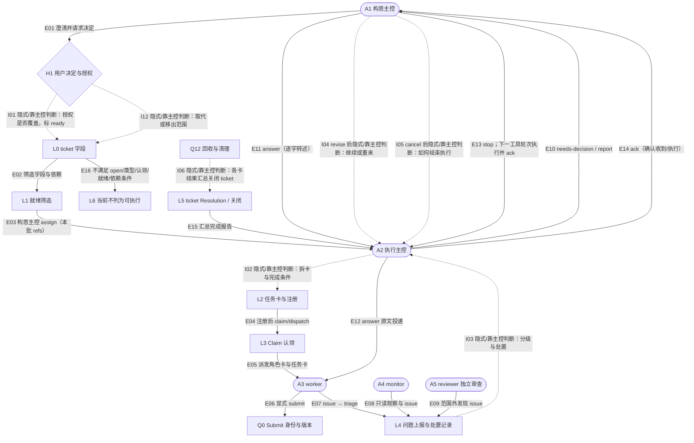
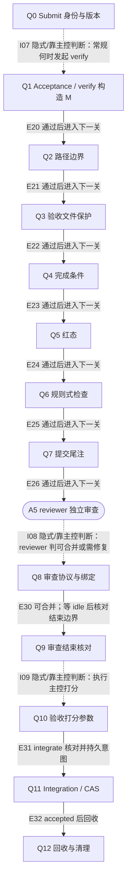
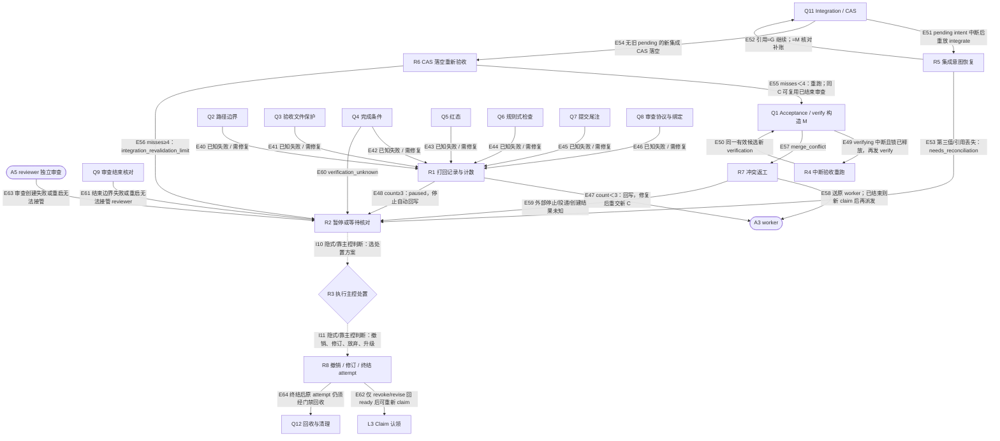

# ticket 生命周期与门禁检查串：显式图（2026-10-16）

T-087-1 / attempt a1；读取来源的最近提交：`fc362ab44054bc82afe8a2f56eef17972ece7bc5`。本页是日期记录，由 `python3 findings/generate_t087_graph.py` 生成。

结论：门禁把受管交付的身份、固定候选、检查结果和 Git 副作用绑定到持久记录；ticket 就绪的含义、任务卡是否充分、异常之后选哪条路、何时关闭 ticket，仍要主控或用户判断。图的虚线列出了这些人工决定。

范围是当前 checkout 的文件与源码分析；未启动服务、模型或真实工作流。日常派发仍处 Herdr 期，后台源码表示已实现路径，不表示已切换日常派发（[switch](#s-switch)、[intent](#s-intent)）。T-081/T-082 的通过只按 ticket 的日期 Resolution 引用，本次未重跑其验收。

读图：矩形是确定性步骤，圆角是 agent 会话，菱形是人工决定点。实线只表示来源写明的检查/协议关系，不表示整段无人判断或已运行通过；虚线一律标“隐式/靠主控判断”。每个点以 ID 连接下方来源表，每条连接的 ID 连接条件、持久化与来源表。三个视图共享 ID，是同一流程的分区展示。

这里沿用门禁检查、agent 会话、人工决定点、task/attempt 等 Ubiquitous language（[worker](#s-worker)、[monitor](#s-monitor)、[reviewrole](#s-reviewrole)）。Tracer bullet 的现有交付闭环由 Claim 到集成展开；Deep modules 所隐藏的锁、fence、快照与恢复在表中露出。没有增加术语或执行器。

## ticket 的真实字段快照

以下直接读取 front matter；ready=yes 可以与 closed 同时存在，因此“曾获授权”不等于“当前可执行”。依赖表读回被依赖票的 status，筛选条件以 [ready](#s-ready)、[readyfilter](#s-readyfilter)、[readydeps](#s-readydeps) 为准。后台任务卡来源校验只检查 ready=yes 与 ready_rev，未重复脚本对 status、ready_by、类型和依赖的整套筛选；这一交接仍需主控按协议完成（[cardbinding](#s-cardbinding)、[readyfilter](#s-readyfilter)、[readydeps](#s-readydeps)）。

| ticket | type | status | claimed_by | ready/by/rev | blocked_by 读回 | 来源 |
| --- | --- | --- | --- | --- | --- | --- |
| T-078 | build | open | 空 | yes/ideation/1 | [] | [T-078:type](#s-T-078:type)、[T-078:status](#s-T-078:status)、[T-078:claimed_by](#s-T-078:claimed_by)、[T-078:ready](#s-T-078:ready)、[T-078:ready_by](#s-T-078:ready_by)、[T-078:ready_rev](#s-T-078:ready_rev)、[T-078:blocked_by](#s-T-078:blocked_by) |
| T-080 | build | closed | 空 | yes/ideation/1 | T-077=closed | [T-080:type](#s-T-080:type)、[T-080:status](#s-T-080:status)、[T-080:claimed_by](#s-T-080:claimed_by)、[T-080:ready](#s-T-080:ready)、[T-080:ready_by](#s-T-080:ready_by)、[T-080:ready_rev](#s-T-080:ready_rev)、[T-080:blocked_by](#s-T-080:blocked_by) |
| T-081 | build | closed | 空 | yes/ideation/1 | T-080=closed | [T-081:type](#s-T-081:type)、[T-081:status](#s-T-081:status)、[T-081:claimed_by](#s-T-081:claimed_by)、[T-081:ready](#s-T-081:ready)、[T-081:ready_by](#s-T-081:ready_by)、[T-081:ready_rev](#s-T-081:ready_rev)、[T-081:blocked_by](#s-T-081:blocked_by) |
| T-082 | build | closed | 空 | yes/ideation/1 | T-077=closed | [T-082:type](#s-T-082:type)、[T-082:status](#s-T-082:status)、[T-082:claimed_by](#s-T-082:claimed_by)、[T-082:ready](#s-T-082:ready)、[T-082:ready_by](#s-T-082:ready_by)、[T-082:ready_rev](#s-T-082:ready_rev)、[T-082:blocked_by](#s-T-082:blocked_by) |
| T-087 | build | open | 空 | yes/ideation/1 | [] | [T-087:type](#s-T-087:type)、[T-087:status](#s-T-087:status)、[T-087:claimed_by](#s-T-087:claimed_by)、[T-087:ready](#s-T-087:ready)、[T-087:ready_by](#s-T-087:ready_by)、[T-087:ready_rev](#s-T-087:ready_rev)、[T-087:blocked_by](#s-T-087:blocked_by) |

## ticket、角色与交接



## 受管交付的门禁检查串



## 拒收与恢复



## 每个点的来源

| ID | 类别 / 名称 | 含义与边界 | 来源 |
| --- | --- | --- | --- |
| A1 | agent 会话 / 构思主控 | 澄清、写决定/spec/ticket、标就绪和转述报告。 | [ideation](#s-ideation)、[authorize](#s-authorize) |
| H1 | 人工决定点 / 用户决定与授权 | T-004：目标/范围/验收/权限/不可逆外部效果/无法核对的外部状态/方向/预算风险。 | [stoprule](#s-stoprule)、[authref](#s-authref) |
| L0 | 确定性步骤 / ticket 字段 | 文件中的 status、blocked_by、claimed_by、ready、ready_by、ready_rev；不是门禁 task.state。 | [ready](#s-ready) |
| L1 | 确定性步骤 / 就绪筛选 | scripts/inbox ready 只列 open、无人认领、可执行类型、就绪字段合法且依赖 closed/superseded 的 ticket。 | [ready](#s-ready)、[readyfilter](#s-readyfilter)、[readydeps](#s-readydeps) |
| A2 | agent 会话 / 执行主控 | 选择就绪工作、写任务卡、经门禁认领/派发/验收/集成/回收、汇总 Resolution。 | [executor](#s-executor) |
| L2 | 确定性步骤 / 任务卡与注册 | 正文由执行主控写；后台版本化任务卡并 create task；Herdr 期先用 Markdown 模板。 | [card](#s-card)、[split](#s-split)、[create](#s-create)、[cardbinding](#s-cardbinding) |
| L3 | 确定性步骤 / Claim 认领 | 原子预留路径、生成 attempt/session、fence 加一、绑定任务卡快照、建 worktree。 | [claim](#s-claim)、[claimsave](#s-claimsave) |
| A3 | agent 会话 / worker | 仅处理分配的 task/attempt；显式 Submit。 | [worker](#s-worker)、[dispatch](#s-dispatch) |
| A4 | agent 会话 / monitor | 只读观察、记录与 issue 上报；无成功判定权限。 | [monitor](#s-monitor) |
| L4 | 确定性步骤 / 问题上报与处置记录 | issue → triage；disposition/answer/ack 追加，不覆盖原条目。 | [kind:issue](#s-kind:issue)、[kind:disposition](#s-kind:disposition)、[answer](#s-answer)、[inboxwrite](#s-inboxwrite) |
| L5 | 确定性步骤 / ticket Resolution / 关闭 | 执行主控汇总各任务卡结果；closed 是 ticket 字段，门禁 accepted 不会在此代码路径自动改 ticket。后半句是限定于已读路径的推断。 | [executor](#s-executor)、[T-087:status](#s-T-087:status)、[integrated](#s-integrated) |
| L6 | 确定性步骤 / 当前不列为可执行 | 未就绪、类型不适用、被认领、依赖未关闭或 status 非 open 均不会列入。closed 是完成记录；superseded/out-of-scope 是被取代/移出范围，不代表工作通过。 | [readyfilter](#s-readyfilter)、[readydeps](#s-readydeps)、[superseded](#s-superseded)、[outscope](#s-outscope) |
| Q0 | 确定性步骤 / Submit 身份与版本 | task/attempt/session/fence/spec、运行时身份、HEAD、干净工作区、launch 交付事实。只到 submitted。 | [submit](#s-submit)、[submitted](#s-submitted)、[current](#s-current) |
| Q1 | 确定性步骤 / Acceptance / verify 构造 M | 持操作锁；由当前工作分支 G 与固定候选 C 构造 M，冲突不进入路径检查。 | [verify](#s-verify)、[verifysave](#s-verifysave)、[merge](#s-merge)、[lock](#s-lock) |
| Q2 | 确定性步骤 / 路径边界 | 候选改动与合并改动均须在 allow 内且不命中 deny。 | [path](#s-path) |
| Q3 | 确定性步骤 / 验收文件保护 | oracle_paths 相对认领起点与 G→M 改动有交集即 oracle_modified。 | [oracle](#s-oracle) |
| Q4 | 确定性步骤 / 完成条件 | 在 M 的验证工作区按卡执行 argv；逐条存意图、结果，非零打回。 | [completion](#s-completion)、[completionlog](#s-completionlog) |
| Q5 | 确定性步骤 / 红态 | 卡写了才查：起点加候选测试必须失败，候选必须通过；未写记 red_not_applicable。 | [red](#s-red)、[quality](#s-quality) |
| Q6 | 确定性步骤 / 规则式检查 | 项目质量快照配置的规则在 M 执行；空列表记 rules_not_applicable。 | [rules](#s-rules) |
| Q7 | 确定性步骤 / 提交尾注 | 完整匹配 task/attempt/session/worker 和交付 launch/tool/model/effort；全无尾注按人工介入处理。 | [trailers](#s-trailers)、[no-trailers](#s-no-trailers) |
| A5 | agent 会话 / reviewer 独立审查 | 每次新建干净会话；T-082 一次性候选副本可写、断网，候选 Git 与共享仓库不可写。判断完成条件是否够格并做 2～5 个变异。 | [reviewrole](#s-reviewrole)、[reviewlaunch](#s-reviewlaunch)、[reviewrequirements](#s-reviewrequirements) |
| Q8 | 确定性步骤 / 审查协议与绑定 | 核对身份、版本、候选、非写入会话、结构化报告；可合并→verified，需修复→submitted/打回。协议格式不能证明判断正确。 | [reviewsubmit](#s-reviewsubmit)、[reviewresult](#s-reviewresult)、[b82judgment](#s-b82judgment) |
| Q9 | 确定性步骤 / 审查结束核对 | reviewer 已 idle；核对 refs、审查/worker worktree 与候选；清理副本和审查目录后写 review_reclaimed。verified 本身不够集成。 | [reviewend](#s-reviewend)、[reviewboundary](#s-reviewboundary)、[reviewremoved](#s-reviewremoved)、[reviewrequired](#s-reviewrequired) |
| Q10 | 确定性步骤 / 验收打分参数 | 执行主控提供主观评分及理由；门禁校验格式、launch 来源并填写客观事实。 | [score](#s-score)、[score-save](#s-score-save) |
| Q11 | 确定性步骤 / Integration / CAS | 核对当前 verification/review/结束记录和打分；持久意图后以 G→M CAS，读回后 accepted、记分。 | [integrate](#s-integrate)、[intent-save](#s-intent-save)、[cas](#s-cas)、[integrated](#s-integrated) |
| Q12 | 确定性步骤 / 回收与清理 | 核对身份、idle、停止/归档读回；保留 Git 引用后清理干净工作区，异常保留并上报。 | [reclaim](#s-reclaim)、[cleanup](#s-cleanup)、[cleanupsave](#s-cleanupsave) |
| R1 | 确定性步骤 / 打回记录与计数 | 同一 attempt 计 delivery_rejected；少于三次允许回写，第三次 paused 并停止自动回写。 | [reject](#s-reject)、[rejectsave](#s-rejectsave)、[feedback](#s-feedback) |
| R2 | 确定性步骤 / 暂停或等待核对 | 未知执行结果、审查生命周期失败、超限或外部效果未知，不能等同成功。具体 state 见各路径。 | [unknown](#s-unknown)、[reviewfailed](#s-reviewfailed)、[revalidate](#s-revalidate)、[conflictunknown](#s-conflictunknown) |
| R3 | 人工决定点 / 执行主控处置 | 三次打回/未知/异常后继续修复、放弃、升级或请求用户决定；不是统一自动恢复。 | [triage](#s-triage)、[stoprule](#s-stoprule)、[abandon](#s-abandon) |
| R4 | 确定性步骤 / 中断验收重跑 | 锁释放后同一 verify 保留旧 interrupted/unknown 证据并新建 verification，不复活过期身份。 | [interrupt](#s-interrupt)、[verify](#s-verify)、[verifybinding](#s-verifybinding) |
| R5 | 确定性步骤 / 集成意图恢复 | 同 intent：引用为 G 继续 CAS；为 M 核对内容补账；第三值或丢失需核对。 | [integrate](#s-integrate)、[reconcile](#s-reconcile) |
| R6 | 确定性步骤 / CAS 落空重新验收 | 首次正常集成遇分支变化，持久 misses 后重跑质量串；候选及绑定不变且审查结束可沿用审查；第 4 次落空暂停上报。 | [revalidate](#s-revalidate)、[reviewrequired](#s-reviewrequired) |
| R7 | 确定性步骤 / 冲突返工 | 保存冲突与候选/base refs；回原 worker；原会话结束时经回收/撤销后新 claim。新候选重跑与新审查。 | [conflict](#s-conflict)、[conflictunknown](#s-conflictunknown)、[submit](#s-submit) |
| R8 | 确定性步骤 / 撤销 / 修订 / 终结 attempt | revoke/revise 使旧身份失效并回 ready；abandon 按打分结果 abandoned/upgraded；不等同 ticket 关闭。 | [revise](#s-revise)、[invalidate](#s-invalidate)、[abandon](#s-abandon) |

## 每条连接的条件与持久化

所有常规门禁修改共用操作锁；save 以事务更新 task/attempt/verification 并追加事件。SQLite 的当前状态行可以更新；不能把“事件追加”写成“所有状态行不可变”（[lock](#s-lock)、[save](#s-save)、[store](#s-store)）。

| ID | 从 → 到 | 条件 / 路由 | 持久化或缺口 | 来源 |
| --- | --- | --- | --- | --- |
| E01 | A1 → H1 | 澄清并请求决定 | 决定写 ticket/spec；用户原话另留引用 | [authorize](#s-authorize)、[stoprule](#s-stoprule) |
| I01 | H1 → L0 | 隐式/靠主控判断：授权是否覆盖，标 ready | ready/by/rev 落文件；判断不由筛选器验证 | [markready](#s-markready)、[authref](#s-authref) |
| E02 | L0 → L1 | 筛选字段与依赖 | 只读文件；不认领、不改字段 | [ready](#s-ready)、[readyfilter](#s-readyfilter)、[readydeps](#s-readydeps) |
| E03 | L1 → A2 | 构思主控 assign（本批 refs） | 收件箱条目落盘；筛选器不发条目、不自动创建 task | [kind:assign](#s-kind:assign)、[assign087](#s-assign087)、[inboxwrite](#s-inboxwrite) |
| I02 | A2 → L2 | 隐式/靠主控判断：拆卡与完成条件 | 卡可持久；充分性与路径选择是人工判断 | [split](#s-split)、[card](#s-card)、[executor](#s-executor) |
| E04 | L2 → L3 | 注册后 claim/dispatch | card 版本/快照、task、attempt、fence 入库 | [create](#s-create)、[claimsave](#s-claimsave) |
| E05 | L3 → A3 | 派发角色卡与任务卡 | 后台 launch/dispatch 入库；Herdr launch/dispatch 分别落文件 | [dispatch](#s-dispatch)、[store](#s-store)、[launch](#s-launch)、[dispatchlog](#s-dispatchlog) |
| E06 | A3 → Q0 | 显式 submit | 成功写 submitted；拒收追加 rejected | [worker](#s-worker)、[submitted](#s-submitted)、[requestfailure](#s-requestfailure) |
| E07 | A3 → L4 | issue → triage | Herdr 收件箱文件；后台 issue_records/events | [kind:issue](#s-kind:issue)、[inboxwrite](#s-inboxwrite)、[issue-save](#s-issue-save) |
| E08 | A4 → L4 | 只读观察与 issue | 观察/报警记录；不写成功状态 | [monitor](#s-monitor)、[kind:issue](#s-kind:issue) |
| E09 | A5 → L4 | 范围外发现 issue | 同问题上报路径，不代替 review_submit | [reviewrole](#s-reviewrole)、[kind:issue](#s-kind:issue) |
| I03 | L4 → A2 | 隐式/靠主控判断：分级与处置 | disposition 落盘；判断内容不由 kind 证明 | [triage](#s-triage)、[kind:disposition](#s-kind:disposition) |
| E10 | A2 → A1 | needs-decision / report | 追加收件箱条目，报告状态逐字 | [kind:needs-decision](#s-kind:needs-decision)、[kind:report](#s-kind:report)、[report](#s-report) |
| E11 | A1 → A2 | answer（逐字转述） | 条目引用 issue/worker；投递后 delivered 和 ack | [kind:answer](#s-kind:answer)、[answer](#s-answer) |
| E12 | A2 → A3 | answer 原文投递 | dispatch 日志；已结束则 forward(session-ended) | [answer](#s-answer)、[dispatchlog](#s-dispatchlog) |
| I04 | A1 → A2 | revise 后隐式/靠主控判断：继续或重来 | ready_rev++ / revise 条目；执行选择另记证据 | [kind:revise](#s-kind:revise)、[revision](#s-revision) |
| I05 | A1 → A2 | cancel 后隐式/靠主控判断：如何结束执行 | cancel 落盘；条目本身不撤销门禁 attempt | [kind:cancel](#s-kind:cancel)、[executor](#s-executor)、[invalidate](#s-invalidate) |
| E13 | A1 → A2 | stop；下一工具轮次执行并 ack | stop/ack 追加；break-glass 需当时用户仍要求 | [kind:stop](#s-kind:stop)、[kind:ack](#s-kind:ack)、[emergency](#s-emergency) |
| E14 | A2 → A1 | ack（确认收到/执行） | 追加文件；ack 不需要再 ack，不是验收证据 | [kind:ack](#s-kind:ack)、[ack](#s-ack) |
| I06 | Q12 → L5 | 隐式/靠主控判断：各卡结果汇总关闭 ticket | Resolution/status 另写文件；与门禁无跨介质原子提交 | [executor](#s-executor)、[integrated](#s-integrated)、[report](#s-report) |
| E15 | L5 → A2 | 汇总完成报告 | 有可执行就绪工作则继续；无则 report | [report](#s-report)、[executor](#s-executor) |
| E16 | L0 → L6 | 不满足 open/类型/认领/就绪/依赖条件 | 只读排除；字段不合规报错，不自动修复 | [readyfilter](#s-readyfilter)、[readydeps](#s-readydeps) |
| I12 | H1 → L0 | 隐式/靠主控判断：取代或移出范围 | 决定另写 ticket 与地图；不自动等同取消活跃 attempt | [superseded](#s-superseded)、[supersededwhy](#s-supersededwhy)、[outscope](#s-outscope)、[outscopewhy](#s-outscopewhy)、[authorize](#s-authorize) |
| I07 | Q0 → Q1 | 隐式/靠主控判断：常规何时发起 verify | submit 已入库；常规由主控调用，显式 run 可自动触发 | [submitted](#s-submitted)、[executor](#s-executor)、[runverify](#s-runverify) |
| E20 | Q1 → Q2 | 通过后进入下一关 | 检查意图/结果与 verification 关联入库；不适用项也记事件 | [path](#s-path)、[save](#s-save) |
| E21 | Q2 → Q3 | 通过后进入下一关 | 检查意图/结果与 verification 关联入库；不适用项也记事件 | [oracle](#s-oracle)、[save](#s-save) |
| E22 | Q3 → Q4 | 通过后进入下一关 | 检查意图/结果与 verification 关联入库；不适用项也记事件 | [completion](#s-completion)、[save](#s-save) |
| E23 | Q4 → Q5 | 通过后进入下一关 | 检查意图/结果与 verification 关联入库；不适用项也记事件 | [quality](#s-quality)、[save](#s-save) |
| E24 | Q5 → Q6 | 通过后进入下一关 | 检查意图/结果与 verification 关联入库；不适用项也记事件 | [rules](#s-rules)、[save](#s-save) |
| E25 | Q6 → Q7 | 通过后进入下一关 | 检查意图/结果与 verification 关联入库；不适用项也记事件 | [trailers](#s-trailers)、[save](#s-save) |
| E26 | Q7 → A5 | 通过后进入下一关 | 检查意图/结果与 verification 关联入库；不适用项也记事件 | [requestreview](#s-requestreview)、[save](#s-save) |
| I08 | A5 → Q8 | 隐式/靠主控判断：reviewer 判可合并或需修复 | 格式、身份、C 绑定能核对；判断正确性无自动证明 | [reviewrequirements](#s-reviewrequirements)、[reviewsubmit](#s-reviewsubmit)、[b82judgment](#s-b82judgment) |
| E30 | Q8 → Q9 | 可合并；等 idle 后核对结束边界 | review_result 和 review_reclaimed 分开保存 | [reviewresult](#s-reviewresult)、[reviewend](#s-reviewend) |
| I09 | Q9 → Q10 | 隐式/靠主控判断：执行主控打分 | 评分文件作参数；门禁校验并补客观字段 | [score](#s-score)、[score-save](#s-score-save)、[executor](#s-executor) |
| E31 | Q10 → Q11 | integrate 核对并持久意图 | intent 绑定 attempt/session/fence/spec/G/C/M/score | [integrate](#s-integrate)、[intent-save](#s-intent-save)、[verifybinding](#s-verifybinding)、[reviewrequired](#s-reviewrequired) |
| E32 | Q11 → Q12 | accepted 后回收 | 分支读回+integrated+score；回收另写 reclaimed | [integrated](#s-integrated)、[reclaim](#s-reclaim)、[cleanup](#s-cleanup) |
| E40 | Q2 → R1 | 已知失败 / 需修复 | delivery_rejected、失败检查、候选、count 持久化 | [path](#s-path)、[rejectsave](#s-rejectsave) |
| E41 | Q3 → R1 | 已知失败 / 需修复 | delivery_rejected、失败检查、候选、count 持久化 | [oracle](#s-oracle)、[rejectsave](#s-rejectsave) |
| E42 | Q4 → R1 | 已知失败 / 需修复 | delivery_rejected、失败检查、候选、count 持久化 | [completion](#s-completion)、[rejectsave](#s-rejectsave) |
| E43 | Q5 → R1 | 已知失败 / 需修复 | delivery_rejected、失败检查、候选、count 持久化 | [red](#s-red)、[rejectsave](#s-rejectsave) |
| E44 | Q6 → R1 | 已知失败 / 需修复 | delivery_rejected、失败检查、候选、count 持久化 | [rules](#s-rules)、[rejectsave](#s-rejectsave) |
| E45 | Q7 → R1 | 已知失败 / 需修复 | delivery_rejected、失败检查、候选、count 持久化 | [trailers](#s-trailers)、[rejectsave](#s-rejectsave) |
| E46 | Q8 → R1 | 已知失败 / 需修复 | delivery_rejected、失败检查、候选、count 持久化 | [reviewresult](#s-reviewresult)、[rejectsave](#s-rejectsave) |
| E47 | R1 → A3 | count＜3：回写，修复后重交新 C | 派发记录与原 attempt 绑定；整串重跑 | [reject](#s-reject)、[feedback](#s-feedback)、[submitted](#s-submitted) |
| E48 | R1 → R2 | count≥3：paused，停止自动回写 | blocking issue 与计数入库 | [reject](#s-reject)、[feedback](#s-feedback)、[issue-save](#s-issue-save) |
| E49 | Q1 → R4 | verifying 中断且锁已释放，再发 verify | 旧 verification=interrupted，缺失输出/退出码保持 unknown | [lock](#s-lock)、[interrupt](#s-interrupt)、[verify](#s-verify) |
| E50 | R4 → Q1 | 同一有效候选新 verification | 新 ID/独立验证工作区，不复用旧通过结论 | [interrupt](#s-interrupt)、[verifysave](#s-verifysave)、[verifybinding](#s-verifybinding) |
| E51 | Q11 → R5 | pending intent 中断后重放 integrate | 先核对原 intent 与当前身份、引用 | [integrate](#s-integrate)、[reconcile](#s-reconcile) |
| E52 | R5 → Q11 | 引用=G 继续；=M 核对补账 | 仍用原 intent；M 分支不重复更新 Git | [integrate](#s-integrate)、[reconcile](#s-reconcile)、[cas](#s-cas) |
| E53 | R5 → R2 | 第三值/引用丢失：needs_reconciliation | 保留 pending intent；不能 revoke/revise 绕过 | [integrate](#s-integrate)、[revise](#s-revise) |
| E54 | Q11 → R6 | 无旧 pending 的新集成 CAS 落空 | integration_compare_failed 先保存 misses | [revalidate](#s-revalidate)、[integrate](#s-integrate) |
| E55 | R6 → Q1 | misses＜4：重跑；同 C 可复用已结束审查 | 旧验证与 refs 保留；不能仅沿用机械结果 | [revalidate](#s-revalidate)、[reviewrequired](#s-reviewrequired) |
| E56 | R6 → R2 | misses≥4：integration_revalidation_limit | paused 与 issue 落库 | [revalidate](#s-revalidate) |
| E57 | Q1 → R7 | merge_conflict | 冲突、候选/base 引用、返工 intent 保存 | [merge](#s-merge)、[conflict](#s-conflict) |
| E58 | R7 → A3 | 送原 worker；已结束则新 claim 后再派发 | 投递回执/替换 attempt 保存；新候选须新审查 | [conflict](#s-conflict)、[submitted](#s-submitted) |
| E59 | R7 → R2 | 外部停止/投递/创建结果未知 | conflict_rework_unknown；不盲重送/重建 | [conflictunknown](#s-conflictunknown) |
| E60 | Q4 → R2 | verification_unknown | unknown 结果与 paused 保存，不计作已知失败 | [unknown](#s-unknown) |
| E61 | Q9 → R2 | 结束边界失败或重启无法接管 reviewer | review_lifecycle_failed；结论失效并上报 | [reviewfailed](#s-reviewfailed)、[reviewrestart](#s-reviewrestart) |
| I10 | R2 → R3 | 隐式/靠主控判断：选处置方案 | issue 有记录；不存在通用自动解锁成功路径 | [triage](#s-triage)、[stoprule](#s-stoprule)、[abandon](#s-abandon) |
| I11 | R3 → R8 | 隐式/靠主控判断：撤销、修订、放弃、升级 | 经对应命令保存；设计/验收/权限变化须问用户 | [revise](#s-revise)、[abandon](#s-abandon)、[stoprule](#s-stoprule) |
| E62 | R8 → L3 | 仅 revoke/revise 回 ready 后可重新 claim | 旧 attempt 撤销，新 attempt/fence；abandon 不能直接 claim | [invalidate](#s-invalidate)、[claim](#s-claim) |
| E63 | A5 → R2 | 审查创建失败或重启无法接管 | review_lifecycle_failed，当前执行暂停并上报 | [reviewfailed](#s-reviewfailed)、[reviewrestart](#s-reviewrestart) |
| E64 | R8 → Q12 | 终结后原 attempt 仍须经门禁回收 | 命令绑定原 attempt；回收历史执行不接管新执行 | [abandon](#s-abandon)、[reclaim](#s-reclaim)、[cleanup](#s-cleanup) |

## 收件箱类型

类型来自 scripts/inbox 的 KINDS 字面量，方向与含义来自交接规格表；两者不一致时脚本停止。ack 只确认条目，不能代替验收。

| kind | 方向 | 含义 | 图中连接 | 来源 |
| --- | --- | --- | --- | --- |
| ack | 任一方 → 发送方 | 确认收到或已执行，可附结果 | E13/E14 | [kind:ack](#s-kind:ack) |
| answer | 构思 → 执行（用户的答复，由构思主控逐字抄录） | 要投递给提问会话的原文，`refs` 带 issue 和 worker，带 `bundle_id`；执行主控投递后写 `delivered` 处置并 `ack` | E11/E12 | [kind:answer](#s-kind:answer) |
| assign | 构思 → 执行 | 本批就绪 ticket（`refs`）、交接说明、`## 授权` 一节 | E03 | [kind:assign](#s-kind:assign) |
| cancel | 构思 → 执行 | 取消某些 ticket 或整批，写明原因 | I05 | [kind:cancel](#s-kind:cancel) |
| disposition | 执行/构思/用户/系统 | 对某条 `issue` 的处置 | I03 | [kind:disposition](#s-kind:disposition) |
| issue | worker/reviewer/monitor → `triage` | 问题上报 | E07/E08/E09 | [kind:issue](#s-kind:issue) |
| needs-decision | 执行 → 构思 | 需要用户抉择：问题、选项、证据、最小选择 | E10 | [kind:needs-decision](#s-kind:needs-decision) |
| report | 执行 → 构思 | 完成报告 | E10 | [kind:report](#s-kind:report) |
| revise | 构思 → 执行 | 某 ticket 改了，新的 `ready_rev` | I04 | [kind:revise](#s-kind:revise) |
| stop | 用户/构思 → 执行 | 紧急停止，首行 `URGENT 停止 <目标>`，`refs` 指向 worker 或 attempt | E13 | [kind:stop](#s-kind:stop) |

## 拒收码与恢复路径的对照

以下为图中路径所需的代表性拒收码，逐个检查其字符串位于对应源码区间，不是所有接口错误的穷举。reviewer 的“需修复”是业务结论，经 independent_review 打回，不冒充一个拒收码；已知失败、权限/运行阻塞、未知副作用分别保留。

| 检查 | 拒收码及源码行 | 下一步 |
| --- | --- | --- |
| 操作锁 | `operation_busy` [code:operation_busy](#s-code:operation_busy) | 等活跃执行者结束；只释放锁不算通过 |
| 交付身份/候选 | `stale_attempt` [code:stale_attempt](#s-code:stale_attempt)；`stale_session` [code:stale_session](#s-code:stale_session)；`stale_fence` [code:stale_fence](#s-code:stale_fence)；`stale_spec` [code:stale_spec](#s-code:stale_spec)；`stale_thread` [code:stale_thread](#s-code:stale_thread)；`identity_conflict` [code:identity_conflict](#s-code:identity_conflict)；`stale_turn` [code:stale_turn](#s-code:stale_turn)；`candidate_conflict` [code:candidate_conflict](#s-code:candidate_conflict)；`not_descendant` [code:not_descendant](#s-code:not_descendant)；`workspace_head_mismatch` [code:workspace_head_mismatch](#s-code:workspace_head_mismatch)；`dirty_worktree` [code:dirty_worktree](#s-code:dirty_worktree)；`repair_requires_new_candidate` [code:repair_requires_new_candidate](#s-code:repair_requires_new_candidate)；`delivery_facts_unknown` [code:delivery_facts_unknown](#s-code:delivery_facts_unknown) | 拒收，核对身份或交新候选；不把迟到提交迁移到新 attempt |
| 验证前置/合并/完成条件 | `quality_rejection_limit` [code:quality_rejection_limit](#s-code:quality_rejection_limit)；`repair_submission_required` [code:repair_submission_required](#s-code:repair_submission_required)；`not_submitted` [code:not_submitted](#s-code:not_submitted)；`needs_reconciliation` [code:needs_reconciliation](#s-code:needs_reconciliation)；`merge_conflict` [code:merge_conflict](#s-code:merge_conflict)；`oracle_failed` [code:oracle_failed](#s-code:oracle_failed)；`verification_unknown` [code:verification_unknown](#s-code:verification_unknown) | 按打回、冲突、未知三条路径分别处理 |
| 路径/验收文件 | `oracle_not_found` [code:oracle_not_found](#s-code:oracle_not_found)；`path_boundary_failed` [code:path_boundary_failed](#s-code:path_boundary_failed)；`oracle_modified` [code:oracle_modified](#s-code:oracle_modified) | 认领起点须存在；交付越界/改验收文件打回 |
| 红态/规则 | `red_state_failed` [code:red_state_failed](#s-code:red_state_failed)；`red_test_file_invalid` [code:red_test_file_invalid](#s-code:red_test_file_invalid)；`red_test_not_changed` [code:red_test_not_changed](#s-code:red_test_not_changed)；`red_test_symlink` [code:red_test_symlink](#s-code:red_test_symlink)；`rule_check_failed` [code:rule_check_failed](#s-code:rule_check_failed)；`quality_reverification_required` [code:quality_reverification_required](#s-code:quality_reverification_required) | 已知质量失败进入打回；未知结果暂停 |
| 提交尾注 | `trailer_task_mismatch` [code:trailer_task_mismatch](#s-code:trailer_task_mismatch)；`invalid_trailers` [code:invalid_trailers](#s-code:invalid_trailers)；`trailer_identity_mismatch` [code:trailer_identity_mismatch](#s-code:trailer_identity_mismatch)；`trailer_launch_record_missing` [code:trailer_launch_record_missing](#s-code:trailer_launch_record_missing) | 打回；全无尾注是人工介入分支，不在此拒收列表 |
| 审查绑定/结束 | `review_launch_boundary` [code:review_launch_boundary](#s-code:review_launch_boundary)；`review_required` [code:review_required](#s-code:review_required)；`stale_review` [code:stale_review](#s-code:stale_review)；`review_end_check_required` [code:review_end_check_required](#s-code:review_end_check_required)；`reviewer_not_idle` [code:reviewer_not_idle](#s-code:reviewer_not_idle)；`review_shared_refs_changed` [code:review_shared_refs_changed](#s-code:review_shared_refs_changed)；`review_worktree_changed` [code:review_worktree_changed](#s-code:review_worktree_changed)；`review_worker_workspace_changed` [code:review_worker_workspace_changed](#s-code:review_worker_workspace_changed) | 边界失败使审查失效并上报；缺结束记录不能 integrate |
| 审查协议 | `reviewer_required` [code:reviewer_required](#s-code:reviewer_required)；`review_candidate_mismatch` [code:review_candidate_mismatch](#s-code:review_candidate_mismatch)；`review_verification_mismatch` [code:review_verification_mismatch](#s-code:review_verification_mismatch)；`review_writer_conflict` [code:review_writer_conflict](#s-code:review_writer_conflict)；`review_native_session_reused` [code:review_native_session_reused](#s-code:review_native_session_reused)；`review_requirements_mismatch` [code:review_requirements_mismatch](#s-code:review_requirements_mismatch) | 拒绝不匹配审查；格式合规仍不证明 reviewer 判断正确 |
| 打分 | `score_required` [code:score_required](#s-code:score_required)；`invalid_score` [code:invalid_score](#s-code:invalid_score)；`score_provenance_required` [code:score_provenance_required](#s-code:score_provenance_required)；`attempt_already_scored` [code:attempt_already_scored](#s-code:attempt_already_scored) | 补合法且绑定的打分，不绕过原 attempt |

集成的 `integration_compare_failed`、`integration_revalidation_limit`、`needs_reconciliation` 与回收的 `worker_working` 分别见 [revalidate](#s-revalidate)、[cas](#s-cas)、[integrate](#s-integrate)、[reclaim](#s-reclaim)；路径分别画在 E51–E56、E32。恢复时不能删锁文件、改 SQLite 或用锁已释放推断成功。

## 持久化边界与未持久化的判断

| 边界 | 落地内容 / 不保证的部分 | 来源 |
| --- | --- | --- |
| ticket → 就绪 | front matter/Resolution 落 Markdown；scripts/inbox ready 只读。所读路径未见 ticket 字段与后台 task 的跨介质事务（静态推断）。 | [ready](#s-ready)、[cardbinding](#s-cardbinding)、[executor](#s-executor) |
| 收件箱 → 执行主控 | Herdr 条目 O_EXCL staging、fsync、link 原子发布；ack/disposition 另加条目。授权正文的含义仍靠人判断。 | [inboxwrite](#s-inboxwrite)、[authref](#s-authref) |
| 认领 → agent 会话 | 后台先保存 claim/dispatch intent、任务卡快照、attempt/session/fence，再建 worktree/会话。Herdr 的 launch 与 dispatch 分落 records/launches.jsonl 和 evidence/<batch>/dispatch.jsonl。 | [claimsave](#s-claimsave)、[launch](#s-launch)、[dispatchlog](#s-dispatchlog)、[store](#s-store) |
| Submit → Acceptance | C、交付 launch/tool/model/effort、attempt/session/fence/spec、任务卡快照均有绑定；verify 新建 G/C/M 与 verification_id。 | [submitted](#s-submitted)、[verifysave](#s-verifysave)、[verifybinding](#s-verifybinding) |
| 每项检查 | completion_intent/result、red/rule、path/oracle/trailer 事件落库；执行中丢失的结果保持 unknown，不据此通过。 | [completionlog](#s-completionlog)、[red](#s-red)、[rules](#s-rules)、[unknown](#s-unknown)、[save](#s-save) |
| reviewer 请求 → 结束 | review 请求、启动记录、一次性副本、结构化结果、结束核对与清理事件分开；报告要求持久化，模型如何选变异与判断正确性无程序证明。 | [reviewrequest](#s-reviewrequest)、[reviewrequirements](#s-reviewrequirements)、[reviewresult](#s-reviewresult)、[reviewend](#s-reviewend)、[b82judgment](#s-b82judgment) |
| 打回 → worker | 失败检查/候选/计数先落库，后台回写有 dispatch 记录；第三次取消待回写队列并记 quality_feedback_stopped。 | [rejectsave](#s-rejectsave)、[feedback](#s-feedback)、[store](#s-store) |
| Integration → Git | SQLite 先持久 pending intent；Git update-ref prepare/commit 做 CAS；读回引用/内容后记 accepted 和打分。SQLite 与 Git 不是同一事务，靠 intent 恢复。 | [intent-save](#s-intent-save)、[cas](#s-cas)、[integrated](#s-integrated)、[reconcile](#s-reconcile) |
| 回收 → 删除工作区 | 身份和 idle 读回；Git 保留引用与 cleanup intent 先于 worktree remove；脏目录或未解决验收保留。 | [reclaim](#s-reclaim)、[cleanup](#s-cleanup)、[cleanupsave](#s-cleanupsave) |
| 人工判断 → 后续操作 | I01–I12 可能有文字记录，但没有能证明判断充分或原子完成路由的状态。日志存在不等于判断正确。派发结果未知时也不能凭重发补齐。 | [authref](#s-authref)、[triage](#s-triage)、[dispatchunknown](#s-dispatchunknown)、[b82judgment](#s-b82judgment) |

## 隐式边清单与 T-081 / T-082 的覆盖

“隐式”包括已规定职责、但下一步仍依赖语义判断的连接，不仅指完全没写规程的连接。后果和未覆盖项是本次静态分析的推断；覆盖仅引用两票的已记录范围，未把本次分析说成独立验收。T-081 记录 16 个坏行为、4 个正确交付及误拒绝 0，并明确能力检查的限制；T-082 记录 2 个真实 reviewer 回合及其适用边界（[b81](#s-b81)、[b81limits](#s-b81limits)、[b82](#s-b82)、[b82judgment](#s-b82judgment)）。

| ID / 从 → 到 | 判断与潜在后果（推断） | T-081 覆盖 / 未覆盖 | T-082 覆盖 / 未覆盖 | 依据 |
| --- | --- | --- | --- | --- |
| I01 / H1 → L0 | ready 看似合法但授权/验收未真正确认，可能执行越权工作。 | 不覆盖用户授权的含义判断。 | 不覆盖授权；只判断候选与完成条件。 | [markready](#s-markready)、[authref](#s-authref)、[b81](#s-b81)、[b81cases](#s-b81cases)、[b82](#s-b82)、[b82judgment](#s-b82judgment) |
| I02 / A2 → L2 | 拆卡漏目标，allow/oracle_paths 漏文件或完成条件过弱，坏交付仍可通过。 | 覆盖已列入卡的越界/改验收文件、自报通过、正确交付误拒；不证明卡覆盖用户目标。 | 直接审查完成条件充分性并做变异；2～5 个选择与判断仍属模型行为，不保证穷尽。 | [split](#s-split)、[card](#s-card)、[executor](#s-executor)、[b81](#s-b81)、[b81cases](#s-b81cases)、[b82](#s-b82)、[b82judgment](#s-b82judgment) |
| I03 / L4 → A2 | 严重问题被关闭、需用户决定的被当作日常问题处理，或未送达。 | 不覆盖问题语义分级/送达。 | 不覆盖 triage；可发现审查范围内问题，不保证跨角色处置。 | [triage](#s-triage)、[kind:disposition](#s-kind:disposition)、[b81](#s-b81)、[b81cases](#s-b81cases)、[b82](#s-b82)、[b82judgment](#s-b82judgment) |
| I04 / A1 → A2 | ready_rev 已变，旧 worker 继续做旧目标，或无谓重启丢失进度。 | 覆盖旧 attempt 迟到交付的门禁拒收；不覆盖是否应该继续/重来。 | 覆盖候选/审查绑定；不判断修订时执行策略。 | [kind:revise](#s-kind:revise)、[revision](#s-revision)、[b81](#s-b81)、[b81cases](#s-b81cases)、[b82](#s-b82)、[b82judgment](#s-b82judgment) |
| I05 / A1 → A2 | 取消通知已确认，活跃 attempt 却仍可运行；误以为 cancel 等于 revoke。 | 不覆盖 cancel 到门禁撤销的人工路由。 | 不覆盖 cancel；审查生命周期核对不是取消决策。 | [kind:cancel](#s-kind:cancel)、[executor](#s-executor)、[invalidate](#s-invalidate)、[b81](#s-b81)、[b81cases](#s-b81cases)、[b82](#s-b82)、[b82judgment](#s-b82judgment) |
| I06 / Q12 → L5 | 漏卡或漏证据仍把 ticket 关闭，或 accepted 后忘记关闭/报告。 | 覆盖单个受管交付的错误拒收与固定候选；不覆盖 ticket 汇总关闭。 | 覆盖每次审查与结束边界；不覆盖多卡汇总和 ticket 状态写回。 | [executor](#s-executor)、[integrated](#s-integrated)、[report](#s-report)、[b81](#s-b81)、[b81cases](#s-b81cases)、[b82](#s-b82)、[b82judgment](#s-b82judgment) |
| I12 / H1 → L0 | 误把未做成或被放弃的工作写成完成；取代关系与活跃执行脱节。 | 不覆盖 ticket 取代/范围决定。 | 不覆盖 ticket 取代/范围决定。 | [superseded](#s-superseded)、[supersededwhy](#s-supersededwhy)、[outscope](#s-outscope)、[outscopewhy](#s-outscopewhy)、[authorize](#s-authorize)、[b81](#s-b81)、[b81cases](#s-b81cases)、[b82](#s-b82)、[b82judgment](#s-b82judgment) |
| I07 / Q0 → Q1 | 候选停在 submitted，或错误地把提交/终端 idle 当已验收。 | 覆盖仅自报成功不能通过完成条件；不保证主控及时触发 verify。 | 审查请求发生在 verify 后；不覆盖触发时机。 | [submitted](#s-submitted)、[executor](#s-executor)、[runverify](#s-runverify)、[b81](#s-b81)、[b81cases](#s-b81cases)、[b82](#s-b82)、[b82judgment](#s-b82judgment) |
| I08 / A5 → Q8 | 完成条件过弱或变异选错仍报可合并；结构化布尔值与报告标题不能证明判断正确。 | 坏 worker 样本与正例检查门禁，不证明任意 reviewer 判断正确。 | 直接增加充分性与变异要求；真实偏弱卡案例如实记录，明确不把判断正确作为门禁条件。 | [reviewrequirements](#s-reviewrequirements)、[reviewsubmit](#s-reviewsubmit)、[b82judgment](#s-b82judgment)、[b81](#s-b81)、[b81cases](#s-b81cases)、[b82](#s-b82)、[b82judgment](#s-b82judgment) |
| I09 / Q9 → Q10 | 评分无根据或尺度漂移；合规 JSON 仍产生失真的评价数据。 | 不覆盖主观分值/理由质量。 | 不覆盖打分尺度。 | [score](#s-score)、[score-save](#s-score-save)、[executor](#s-executor)、[b81](#s-b81)、[b81cases](#s-b81cases)、[b82](#s-b82)、[b82judgment](#s-b82judgment) |
| I10 / R2 → R3 | 把未知结果当成功，重复外部副作用，或一直暂停无人处置。 | 覆盖分支被改后的 CAS/拒收样本；不覆盖所有未知恢复的人工作法。 | 覆盖 reviewer 结束边界与失效上报；不覆盖主控之后的决定。 | [triage](#s-triage)、[stoprule](#s-stoprule)、[abandon](#s-abandon)、[b81](#s-b81)、[b81cases](#s-b81cases)、[b82](#s-b82)、[b82judgment](#s-b82judgment) |
| I11 / R3 → R8 | 越权改验收/权限，或错误结束 attempt 后想沿用旧身份。 | 覆盖旧身份拒收；不证明放弃/升级的业务判断或用户授权。 | 不覆盖撤销/修订/升级的授权；可保护原候选审查边界。 | [revise](#s-revise)、[abandon](#s-abandon)、[stoprule](#s-stoprule)、[b81](#s-b81)、[b81cases](#s-b81cases)、[b82](#s-b82)、[b82judgment](#s-b82judgment) |

## 再生成、引用检查与证据边界

在仓库根目录运行（输出 UTF-8、无 BOM、LF）：

```sh
python3 findings/generate_t087_graph.py > /tmp/t087-first.md
python3 findings/generate_t087_graph.py > /tmp/t087-second.md
diff -u /tmp/t087-first.md /tmp/t087-second.md
python3 findings/generate_t087_graph.py --check findings/ticket-gates-graph-2026-10-16.zh-CN.md
```

脚本只读仓库来源与 Git 版本信息，向 stdout 输出文本；不写状态、不调门禁、不派发、不启动服务。来源集合最近提交号随来源提交变化，生成物本身提交不会改变它。锚点缺失/歧义、kind 不一致或红态/规则次序变化时停止，不能静默沿用旧引用。检查串调用的相对顺序从 verifyCandidate 中的锚点行序生成。

这是面向这些文件的定向摘录，并非任意 TypeScript 控制流解析器。新增分支或其他文件中的新路由需要重新分析；源码变了，即使现有锚点仍在，也不能只凭引用存在就认定图语义完整。--check 检查点/连接 ID、引用声明、文件行号与摘录是否存在，不判断来源是否支持作者解读。

状态：本页是 worker 的待审候选。两次生成、引用存在性和 project_map 状态另存 evidence/2026-10-16-batch16/T-087/；来源语义抽查须由不写图的会话完成（[audit087](#s-audit087)），本作者不自称完成该抽查。

## 来源索引

每项链接显示仓库相对文件:行号；摘录为当前该行原文。图中来源 ID 都在这里展开。

| 来源 ID | 文件:行 | 该行摘录 |
| --- | --- | --- |
| <a id="s-T-077:blocked_by"></a>T-077:blocked_by | [.project-map/tickets/T-077-worktree-lifecycle-conflicts.md:6](../.project-map/tickets/T-077-worktree-lifecycle-conflicts.md#L6) | "blocked_by: []" |
| <a id="s-T-077:claimed_by"></a>T-077:claimed_by | [.project-map/tickets/T-077-worktree-lifecycle-conflicts.md:7](../.project-map/tickets/T-077-worktree-lifecycle-conflicts.md#L7) | "claimed_by:" |
| <a id="s-T-077:id"></a>T-077:id | [.project-map/tickets/T-077-worktree-lifecycle-conflicts.md:2](../.project-map/tickets/T-077-worktree-lifecycle-conflicts.md#L2) | "id: T-077" |
| <a id="s-T-077:ready"></a>T-077:ready | [.project-map/tickets/T-077-worktree-lifecycle-conflicts.md:9](../.project-map/tickets/T-077-worktree-lifecycle-conflicts.md#L9) | "ready: yes" |
| <a id="s-T-077:ready_by"></a>T-077:ready_by | [.project-map/tickets/T-077-worktree-lifecycle-conflicts.md:10](../.project-map/tickets/T-077-worktree-lifecycle-conflicts.md#L10) | "ready_by: ideation" |
| <a id="s-T-077:ready_rev"></a>T-077:ready_rev | [.project-map/tickets/T-077-worktree-lifecycle-conflicts.md:11](../.project-map/tickets/T-077-worktree-lifecycle-conflicts.md#L11) | "ready_rev: 1" |
| <a id="s-T-077:status"></a>T-077:status | [.project-map/tickets/T-077-worktree-lifecycle-conflicts.md:5](../.project-map/tickets/T-077-worktree-lifecycle-conflicts.md#L5) | "status: closed" |
| <a id="s-T-077:type"></a>T-077:type | [.project-map/tickets/T-077-worktree-lifecycle-conflicts.md:4](../.project-map/tickets/T-077-worktree-lifecycle-conflicts.md#L4) | "type: build" |
| <a id="s-T-078:blocked_by"></a>T-078:blocked_by | [.project-map/tickets/T-078-controllers-in-workbench.md:6](../.project-map/tickets/T-078-controllers-in-workbench.md#L6) | "blocked_by: []" |
| <a id="s-T-078:claimed_by"></a>T-078:claimed_by | [.project-map/tickets/T-078-controllers-in-workbench.md:7](../.project-map/tickets/T-078-controllers-in-workbench.md#L7) | "claimed_by:" |
| <a id="s-T-078:id"></a>T-078:id | [.project-map/tickets/T-078-controllers-in-workbench.md:2](../.project-map/tickets/T-078-controllers-in-workbench.md#L2) | "id: T-078" |
| <a id="s-T-078:ready"></a>T-078:ready | [.project-map/tickets/T-078-controllers-in-workbench.md:9](../.project-map/tickets/T-078-controllers-in-workbench.md#L9) | "ready: yes" |
| <a id="s-T-078:ready_by"></a>T-078:ready_by | [.project-map/tickets/T-078-controllers-in-workbench.md:10](../.project-map/tickets/T-078-controllers-in-workbench.md#L10) | "ready_by: ideation" |
| <a id="s-T-078:ready_rev"></a>T-078:ready_rev | [.project-map/tickets/T-078-controllers-in-workbench.md:11](../.project-map/tickets/T-078-controllers-in-workbench.md#L11) | "ready_rev: 1" |
| <a id="s-T-078:status"></a>T-078:status | [.project-map/tickets/T-078-controllers-in-workbench.md:5](../.project-map/tickets/T-078-controllers-in-workbench.md#L5) | "status: open" |
| <a id="s-T-078:type"></a>T-078:type | [.project-map/tickets/T-078-controllers-in-workbench.md:4](../.project-map/tickets/T-078-controllers-in-workbench.md#L4) | "type: build" |
| <a id="s-T-080:blocked_by"></a>T-080:blocked_by | [.project-map/tickets/T-080-protected-acceptance-files.md:6](../.project-map/tickets/T-080-protected-acceptance-files.md#L6) | "blocked_by: [T-077]" |
| <a id="s-T-080:claimed_by"></a>T-080:claimed_by | [.project-map/tickets/T-080-protected-acceptance-files.md:7](../.project-map/tickets/T-080-protected-acceptance-files.md#L7) | "claimed_by:" |
| <a id="s-T-080:id"></a>T-080:id | [.project-map/tickets/T-080-protected-acceptance-files.md:2](../.project-map/tickets/T-080-protected-acceptance-files.md#L2) | "id: T-080" |
| <a id="s-T-080:ready"></a>T-080:ready | [.project-map/tickets/T-080-protected-acceptance-files.md:9](../.project-map/tickets/T-080-protected-acceptance-files.md#L9) | "ready: yes" |
| <a id="s-T-080:ready_by"></a>T-080:ready_by | [.project-map/tickets/T-080-protected-acceptance-files.md:10](../.project-map/tickets/T-080-protected-acceptance-files.md#L10) | "ready_by: ideation" |
| <a id="s-T-080:ready_rev"></a>T-080:ready_rev | [.project-map/tickets/T-080-protected-acceptance-files.md:11](../.project-map/tickets/T-080-protected-acceptance-files.md#L11) | "ready_rev: 1" |
| <a id="s-T-080:status"></a>T-080:status | [.project-map/tickets/T-080-protected-acceptance-files.md:5](../.project-map/tickets/T-080-protected-acceptance-files.md#L5) | "status: closed" |
| <a id="s-T-080:type"></a>T-080:type | [.project-map/tickets/T-080-protected-acceptance-files.md:4](../.project-map/tickets/T-080-protected-acceptance-files.md#L4) | "type: build" |
| <a id="s-T-081:blocked_by"></a>T-081:blocked_by | [.project-map/tickets/T-081-bad-worker-suite.md:6](../.project-map/tickets/T-081-bad-worker-suite.md#L6) | "blocked_by: [T-080]" |
| <a id="s-T-081:claimed_by"></a>T-081:claimed_by | [.project-map/tickets/T-081-bad-worker-suite.md:7](../.project-map/tickets/T-081-bad-worker-suite.md#L7) | "claimed_by:" |
| <a id="s-T-081:id"></a>T-081:id | [.project-map/tickets/T-081-bad-worker-suite.md:2](../.project-map/tickets/T-081-bad-worker-suite.md#L2) | "id: T-081" |
| <a id="s-T-081:ready"></a>T-081:ready | [.project-map/tickets/T-081-bad-worker-suite.md:9](../.project-map/tickets/T-081-bad-worker-suite.md#L9) | "ready: yes" |
| <a id="s-T-081:ready_by"></a>T-081:ready_by | [.project-map/tickets/T-081-bad-worker-suite.md:10](../.project-map/tickets/T-081-bad-worker-suite.md#L10) | "ready_by: ideation" |
| <a id="s-T-081:ready_rev"></a>T-081:ready_rev | [.project-map/tickets/T-081-bad-worker-suite.md:11](../.project-map/tickets/T-081-bad-worker-suite.md#L11) | "ready_rev: 1" |
| <a id="s-T-081:status"></a>T-081:status | [.project-map/tickets/T-081-bad-worker-suite.md:5](../.project-map/tickets/T-081-bad-worker-suite.md#L5) | "status: closed" |
| <a id="s-T-081:type"></a>T-081:type | [.project-map/tickets/T-081-bad-worker-suite.md:4](../.project-map/tickets/T-081-bad-worker-suite.md#L4) | "type: build" |
| <a id="s-T-082:blocked_by"></a>T-082:blocked_by | [.project-map/tickets/T-082-reviewer-oracle-sufficiency-mutation.md:6](../.project-map/tickets/T-082-reviewer-oracle-sufficiency-mutation.md#L6) | "blocked_by: [T-077]" |
| <a id="s-T-082:claimed_by"></a>T-082:claimed_by | [.project-map/tickets/T-082-reviewer-oracle-sufficiency-mutation.md:7](../.project-map/tickets/T-082-reviewer-oracle-sufficiency-mutation.md#L7) | "claimed_by:" |
| <a id="s-T-082:id"></a>T-082:id | [.project-map/tickets/T-082-reviewer-oracle-sufficiency-mutation.md:2](../.project-map/tickets/T-082-reviewer-oracle-sufficiency-mutation.md#L2) | "id: T-082" |
| <a id="s-T-082:ready"></a>T-082:ready | [.project-map/tickets/T-082-reviewer-oracle-sufficiency-mutation.md:9](../.project-map/tickets/T-082-reviewer-oracle-sufficiency-mutation.md#L9) | "ready: yes" |
| <a id="s-T-082:ready_by"></a>T-082:ready_by | [.project-map/tickets/T-082-reviewer-oracle-sufficiency-mutation.md:10](../.project-map/tickets/T-082-reviewer-oracle-sufficiency-mutation.md#L10) | "ready_by: ideation" |
| <a id="s-T-082:ready_rev"></a>T-082:ready_rev | [.project-map/tickets/T-082-reviewer-oracle-sufficiency-mutation.md:11](../.project-map/tickets/T-082-reviewer-oracle-sufficiency-mutation.md#L11) | "ready_rev: 1" |
| <a id="s-T-082:status"></a>T-082:status | [.project-map/tickets/T-082-reviewer-oracle-sufficiency-mutation.md:5](../.project-map/tickets/T-082-reviewer-oracle-sufficiency-mutation.md#L5) | "status: closed" |
| <a id="s-T-082:type"></a>T-082:type | [.project-map/tickets/T-082-reviewer-oracle-sufficiency-mutation.md:4](../.project-map/tickets/T-082-reviewer-oracle-sufficiency-mutation.md#L4) | "type: build" |
| <a id="s-T-087:blocked_by"></a>T-087:blocked_by | [.project-map/tickets/T-087-explicit-graph-view.md:6](../.project-map/tickets/T-087-explicit-graph-view.md#L6) | "blocked_by: []" |
| <a id="s-T-087:claimed_by"></a>T-087:claimed_by | [.project-map/tickets/T-087-explicit-graph-view.md:7](../.project-map/tickets/T-087-explicit-graph-view.md#L7) | "claimed_by:" |
| <a id="s-T-087:id"></a>T-087:id | [.project-map/tickets/T-087-explicit-graph-view.md:2](../.project-map/tickets/T-087-explicit-graph-view.md#L2) | "id: T-087" |
| <a id="s-T-087:ready"></a>T-087:ready | [.project-map/tickets/T-087-explicit-graph-view.md:9](../.project-map/tickets/T-087-explicit-graph-view.md#L9) | "ready: yes" |
| <a id="s-T-087:ready_by"></a>T-087:ready_by | [.project-map/tickets/T-087-explicit-graph-view.md:10](../.project-map/tickets/T-087-explicit-graph-view.md#L10) | "ready_by: ideation" |
| <a id="s-T-087:ready_rev"></a>T-087:ready_rev | [.project-map/tickets/T-087-explicit-graph-view.md:11](../.project-map/tickets/T-087-explicit-graph-view.md#L11) | "ready_rev: 1" |
| <a id="s-T-087:status"></a>T-087:status | [.project-map/tickets/T-087-explicit-graph-view.md:5](../.project-map/tickets/T-087-explicit-graph-view.md#L5) | "status: open" |
| <a id="s-T-087:type"></a>T-087:type | [.project-map/tickets/T-087-explicit-graph-view.md:4](../.project-map/tickets/T-087-explicit-graph-view.md#L4) | "type: build" |
| <a id="s-abandon"></a>abandon | [workbench/src/gates/core.ts:3386](../workbench/src/gates/core.ts#L3386) | "if (args.command === \"abandon\") {" |
| <a id="s-ack"></a>ack | [scripts/inbox:217](../scripts/inbox#L217) | "if args.kind == \"ack\":" |
| <a id="s-answer"></a>answer | [.project-map/roles/executor.md:14](../.project-map/roles/executor.md#L14) | "- 收到 `answer`：用 `scripts/dispatch` 把正文原样发给 `refs` 里的 worker，成功后对每个问题写 `disposition delivered`，再 `ack`；会话已结束就写 `disposition forward`（理由 `session-ended`），并在 `report` 里列出。" |
| <a id="s-assign087"></a>assign087 | [.project-map/inbox/20261016T082147Z-ideation-assign-001.md:4](../.project-map/inbox/20261016T082147Z-ideation-assign-001.md#L4) | "kind: \"assign\"" |
| <a id="s-audit087"></a>audit087 | [.project-map/tickets/T-087-explicit-graph-view.md:27](../.project-map/tickets/T-087-explicit-graph-view.md#L27) | "- [ ] 图的每个节点与边都有来源引用；抽查由不写图的会话完成（至少门禁检查串的顺序与拒收码对照 `workbench/src/gates/`，不读图作者的说明）。" |
| <a id="s-authorize"></a>authorize | [.project-map/roles/ideation.md:7](../.project-map/roles/ideation.md#L7) | "- 接收用户的想法并澄清；需要决定时用 grilling 把决定落成 ticket 和 spec；用户明确接受后才改目标、规则、术语。" |
| <a id="s-authref"></a>authref | [.project-map/specs/controller-split-user-input-2026-10-09.md:287](../.project-map/specs/controller-split-user-input-2026-10-09.md#L287) | "**授权引用**：对方消息只按队友请求处理，不算用户对待决提示的批准。`assign` 和 `revise` 里凡依赖用户授权的，须在 `## 授权` 一节逐字引用用户原话并给出位置（账本决定号、文档位置或输入记录号）。没有引用的，执行主控对 T-004 类动作按未授权处理，经构思主控问用户。" |
| <a id="s-b81"></a>b81 | [.project-map/tickets/T-081-bad-worker-suite.md:46](../.project-map/tickets/T-081-bad-worker-suite.md#L46) | "## Resolution" |
| <a id="s-b81cases"></a>b81cases | [.project-map/tickets/T-081-bad-worker-suite.md:18](../.project-map/tickets/T-081-bad-worker-suite.md#L18) | "坏行为（每项一案，可以有变体）：" |
| <a id="s-b81limits"></a>b81limits | [.project-map/tickets/T-081-bad-worker-suite.md:49](../.project-map/tickets/T-081-bad-worker-suite.md#L49) | "- 第 7 项按用户决定（answer `20261015T044138Z-ideation-answer-001`）记为已知行为不改；未覆盖项：objects 未逐字节清点、`--no-verify` 下 pre-commit/commit-msg 未测、`panes.ts` 三个动态 hook `-c` 未进沙箱包装。" |
| <a id="s-b82"></a>b82 | [.project-map/tickets/T-082-reviewer-oracle-sufficiency-mutation.md:41](../.project-map/tickets/T-082-reviewer-oracle-sufficiency-mutation.md#L41) | "## Resolution" |
| <a id="s-b82judgment"></a>b82judgment | [.project-map/tickets/T-082-reviewer-oracle-sufficiency-mutation.md:31](../.project-map/tickets/T-082-reviewer-oracle-sufficiency-mutation.md#L31) | "- [x] 一次真实交付审查：选一张完成条件明显偏弱的夹具任务卡，reviewer 报告里有完成条件审查一节和至少 2 个变异的命令与结果；reviewer 判断是否正确如实记录，不作为门禁通过条件（模型行为不由本票保证）。" |
| <a id="s-card"></a>card | [.project-map/templates/task-card.md:13](../.project-map/templates/task-card.md#L13) | "&#124; 验收文件（`oracle_paths`） &#124; `<确切文件路径或以 / 结尾的目录前缀，至少一项>` &#124; 执行主控：列出完成条件依赖的仓库内测试、脚本、夹具和配置；每项须在认领起点已有受控文件，不允许 `.`、绝对路径、通配符、`..`、`.git`，不得与红态测试路径重叠；候选改到就拒收。 &#124;" |
| <a id="s-cardbinding"></a>cardbinding | [workbench/src/gates/taskCards.ts:128](../workbench/src/gates/taskCards.ts#L128) | "check(card.source.ready_rev === source.source.ready_rev, \"source.ready_rev\", \"Ticket revision does not match.\");" |
| <a id="s-cas"></a>cas | [workbench/src/gates/core.ts:1815](../workbench/src/gates/core.ts#L1815) | "await send(`update ${intent.integration_ref} ${intent.M} ${intent.G}\\nprepare\\n`, \"prepare: ok\");" |
| <a id="s-claim"></a>claim | [workbench/src/gates/core.ts:1333](../workbench/src/gates/core.ts#L1333) | "private async claim(task: A2ATask, args: A2AGateRequest, run?: A2ARun, conflict?: A2AVerification): Promise<A2AGateResult> {" |
| <a id="s-claimsave"></a>claimsave | [workbench/src/gates/core.ts:1377](../workbench/src/gates/core.ts#L1377) | "this.save(task, args.command === \"dispatch\" ? \"dispatch_intent\" : \"claim_intent\", {" |
| <a id="s-cleanup"></a>cleanup | [workbench/src/gates/core.ts:1092](../workbench/src/gates/core.ts#L1092) | "private async cleanupAttempt(task: A2ATask, attempt: A2AAttempt) {" |
| <a id="s-cleanupsave"></a>cleanupsave | [workbench/src/gates/core.ts:1132](../workbench/src/gates/core.ts#L1132) | "this.save(task, \"worktree_cleanup_intent\", { cleanup: attempt.cleanup, workspace: attempt.workspace }, attempt);" |
| <a id="s-code:attempt_already_scored"></a>code:attempt_already_scored | [workbench/src/gates/core.ts:2394](../workbench/src/gates/core.ts#L2394) | "requireGate(previous.length === 0, \"attempt_already_scored\");" |
| <a id="s-code:candidate_conflict"></a>code:candidate_conflict | [workbench/src/gates/core.ts:3500](../workbench/src/gates/core.ts#L3500) | "\"candidate_conflict\"," |
| <a id="s-code:delivery_facts_unknown"></a>code:delivery_facts_unknown | [workbench/src/gates/core.ts:3541](../workbench/src/gates/core.ts#L3541) | "facts.model !== \"unknown\" && facts.effort !== \"unknown\", \"delivery_facts_unknown\");" |
| <a id="s-code:dirty_worktree"></a>code:dirty_worktree | [workbench/src/gates/core.ts:3529](../workbench/src/gates/core.ts#L3529) | "\"dirty_worktree\"," |
| <a id="s-code:identity_conflict"></a>code:identity_conflict | [workbench/src/gates/core.ts:3486](../workbench/src/gates/core.ts#L3486) | "\"identity_conflict\"," |
| <a id="s-code:invalid_score"></a>code:invalid_score | [workbench/src/gates/core.ts:2385](../workbench/src/gates/core.ts#L2385) | "catch (error) { if (error instanceof SyntaxError) throw new Refusal(\"invalid_score\", \"Invalid JSON.\"); throw error; }" |
| <a id="s-code:invalid_trailers"></a>code:invalid_trailers | [workbench/src/gates/core.ts:2002](../workbench/src/gates/core.ts#L2002) | "required.some((key) => trailers[key]?.length !== 1 &#124;&#124; !trailers[key]![0])) error = \"invalid_trailers\";" |
| <a id="s-code:merge_conflict"></a>code:merge_conflict | [workbench/src/gates/core.ts:1614](../workbench/src/gates/core.ts#L1614) | "throw new Refusal(\"merge_conflict\", v);" |
| <a id="s-code:needs_reconciliation"></a>code:needs_reconciliation | [workbench/src/gates/core.ts:1522](../workbench/src/gates/core.ts#L1522) | "requireGate(!task.integration_intent, \"needs_reconciliation\");" |
| <a id="s-code:not_descendant"></a>code:not_descendant | [workbench/src/gates/core.ts:3505](../workbench/src/gates/core.ts#L3505) | "\"not_descendant\"," |
| <a id="s-code:not_submitted"></a>code:not_submitted | [workbench/src/gates/core.ts:1521](../workbench/src/gates/core.ts#L1521) | "requireGate(task.state === \"submitted\" && task.candidate_commit, \"not_submitted\");" |
| <a id="s-code:operation_busy"></a>code:operation_busy | [workbench/src/gates/core.ts:250](../workbench/src/gates/core.ts#L250) | "throw new Refusal(\"operation_busy\");" |
| <a id="s-code:oracle_failed"></a>code:oracle_failed | [workbench/src/gates/core.ts:1714](../workbench/src/gates/core.ts#L1714) | "await this.rejectDelivery(task, attempt, \"completion\", { error: \"oracle_failed\", result: v.result });" |
| <a id="s-code:oracle_modified"></a>code:oracle_modified | [workbench/src/gates/core.ts:1634](../workbench/src/gates/core.ts#L1634) | "if (!(error instanceof Refusal) &#124;&#124; (check === \"oracle\" && error.code !== \"oracle_modified\")) throw error;" |
| <a id="s-code:oracle_not_found"></a>code:oracle_not_found | [workbench/src/gates/core.ts:1879](../workbench/src/gates/core.ts#L1879) | "requireGate(missing.length === 0, \"oracle_not_found\", { base_commit: base, missing });" |
| <a id="s-code:path_boundary_failed"></a>code:path_boundary_failed | [workbench/src/gates/core.ts:1867](../workbench/src/gates/core.ts#L1867) | "requireGate(forbidden.length === 0, \"path_boundary_failed\", { forbidden });" |
| <a id="s-code:quality_rejection_limit"></a>code:quality_rejection_limit | [workbench/src/gates/core.ts:1520](../workbench/src/gates/core.ts#L1520) | "requireGate(!task.repair, task.repair?.stopped ? \"quality_rejection_limit\" : \"repair_submission_required\", task.repair);" |
| <a id="s-code:quality_reverification_required"></a>code:quality_reverification_required | [workbench/src/gates/core.ts:1981](../workbench/src/gates/core.ts#L1981) | "\"quality_reverification_required\");" |
| <a id="s-code:red_state_failed"></a>code:red_state_failed | [workbench/src/gates/core.ts:1683](../workbench/src/gates/core.ts#L1683) | "const expected = error instanceof Refusal && [\"red_state_failed\", \"red_test_file_invalid\", \"red_test_not_changed\", \"red_test_symlink\", \"rule_check_failed\"].includes(error.code);" |
| <a id="s-code:red_test_file_invalid"></a>code:red_test_file_invalid | [workbench/src/gates/core.ts:1683](../workbench/src/gates/core.ts#L1683) | "const expected = error instanceof Refusal && [\"red_state_failed\", \"red_test_file_invalid\", \"red_test_not_changed\", \"red_test_symlink\", \"rule_check_failed\"].includes(error.code);" |
| <a id="s-code:red_test_not_changed"></a>code:red_test_not_changed | [workbench/src/gates/core.ts:1683](../workbench/src/gates/core.ts#L1683) | "const expected = error instanceof Refusal && [\"red_state_failed\", \"red_test_file_invalid\", \"red_test_not_changed\", \"red_test_symlink\", \"rule_check_failed\"].includes(error.code);" |
| <a id="s-code:red_test_symlink"></a>code:red_test_symlink | [workbench/src/gates/core.ts:1683](../workbench/src/gates/core.ts#L1683) | "const expected = error instanceof Refusal && [\"red_state_failed\", \"red_test_file_invalid\", \"red_test_not_changed\", \"red_test_symlink\", \"rule_check_failed\"].includes(error.code);" |
| <a id="s-code:repair_requires_new_candidate"></a>code:repair_requires_new_candidate | [workbench/src/gates/core.ts:3536](../workbench/src/gates/core.ts#L3536) | "requireGate(!task.repair &#124;&#124; commit !== task.repair.candidate_commit, \"repair_requires_new_candidate\");" |
| <a id="s-code:repair_submission_required"></a>code:repair_submission_required | [workbench/src/gates/core.ts:1520](../workbench/src/gates/core.ts#L1520) | "requireGate(!task.repair, task.repair?.stopped ? \"quality_rejection_limit\" : \"repair_submission_required\", task.repair);" |
| <a id="s-code:review_candidate_mismatch"></a>code:review_candidate_mismatch | [workbench/src/gates/core.ts:3434](../workbench/src/gates/core.ts#L3434) | "\"review_candidate_mismatch\");" |
| <a id="s-code:review_end_check_required"></a>code:review_end_check_required | [workbench/src/gates/core.ts:2172](../workbench/src/gates/core.ts#L2172) | "requireGate(ended, \"review_end_check_required\");" |
| <a id="s-code:review_launch_boundary"></a>code:review_launch_boundary | [workbench/src/gates/core.ts:2154](../workbench/src/gates/core.ts#L2154) | "\"review_launch_boundary\", { launch, live: { workspace: live.workspace, runtime_identity: live.runtime_identity } });" |
| <a id="s-code:review_native_session_reused"></a>code:review_native_session_reused | [workbench/src/gates/core.ts:3451](../workbench/src/gates/core.ts#L3451) | "requireGate(!reused, \"review_native_session_reused\");" |
| <a id="s-code:review_required"></a>code:review_required | [workbench/src/gates/core.ts:2164](../workbench/src/gates/core.ts#L2164) | "review.candidate_commit === task.candidate_commit, \"review_required\");" |
| <a id="s-code:review_requirements_mismatch"></a>code:review_requirements_mismatch | [workbench/src/gates/core.ts:3455](../workbench/src/gates/core.ts#L3455) | "\"review_requirements_mismatch\", { expected: review.candidate_workspace," |
| <a id="s-code:review_shared_refs_changed"></a>code:review_shared_refs_changed | [workbench/src/gates/core.ts:2322](../workbench/src/gates/core.ts#L2322) | "requireGate(refs === review.shared_refs, \"review_shared_refs_changed\", { expected: review.shared_refs, actual: refs });" |
| <a id="s-code:review_verification_mismatch"></a>code:review_verification_mismatch | [workbench/src/gates/core.ts:3436](../workbench/src/gates/core.ts#L3436) | "task.verification.verification_id === review.verification_id, \"review_verification_mismatch\");" |
| <a id="s-code:review_worker_workspace_changed"></a>code:review_worker_workspace_changed | [workbench/src/gates/core.ts:2336](../workbench/src/gates/core.ts#L2336) | "\"review_worker_workspace_changed\", { worker, listed });" |
| <a id="s-code:review_worktree_changed"></a>code:review_worktree_changed | [workbench/src/gates/core.ts:2331](../workbench/src/gates/core.ts#L2331) | "\"review_worktree_changed\", { workspace: review.workspace, candidate: review.candidate_commit });" |
| <a id="s-code:review_writer_conflict"></a>code:review_writer_conflict | [workbench/src/gates/core.ts:3448](../workbench/src/gates/core.ts#L3448) | "live.runtime_identity.native_session !== attempt.runtime_identity?.native_session, \"review_writer_conflict\");" |
| <a id="s-code:reviewer_not_idle"></a>code:reviewer_not_idle | [workbench/src/gates/core.ts:2294](../workbench/src/gates/core.ts#L2294) | "requireGate(!live.running && !live.blocked && !live.error, \"reviewer_not_idle\");" |
| <a id="s-code:reviewer_required"></a>code:reviewer_required | [workbench/src/gates/core.ts:3427](../workbench/src/gates/core.ts#L3427) | "args.review_id === review.review_id && caller.thread === review.thread_id, \"reviewer_required\");" |
| <a id="s-code:rule_check_failed"></a>code:rule_check_failed | [workbench/src/gates/core.ts:1683](../workbench/src/gates/core.ts#L1683) | "const expected = error instanceof Refusal && [\"red_state_failed\", \"red_test_file_invalid\", \"red_test_not_changed\", \"red_test_symlink\", \"rule_check_failed\"].includes(error.code);" |
| <a id="s-code:score_provenance_required"></a>code:score_provenance_required | [workbench/src/gates/core.ts:2391](../workbench/src/gates/core.ts#L2391) | "requireGate(intent.score && provenance, \"score_provenance_required\");" |
| <a id="s-code:score_required"></a>code:score_required | [workbench/src/gates/core.ts:2382](../workbench/src/gates/core.ts#L2382) | "requireGate(path, \"score_required\");" |
| <a id="s-code:stale_attempt"></a>code:stale_attempt | [workbench/src/gates/core.ts:3466](../workbench/src/gates/core.ts#L3466) | "requireGate(args.attempt === attempt.attempt_id, \"stale_attempt\");" |
| <a id="s-code:stale_fence"></a>code:stale_fence | [workbench/src/gates/core.ts:3468](../workbench/src/gates/core.ts#L3468) | "requireGate(args.fence === attempt.fence, \"stale_fence\");" |
| <a id="s-code:stale_review"></a>code:stale_review | [workbench/src/gates/core.ts:2167](../workbench/src/gates/core.ts#L2167) | "requireGate(row && JSON.stringify(JSON.parse(String(row.details)).review) === JSON.stringify(review), \"stale_review\");" |
| <a id="s-code:stale_session"></a>code:stale_session | [workbench/src/gates/core.ts:3467](../workbench/src/gates/core.ts#L3467) | "requireGate(args.session === attempt.session_id, \"stale_session\");" |
| <a id="s-code:stale_spec"></a>code:stale_spec | [workbench/src/gates/core.ts:3469](../workbench/src/gates/core.ts#L3469) | "requireGate(args.spec_rev === task.spec_rev, \"stale_spec\");" |
| <a id="s-code:stale_thread"></a>code:stale_thread | [workbench/src/gates/core.ts:3473](../workbench/src/gates/core.ts#L3473) | "\"stale_thread\"," |
| <a id="s-code:stale_turn"></a>code:stale_turn | [workbench/src/gates/core.ts:3489](../workbench/src/gates/core.ts#L3489) | "task.repair && !task.repair.stopped && task.repair.candidate_commit === task.candidate_commit, \"stale_turn\");" |
| <a id="s-code:trailer_identity_mismatch"></a>code:trailer_identity_mismatch | [workbench/src/gates/core.ts:2004](../workbench/src/gates/core.ts#L2004) | "error = \"trailer_identity_mismatch\";" |
| <a id="s-code:trailer_launch_record_missing"></a>code:trailer_launch_record_missing | [workbench/src/gates/core.ts:2011](../workbench/src/gates/core.ts#L2011) | "} else error = \"trailer_launch_record_missing\";" |
| <a id="s-code:trailer_task_mismatch"></a>code:trailer_task_mismatch | [workbench/src/gates/core.ts:2000](../workbench/src/gates/core.ts#L2000) | "if (trailers.task?.some((value) => value !== task.task_id)) error = \"trailer_task_mismatch\";" |
| <a id="s-code:verification_unknown"></a>code:verification_unknown | [workbench/src/gates/core.ts:1674](../workbench/src/gates/core.ts#L1674) | "throw new Refusal(\"verification_unknown\", v);" |
| <a id="s-code:workspace_head_mismatch"></a>code:workspace_head_mismatch | [workbench/src/gates/core.ts:3521](../workbench/src/gates/core.ts#L3521) | "\"workspace_head_mismatch\"," |
| <a id="s-completion"></a>completion | [workbench/src/gates/core.ts:1644](../workbench/src/gates/core.ts#L1644) | "for (const [index, command] of v.commands.entries()) {" |
| <a id="s-completionlog"></a>completionlog | [workbench/src/gates/core.ts:1653](../workbench/src/gates/core.ts#L1653) | "this.event(taskId, \"completion_check\", { verification_id, card_snapshot_id: v.card_snapshot_id," |
| <a id="s-conflict"></a>conflict | [workbench/src/gates/core.ts:1452](../workbench/src/gates/core.ts#L1452) | "private async writeConflict(task: A2ATask, attempt: A2AAttempt, v: A2AVerification) {" |
| <a id="s-conflictunknown"></a>conflictunknown | [workbench/src/gates/core.ts:1510](../workbench/src/gates/core.ts#L1510) | "this.save(task, \"conflict_rework_unknown\", { repair }, attempt);" |
| <a id="s-create"></a>create | [workbench/src/gates/core.ts:3237](../workbench/src/gates/core.ts#L3237) | "this.save(task, \"created\");" |
| <a id="s-current"></a>current | [workbench/src/gates/core.ts:2028](../workbench/src/gates/core.ts#L2028) | "private current(task: A2ATask, expected?: string) {" |
| <a id="s-dispatch"></a>dispatch | [workbench/src/gates/core.ts:1441](../workbench/src/gates/core.ts#L1441) | "this.save(task, \"dispatched\", { attempt });" |
| <a id="s-dispatchlog"></a>dispatchlog | [scripts/dispatch:53](../scripts/dispatch#L53) | "logfile = directory / \"dispatch.jsonl\"" |
| <a id="s-dispatchunknown"></a>dispatchunknown | [scripts/dispatch:86](../scripts/dispatch#L86) | "print(\"派发结果未能记录；可能已送达，不得重试：\" + str(exc), file=sys.stderr)" |
| <a id="s-emergency"></a>emergency | [.project-map/specs/controller-split-user-input-2026-10-09.md:293](../.project-map/specs/controller-split-user-input-2026-10-09.md#L293) | "3. 执行主控 2 分钟没回 `ack`，且用户仍要求：构思主控可以直接对该 worker 做\"停止\"——只中断当前 turn，不关 pane、不回收、不验收、不集成——并记录。Herdr 期用 `herdr agent send-keys <worker> esc`，Synara 期用 `a2a:stop`。授权来自用户当时那句话，不是常设权限。Synara 期服务端检查前置条件：存在发给执行主控、超过 2 分钟仍无 `ack` 的 `stop` 条目，目标是受管或 attach 的 worker 会话。" |
| <a id="s-executor"></a>executor | [.project-map/roles/executor.md:9](../.project-map/roles/executor.md#L9) | "- 执行就绪 ticket：认领、派发 worker、盯进度、审查、验收/集成/回收，全经门禁；在证据里记下依据的 `ready_rev`；写[任务卡](../templates/task-card.md)、证据、Resolution。发给 worker 的每段文本经 `scripts/dispatch`（[T-054](../tickets/T-054-dispatch-wrapper-and-session-copy.md) 提供；完成前保持现状，并在任务卡里注明）。" |
| <a id="s-feedback"></a>feedback | [workbench/src/panes.ts:354](../workbench/src/panes.ts#L354) | "async qualityFeedback(attempt: A2AAttempt, repair: A2ARepair) {" |
| <a id="s-ideation"></a>ideation | [.project-map/roles/ideation.md:3](../.project-map/roles/ideation.md#L3) | "2026-10-09，随 [spec](../specs/controller-split-user-input-2026-10-09.md) 生效。你是上层主控，用户日常只看你。" |
| <a id="s-inboxwrite"></a>inboxwrite | [scripts/inbox:177](../scripts/inbox#L177) | "os.link(temporary, inbox / (candidate + \".md\"), follow_symlinks=False)" |
| <a id="s-integrate"></a>integrate | [workbench/src/gates/core.ts:3574](../workbench/src/gates/core.ts#L3574) | "if (args.command === \"integrate\") {" |
| <a id="s-integrated"></a>integrated | [workbench/src/gates/core.ts:3682](../workbench/src/gates/core.ts#L3682) | "this.save(task, completed ? \"integrated\" : \"integration_conflict\", { intent, readback });" |
| <a id="s-intent"></a>intent | [intent.md:13](../intent.md#L13) | "> 让协作不依赖模型持续记住操作手册。" |
| <a id="s-intent-save"></a>intent-save | [workbench/src/gates/core.ts:3656](../workbench/src/gates/core.ts#L3656) | "this.save(task, \"integration_intent\", intent);" |
| <a id="s-interrupt"></a>interrupt | [workbench/src/gates/core.ts:1294](../workbench/src/gates/core.ts#L1294) | "private interruptVerification(task: A2ATask) {" |
| <a id="s-invalidate"></a>invalidate | [workbench/src/gates/core.ts:1313](../workbench/src/gates/core.ts#L1313) | "private invalidate(task: A2ATask, reason: string) {" |
| <a id="s-issue-save"></a>issue-save | [workbench/src/gates/core.ts:2040](../workbench/src/gates/core.ts#L2040) | "private qualityIssue(task: A2ATask, attempt: A2AAttempt, title: string, body: unknown, thread = attempt.thread_id) {" |
| <a id="s-kind:ack"></a>kind:ack | [.project-map/specs/controller-split-user-input-2026-10-09.md:266](../.project-map/specs/controller-split-user-input-2026-10-09.md#L266) | "&#124; `ack` &#124; 任一方 → 发送方 &#124; 确认收到或已执行，可附结果 &#124;" |
| <a id="s-kind:answer"></a>kind:answer | [.project-map/specs/controller-split-user-input-2026-10-09.md:265](../.project-map/specs/controller-split-user-input-2026-10-09.md#L265) | "&#124; `answer` &#124; 构思 → 执行（用户的答复，由构思主控逐字抄录） &#124; 要投递给提问会话的原文，`refs` 带 issue 和 worker，带 `bundle_id`；执行主控投递后写 `delivered` 处置并 `ack` &#124;" |
| <a id="s-kind:assign"></a>kind:assign | [.project-map/specs/controller-split-user-input-2026-10-09.md:257](../.project-map/specs/controller-split-user-input-2026-10-09.md#L257) | "&#124; `assign` &#124; 构思 → 执行 &#124; 本批就绪 ticket（`refs`）、交接说明、`## 授权` 一节 &#124;" |
| <a id="s-kind:cancel"></a>kind:cancel | [.project-map/specs/controller-split-user-input-2026-10-09.md:259](../.project-map/specs/controller-split-user-input-2026-10-09.md#L259) | "&#124; `cancel` &#124; 构思 → 执行 &#124; 取消某些 ticket 或整批，写明原因 &#124;" |
| <a id="s-kind:disposition"></a>kind:disposition | [.project-map/specs/controller-split-user-input-2026-10-09.md:264](../.project-map/specs/controller-split-user-input-2026-10-09.md#L264) | "&#124; `disposition` &#124; 执行/构思/用户/系统 &#124; 对某条 `issue` 的处置 &#124;" |
| <a id="s-kind:issue"></a>kind:issue | [.project-map/specs/controller-split-user-input-2026-10-09.md:263](../.project-map/specs/controller-split-user-input-2026-10-09.md#L263) | "&#124; `issue` &#124; worker/reviewer/monitor → `triage` &#124; 问题上报 &#124;" |
| <a id="s-kind:needs-decision"></a>kind:needs-decision | [.project-map/specs/controller-split-user-input-2026-10-09.md:262](../.project-map/specs/controller-split-user-input-2026-10-09.md#L262) | "&#124; `needs-decision` &#124; 执行 → 构思 &#124; 需要用户抉择：问题、选项、证据、最小选择 &#124;" |
| <a id="s-kind:report"></a>kind:report | [.project-map/specs/controller-split-user-input-2026-10-09.md:261](../.project-map/specs/controller-split-user-input-2026-10-09.md#L261) | "&#124; `report` &#124; 执行 → 构思 &#124; 完成报告 &#124;" |
| <a id="s-kind:revise"></a>kind:revise | [.project-map/specs/controller-split-user-input-2026-10-09.md:258](../.project-map/specs/controller-split-user-input-2026-10-09.md#L258) | "&#124; `revise` &#124; 构思 → 执行 &#124; 某 ticket 改了，新的 `ready_rev` &#124;" |
| <a id="s-kind:stop"></a>kind:stop | [.project-map/specs/controller-split-user-input-2026-10-09.md:260](../.project-map/specs/controller-split-user-input-2026-10-09.md#L260) | "&#124; `stop` &#124; 用户/构思 → 执行 &#124; 紧急停止，首行 `URGENT 停止 <目标>`，`refs` 指向 worker 或 attempt &#124;" |
| <a id="s-launch"></a>launch | [scripts/launch-worker:61](../scripts/launch-worker#L61) | "logfile = root / \"records/launches.jsonl\"" |
| <a id="s-lock"></a>lock | [workbench/src/gates/core.ts:238](../workbench/src/gates/core.ts#L238) | "private operationLock(task: string): DatabaseSync {" |
| <a id="s-markready"></a>markready | [.project-map/roles/ideation.md:8](../.project-map/roles/ideation.md#L8) | "- 把用户已决定、验收条件写清、依赖已关闭的 build/task/research ticket 标为就绪：`ready: yes`、`ready_by: ideation`、`ready_rev`。" |
| <a id="s-merge"></a>merge | [workbench/src/gates/core.ts:1626](../workbench/src/gates/core.ts#L1626) | "this.save(task, \"merge_candidate\", v);" |
| <a id="s-monitor"></a>monitor | [.project-map/roles/monitor.md:15](../.project-map/roles/monitor.md#L15) | "- 不 claim，不 submit，不集成，不宣布成功。" |
| <a id="s-no-trailers"></a>no-trailers | [workbench/src/gates/core.ts:1998](../workbench/src/gates/core.ts#L1998) | "const missing = Object.keys(trailers).length === 0;" |
| <a id="s-oracle"></a>oracle | [workbench/src/gates/core.ts:1631](../workbench/src/gates/core.ts#L1631) | "await this.checkOraclePaths(task, attempt, v);" |
| <a id="s-outscope"></a>outscope | [.project-map/tickets/T-028-app-tracer-bullet.md:5](../.project-map/tickets/T-028-app-tracer-bullet.md#L5) | "status: out-of-scope" |
| <a id="s-outscopewhy"></a>outscopewhy | [.project-map/tickets/T-028-app-tracer-bullet.md:30](../.project-map/tickets/T-028-app-tracer-bullet.md#L30) | "**2026-10-07：out-of-scope。** GPUI 的 Muster.app 不再建设，见 T-030、T-032。" |
| <a id="s-path"></a>path | [workbench/src/gates/core.ts:1629](../workbench/src/gates/core.ts#L1629) | "await this.checkPaths(task, attempt, v);" |
| <a id="s-quality"></a>quality | [workbench/src/gates/core.ts:1679](../workbench/src/gates/core.ts#L1679) | "await this.checkQuality(task, attempt, v);" |
| <a id="s-ready"></a>ready | [.project-map/specs/controller-split-user-input-2026-10-09.md:249](../.project-map/specs/controller-split-user-input-2026-10-09.md#L249) | "可执行的 ticket 类型是 build、task、research；decide、compare、prototype 与用户一起解决，不由执行主控执行。`scripts/inbox ready` 列出满足下面全部条件的 ticket：`ready: yes`，三个字段齐全，类型可执行，`status: open`，无人认领，`blocked_by` 里每一项都是 closed 或 superseded。字段缺失的列为不合规，不算就绪。碰到 T-004 那几类（目标、范围、验收、权限、不可逆外部效果、方向取舍、预算与风险）一律不自标，发 `needs-decision`。" |
| <a id="s-readydeps"></a>readydeps | [scripts/inbox:366](../scripts/inbox#L366) | "if all(dep in tickets and tickets[dep].get(\"status\") in (\"closed\", \"superseded\") for dep in dependencies):" |
| <a id="s-readyfilter"></a>readyfilter | [scripts/inbox:346](../scripts/inbox#L346) | "if item.get(\"status\") != \"open\":" |
| <a id="s-reclaim"></a>reclaim | [workbench/src/gates/core.ts:3714](../workbench/src/gates/core.ts#L3714) | "this.event(taskId, \"reclaim_intent\", { attempt, live }, attempt.attempt_id);" |
| <a id="s-reconcile"></a>reconcile | [workbench/src/gates/core.ts:3620](../workbench/src/gates/core.ts#L3620) | "this.save(task, \"integrated_reconciled\", intent);" |
| <a id="s-red"></a>red | [workbench/src/gates/core.ts:1952](../workbench/src/gates/core.ts#L1952) | "const baseResult = await this.qualityCommand(task, v, \"red_state\", \"base-with-tests\", command.argv, base);" |
| <a id="s-reject"></a>reject | [workbench/src/gates/core.ts:2050](../workbench/src/gates/core.ts#L2050) | "private async rejectDelivery(task: A2ATask, attempt: A2AAttempt, check: string, failure: unknown) {" |
| <a id="s-rejectsave"></a>rejectsave | [workbench/src/gates/core.ts:2061](../workbench/src/gates/core.ts#L2061) | "this.save(task, \"delivery_rejected\", { task, repair });" |
| <a id="s-report"></a>report | [.project-map/specs/controller-split-user-input-2026-10-09.md:285](../.project-map/specs/controller-split-user-input-2026-10-09.md#L285) | "构思主控转述时状态逐字，不上调，并用 `project_map.py status` 与 `scripts/inbox ready` 核对没有遗漏的就绪 ticket。执行主控只有在没有可执行的就绪 ticket 时才停；停下的原因不是\"做完了\"时（被阻塞、等用户决定），报告里要写明。" |
| <a id="s-requestfailure"></a>requestfailure | [workbench/src/gates/core.ts:3752](../workbench/src/gates/core.ts#L3752) | "this.event(taskId, \"rejected\", { error: code, details, input: raw });" |
| <a id="s-requestreview"></a>requestreview | [workbench/src/gates/core.ts:1717](../workbench/src/gates/core.ts#L1717) | "await this.requestReview(task, attempt);" |
| <a id="s-revalidate"></a>revalidate | [workbench/src/gates/core.ts:1723](../workbench/src/gates/core.ts#L1723) | "private async revalidateForIntegration(task: A2ATask, attempt: A2AAttempt, v: A2AVerification, actual: string) {" |
| <a id="s-reviewboundary"></a>reviewboundary | [workbench/src/gates/core.ts:2314](../workbench/src/gates/core.ts#L2314) | "private async checkReviewBoundary(task: A2ATask, review: A2AReview) {" |
| <a id="s-reviewend"></a>reviewend | [workbench/src/gates/core.ts:2281](../workbench/src/gates/core.ts#L2281) | "async reclaimReview(taskId: string, reviewId: string) {" |
| <a id="s-reviewfailed"></a>reviewfailed | [workbench/src/gates/core.ts:2176](../workbench/src/gates/core.ts#L2176) | "private reviewLifecycleFailed(task: A2ATask, review: A2AReview, phase: string, details: unknown) {" |
| <a id="s-reviewlaunch"></a>reviewlaunch | [workbench/src/gates/core.ts:2135](../workbench/src/gates/core.ts#L2135) | "private reviewLaunch(task: A2ATask, review: A2AReview, live: Awaited<ReturnType<GateRuntime[\"readThread\"]>>) {" |
| <a id="s-reviewremoved"></a>reviewremoved | [workbench/src/gates/core.ts:2351](../workbench/src/gates/core.ts#L2351) | "this.event(task.task_id, \"review_candidate_copy_removed\", binding, review.attempt.attempt_id);" |
| <a id="s-reviewrequest"></a>reviewrequest | [workbench/src/gates/core.ts:2220](../workbench/src/gates/core.ts#L2220) | "const review: A2AReview = { review_id: reviewId, ordinal, task_id: task.task_id, attempt: { ...attempt }," |
| <a id="s-reviewrequired"></a>reviewrequired | [workbench/src/gates/core.ts:2158](../workbench/src/gates/core.ts#L2158) | "private requireReviewed(task: A2ATask, attempt: A2AAttempt) {" |
| <a id="s-reviewrequirements"></a>reviewrequirements | [workbench/src/gates/core.ts:2240](../workbench/src/gates/core.ts#L2240) | "mutation_checks: { min: 2, max: 5, workspace: candidateWorkspace, report_section: \"完成条件与变异检查\" }," |
| <a id="s-reviewrestart"></a>reviewrestart | [workbench/src/gates/core.ts:2190](../workbench/src/gates/core.ts#L2190) | "recoverReviews() {" |
| <a id="s-reviewresult"></a>reviewresult | [workbench/src/gates/core.ts:3461](../workbench/src/gates/core.ts#L3461) | "this.save(task, \"review_result\", { task, review });" |
| <a id="s-reviewrole"></a>reviewrole | [.project-map/roles/reviewer.md:8](../.project-map/roles/reviewer.md#L8) | "- 必查完成条件是否足以拒绝明显错误的实现：在门禁为你建的一次性副本里构造少量错误实现（2～5 个），跑完成条件或候选的新测试，确认会失败；每个变异写明改了什么、跑了什么命令、结果。完成条件不够格时结论写“需修复”并说明缺什么。（2026-10-14 起，随 [T-082](../tickets/T-082-reviewer-oracle-sufficiency-mutation.md) 生效。）" |
| <a id="s-reviewsubmit"></a>reviewsubmit | [workbench/src/gates/core.ts:3424](../workbench/src/gates/core.ts#L3424) | "if (args.command === \"review_submit\") {" |
| <a id="s-revise"></a>revise | [workbench/src/gates/core.ts:3331](../workbench/src/gates/core.ts#L3331) | "if (args.command === \"revoke\" &#124;&#124; args.command === \"revise\") {" |
| <a id="s-revision"></a>revision | [.project-map/specs/controller-split-user-input-2026-10-09.md:251](../.project-map/specs/controller-split-user-input-2026-10-09.md#L251) | "**冻结与修订**：标就绪后正文冻结。要改，构思主控改完把 `ready_rev` 加 1 并发 `revise`。执行主控在证据里记下自己依据的 `ready_rev`（交付绑定规格版本）；旧 rev 上进行中的 worker 由它决定继续还是重来。" |
| <a id="s-rules"></a>rules | [workbench/src/gates/core.ts:1962](../workbench/src/gates/core.ts#L1962) | "for (const rule of task.quality.rule_checks) {" |
| <a id="s-runverify"></a>runverify | [workbench/src/gates/core.ts:2611](../workbench/src/gates/core.ts#L2611) | "const verified = await this.request({ command: \"verify\", task: args.task, attempt: run.attempt_id! });" |
| <a id="s-save"></a>save | [workbench/src/gates/core.ts:985](../workbench/src/gates/core.ts#L985) | "private save(" |
| <a id="s-score"></a>score | [workbench/src/gates/core.ts:2381](../workbench/src/gates/core.ts#L2381) | "private scoreData(path: string &#124; undefined, command: \"integrate\" &#124; \"abandon\" = \"integrate\") {" |
| <a id="s-score-save"></a>score-save | [workbench/src/gates/core.ts:2389](../workbench/src/gates/core.ts#L2389) | "private finalScore(task: A2ATask, attempt: A2AAttempt, intent: { score?: { score_id: string; data: Record<string, unknown> } }," |
| <a id="s-split"></a>split | [.project-map/specs/native-cli-orchestration-2026-10-10.md:82](../.project-map/specs/native-cli-orchestration-2026-10-10.md#L82) | "- 一张就绪 ticket 拆成一张或几张任务卡；任务卡全文随派发写进 worker 窗格，角色卡由同一命令附带。" |
| <a id="s-stoprule"></a>stoprule | [.project-map/tickets/T-004-major-decision-stop-boundary.md:18](../.project-map/tickets/T-004-major-decision-stop-boundary.md#L18) | "The controller stops for scope or goal changes, acceptance or permission changes," |
| <a id="s-store"></a>store | [workbench/src/store.ts:11](../workbench/src/store.ts#L11) | "CREATE TABLE IF NOT EXISTS launch_records (id TEXT PRIMARY KEY, task TEXT NOT NULL, attempt TEXT NOT NULL, data TEXT NOT NULL);" |
| <a id="s-submit"></a>submit | [workbench/src/gates/core.ts:3465](../workbench/src/gates/core.ts#L3465) | "if (args.command === \"submit\") {" |
| <a id="s-submitted"></a>submitted | [workbench/src/gates/core.ts:3570](../workbench/src/gates/core.ts#L3570) | "this.save(task, \"submitted\", { attempt, commit, task });" |
| <a id="s-superseded"></a>superseded | [.project-map/tickets/T-030-synara-fork-base.md:5](../.project-map/tickets/T-030-synara-fork-base.md#L5) | "status: superseded" |
| <a id="s-supersededwhy"></a>supersededwhy | [.project-map/tickets/T-030-synara-fork-base.md:26](../.project-map/tickets/T-030-synara-fork-base.md#L26) | "2026-10-10 由 [T-069](T-069-third-stage-direction.md) 取代：工作台改为本仓库里的轻量应用，fork 只作组件来源，不再跟进上游。" |
| <a id="s-switch"></a>switch | [intent.md:61](../intent.md#L61) | "之后日常派发从 Herdr 挪到新工作台，Herdr 期的收件箱文件与脚本退役，不双写。在此之前，日常派发仍经 Herdr；Herdr 期先用任务卡模板、提交尾注与验收打分，从现在起攒数据。" |
| <a id="s-trailers"></a>trailers | [workbench/src/gates/core.ts:1698](../workbench/src/gates/core.ts#L1698) | "try { await this.checkTrailers(task, attempt, v); }" |
| <a id="s-triage"></a>triage | [.project-map/roles/executor.md:13](../.project-map/roles/executor.md#L13) | "- 问题上报：判断任务级的。可以关闭\"不是问题 / 已解决 / 重复 / 已登记为后续工作\"，写 `disposition close`，附理由和依据，不删不改原条目。直接进\"等你决定\"、不得自行关闭：标 blocking 的；涉及权限、范围、验收条件、安全、不可逆操作的；明确问用户的选择题；你自己拿不准的。设计、目标、权限级的写 `disposition forward` 交构思主控。你只能关闭，不能替用户回答。" |
| <a id="s-unknown"></a>unknown | [workbench/src/gates/core.ts:1674](../workbench/src/gates/core.ts#L1674) | "throw new Refusal(\"verification_unknown\", v);" |
| <a id="s-verify"></a>verify | [workbench/src/gates/core.ts:1517](../workbench/src/gates/core.ts#L1517) | "private async verifyCandidate(task: A2ATask, attempt: A2AAttempt): Promise<A2AGateResult> {" |
| <a id="s-verifybinding"></a>verifybinding | [workbench/src/gates/core.ts:1272](../workbench/src/gates/core.ts#L1272) | "private checkVerification(" |
| <a id="s-verifysave"></a>verifysave | [workbench/src/gates/core.ts:1559](../workbench/src/gates/core.ts#L1559) | "this.save(task, \"verification_intent\", v);" |
| <a id="s-worker"></a>worker | [.project-map/roles/worker.md:7](../.project-map/roles/worker.md#L7) | "- 按[任务卡](../templates/task-card.md)的范围实现，显式 submit，不靠\"我做完了\"。" |
