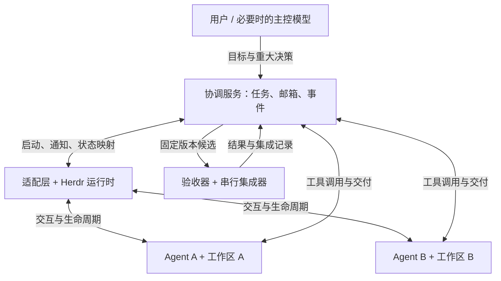

# Herdr 多 Agent 协作：调研汇总与确定性运行方案

> 文档版本：讨论稿 v0.1  
> 整理日期：2026-10-06（Asia/Taipei）  
> 调研报告日期：2026-10-05  
> 当前阶段：需求讨论与架构设计；暂停创建仓库。本文不表示功能已经实现或实验已经通过。

## 0. 阅读说明与证据边界

本文汇总两部分材料：用户提供的《Herdr 二开调研：先验证协作闭环，不要先做“去中心化平台”》，以及随后关于 skill、长上下文和确定性执行的讨论。

本次整理没有重新完整审计上游、安装或运行 Herdr，也没有复现现场问题。原报告中标为“源码确认”的内容，在本文中仍是**对原报告调查结果的转述**，不能理解为本次逐项复核。此前对话实际读取过上游 README、AGENTS.md、Herdr skill 与仓库树，并查询了长上下文研究和 Claude Code hooks 官方文档。

本文采用以下标记：

| 标记 | 含义 |
| --- | --- |
| **【会话核对】** | 此前对话直接读取的文档或工具结果能够支持。 |
| **【报告转述】** | 来自用户提供的报告；具体版本、代码结论和产品状态需要在实施前按来源复核。 |
| **【方案建议】** | 当前提出的设计，尚未实现，也不代表用户已经确认全部技术选择。 |
| **【待验证】** | 需要通过真实工作流、故障注入或对照实验验证。 |

来源索引在文末。原报告粘贴文本未保留完整逐条引用，本文不补造已验证的出处；对缺少精确来源的产品细节，保留为调研线索。

## 1. 决策摘要

### 1.1 项目要解决什么

在保留 Herdr 与现有 coding CLI 使用体验的前提下，减少多个 agent 的重复劳动、修改干扰、消息误解、错误完成判断和集成返工，降低主控模型用于转述、追踪和补救的负担。

讨论后进一步明确的核心目标是：

> **让协作不依赖模型持续记住一份操作手册：任务状态由程序维护，关键步骤自动触发，交付由外部验收。即使模型忘记 skill，也不能因此错误转移任务所有权或接受不合格结果。**

这不等于保证模型永远不犯错，也不等于保证所有任务无需人工即可完成。程序需要让错误可见、可隔离、可恢复；无法确定结果时可以暂停。

### 1.2 当前已明确与尚未确定的事项

| 事项 | 当前结论 | 状态 |
| --- | --- | --- |
| 创建 GitHub 仓库 | 暂停，先讨论方案。 | 用户明确要求 |
| 产品名称 | `herdr-a2a` 仅为暂定名称。 | 未最终确定 |
| 核心方向 | 将部分依赖提示词记忆的协作行为固化为程序机制。 | 用户提出的核心诉求 |
| 修改 Herdr 核心 | 先评估外部扩展；只有公开接口确实不足时才考虑窄范围补丁。 | 方案建议 |
| 第一版规模 | 单机、两个实际使用的 coding agent，随后验证异构组合。 | 方案建议 |
| 正式 A2A 协议 | 暂不作为首版前提；有真实互操作需求后再评估。 | 方案建议 |
| 技术栈 | 单进程服务 + SQLite 可作为起点；Python、Rust 或 TypeScript 尚未定案。 | 未最终确定 |
| 收益 | 冲突率、主控 token、总成本、交付质量均没有本项目实测结论。 | 待验证 |

### 1.3 对原报告建议的调整

原报告建议先做 A（配置、worktree、短 skill），仍有问题再做 B（独立协调服务）。后续讨论增加了一项重要目标：**验证协作对模型记忆的依赖能否降低。**

因此，保留 A 作为低成本基线和对照组，但不必先花大量时间完善长篇 skill 才开始验证 B。可以直接做一个极小的确定性闭环，同时与 A 比较。

首版最有价值的交付不是更复杂的聊天功能，而是能演示以下事实：两个 agent 同时认领任务不会形成两个有效所有者；旧会话不能提交有效旧结果；终端空闲不会被当作任务验收通过。

## 2. 背景、痛点与待验证假设

### 2.1 当前使用路径

```bash
# 以下仅记录当前安装方式，不代表本次执行了安装。
curl -fsSL herdr.dev/install.sh | sh
npx skills add herdrdev/herdr --skill herdr -g
```

随后启动 Herdr，在不同 pane 中运行 coding agent，通过 skill 使用 Herdr 的 CLI/API 协作。

Herdr 本体是程序，skill 是模型使用相关能力的说明。问题不在于“安装包叫 skill”，而在于某些关键行为是否仍要求模型主动记住、主动调用，以及程序是否会验证调用结果。

### 2.2 用户观察

- 多个 agent 仍可能相互干扰、重复或冲突。
- 主控模型需要持续掌握全局进展、解释状态和处理残局。
- 上下文增长或压缩后，模型可能遗漏协作约定。
- 希望 agent 能直接进行局部沟通，同时把机械性协调交给程序。

这些观察尚未转换为固定版本下的复现用例。不能直接认定共享目录、状态检测或某一种模型是全部问题的根因。

### 2.3 “互相打架”的故障分类

| 问题 | 典型表现 | 优先验证 | 对应机制 | 机制的限制 |
| --- | --- | --- | --- | --- |
| 文件与 Git 操作干扰 | 修改被覆盖、提交夹带他人内容、分支切换影响同伴 | 实际 cwd、worktree、index、Git 操作轨迹 | 每次执行独立工作区；集中集成 | worktree 不是安全沙箱 |
| 接口或设计冲突 | 分别合理，组合后不兼容 | 接口约定、版本和联合测试 | 版本化契约；定向协商 | 仍可能有未被测试发现的语义错误 |
| 重复或遗漏任务 | 多人重复做一件事，另一些需求无人负责 | task/attempt 记录、需求覆盖 | 原子认领；明确依赖 | 不同 task ID 可能语义重复 |
| 消息不可靠 | 重复执行、依据旧消息、请求没有回应 | 发送、入库、读取和回复记录 | 持久邮箱；关联 ID；去重 | 已读不代表理解 |
| 错误完成判断 | wait 返回后就合并，实际仍在工作或等待许可 | 旧轮次结束、blocked、过期完成文本 | 显式交付；固定代码版本验收 | 验收范围仍有限 |
| 无限讨论或循环委派 | 消息增多但无产物，互相等待 | 等待关系、消息轮次、新增产物 | 讨论预算；环检测；升级 | 隐含语义依赖需模型或人判断 |
| 集成后回归 | 单分支通过，组合后失败 | 在真实合并候选上跑测试 | 串行集成；基线变化后重测 | 测试无法覆盖所有行为 |
| 崩溃后旧结果回流 | 已换人执行，旧 agent 恢复后又交付 | 暂停/恢复、旧提交重放 | attempt、会话身份、所有权代次 | 只能约束经过受控入口的操作 |

## 3. Herdr 已有能力与业务协作缺口

### 3.1 版本基线

以下版本信息保留自 2026-10-05 的原报告，作为复查基线，不代表整理日重新查询的最新版本。

| 项目 | 原报告记录 |
| --- | --- |
| 默认分支 | `master` |
| 固定 master commit | `e35f3937b0efe40ec0dab675709c68e1d8e8c9e6` |
| 上述 commit 时间 | 2026-10-04 15:33:54 UTC |
| 报告核验的稳定版 | `v0.9.3`，2026-09-29 发布 |
| 稳定版对应 commit | `7b116c05bfda646af39d2524c54e70c751f57ee8` |
| 固定 master 的 preview 清单指向 | `8e78f929d8f0306a5c68518969e90274c44cb1f0` |

【会话核对】此前读取的仓库树返回了上述 master SHA。上游 AGENTS.md 说明，`skills/herdr/SKILL.md` 跟随稳定发布；从 master 安装 skill 不代表安装了所有开发中能力。

【报告转述】检测 manifest 可独立更新。复现实验应记录客户端、实际 server、agent CLI、检测规则、integration 和 skill 的版本，不能仅记录一个二进制版本号。

### 3.2 源码入口与结论

下表按原报告整理，除明确标注外，不表示本次重新逐函数核验。

| 入口 | 原报告核验到的能力 | 对本项目的意义 |
| --- | --- | --- |
| `skills/herdr/SKILL.md` | 默认相邻 pane、当前 cwd；非明确要求时不主动创建 worktree | 共享目录是需要检查的风险，不能直接认定为现场根因 |
| `src/app/agents.rs::start_agent` | 检查 agent 名称、类型、pane、前台 shell，提交启动并等待就绪 | 启动 agent 不等于创建隔离环境或业务任务 |
| `src/app/api/agents.rs::queue_agent_prompt` | 检查当前 agent 身份、blocked 状态，编码文本与 Enter，等待输入队列 | 有真实运行时保护，但保证主要停留在输入层 |
| `src/api/wait.rs` | 根据事件与生命周期状态等待 | 不等于特定业务任务完成协议 |
| `src/api/schema/agents.rs` | terminal、native session、状态和 completion 等身份或序列 | 需要另建 task、attempt、message 的关联层 |
| `src/terminal/state.rs` | 区分检测回退、hook authority、session 和上报序列 | 不能把所有状态观察概括为屏幕正则 |
| `src/api/event_hub.rs` | 有限内存事件历史；报告记录容量为 512 条并支持缺口报告 | 可用于观察与唤醒，不能直接充当持久业务邮箱 |
| `src/worktree.rs`、`src/app/api/worktrees.rs` | Git worktree 管理与工作区关联 | 应优先复用，不重新实现终端运行层 |
| 官方插件机制 | 外部命令、动作、事件、终端 pane，插件可维护自己的状态 | 适合挂载协调服务及状态界面，但不自动提供事务 |

### 3.3 必须分开的身份与状态

| 对象 | 表达什么 | 不应误认为 |
| --- | --- | --- |
| pane | 终端位置和交互入口 | 安全隔离环境、永久 worker 身份 |
| workspace | 终端和工作目录的组织关系 | 必然拥有独立 checkout |
| Git worktree | 独立工作目录及部分 Git 状态 | 完全独立的仓库或权限边界 |
| agent/session | 某个逻辑 agent 或实际运行实例 | 永远不变的任务所有者 |
| native turn | 某次模型执行轮次 | 工程任务验收结果 |
| task/attempt | 业务任务及一次执行尝试 | 终端的 idle/done 标签 |

【会话核对】Herdr skill 明确，`agent prompt --wait` 观察的是生命周期状态；当 agent 已经在工作时，当前活动轮次的结束可能满足等待条件。`idle`、`done`、`blocked` 不能直接映射为业务任务成功。

工程上需要分开记录五个事实：终端输入已写入、对应任务已被接收或认领、相关执行轮次结束、指定代码版本通过验收、指定版本已被集成。任何一层的确认都不能自动替代后续确认。

### 3.4 恢复与已知故障线索

【报告转述】Herdr 已有会话和布局恢复能力，部分集成有原生会话恢复及更可靠的状态上报。进程、对话或布局恢复不等于任务所有权和交付状态恢复。

原报告引用的调查线索：

| 记录 | 原报告描述 | 使用方式 |
| --- | --- | --- |
| Issue `#2690` / `#2682` | prompt 已送达而 wait 报 stalled，维护者归因于旧检测规则并提供修复说明 | 提醒固定检测规则版本；不能当作当前未修缺陷 |
| Issue `#4864` | 移动 pane 后 Codex 中断的用户报告 | 可加入故障场景；本项目未复现 |
| PR `#4872` | Windows 关闭 pane 时的 Enter/shutdown 等待修复 | 区分输入排队与实际副作用；按版本核验 |

没有足够依据承诺上游即将提供完整业务任务账本。上游贡献政策也意味着，不能把自定义能力能否合入核心视为既定条件。

## 4. 从 skill 约定转向确定性执行

### 4.1 长上下文只是问题的一部分

【会话核对】《Lost in the Middle》研究发现，相关信息在上下文中的位置会影响所测模型的检索和问答表现；它并未直接验证当前使用的模型、Herdr 或 skill 遗漏率。

需要分别看待长上下文信息利用不足、压缩造成细节丢失、模型没有选择正确工具、并发竞争，以及真实任务状态已经变化。这些问题不能统一通过“再提醒一次”解决。

即使两个模型完整记住“先检查任务是否有人做”，也可能同时检查到无人认领并同时开始。排他认领必须由原子操作保证。

### 4.2 只把提示词换成命令，还不够

如果把逻辑写成 `coop claim`、`coop inbox`、`coop submit`，却仍完全依赖 skill 提醒模型按时调用，就只解决了命令内部的执行问题。

完整设计需要覆盖：

1. **触发**：什么时候执行，由程序还是模型决定？
2. **检查**：执行前验证哪些身份、版本和前置条件？
3. **持久化**：事实写在哪里，重启后是否存在？
4. **恢复**：超时或未知结果如何核对？
5. **反馈**：模型如何获得当前状态和下一步可执行操作？

### 4.3 固化哪些行为，保留哪些判断

| 环节 | 程序负责 | 模型负责 |
| --- | --- | --- |
| 任务准备 | 生成身份、校验依赖、创建工作区、启动 agent | 理解目标，提出分工建议 |
| 认领 | 原子确定有效 owner 和 attempt | 判断是否有能力承担、是否需澄清 |
| 运行状态 | wrapper 心跳、进程观察、期限和事件记录 | 实现、分析、定位问题 |
| 消息 | 持久化、关联、去重、通知、可查历史 | 判断何时提问、问题内容和回复含义 |
| 上下文恢复 | 提供当前任务事实、版本和待处理变化 | 理解事实并调整方案 |
| 交付 | 检查所有权，冻结候选，运行验收 | 提交候选结果和必要说明 |
| 集成 | 串行构造候选、重测、比较后更新、恢复核对 | 分析语义冲突，提出修复 |
| 升级 | 检查次数、期限、循环和明确失败条件 | 判断需要用户决策的实质问题 |

“何时需要语义协商”不能完全用普通程序确定。模型可以提出委派或契约修改建议，由程序检查是否重复、是否越过当前任务范围，再执行受管理的操作。

### 4.4 三个不同层面的保证

| 层面 | 示例 | 不能因此承诺 |
| --- | --- | --- |
| 提醒与说明 | skill、工具说明、动态任务摘要 | 模型一定理解并遵守 |
| 服务端校验与状态规则 | 拒绝重复 claim、过期 submit、未通过验收的集成 | 任意 shell 无法绕过服务写文件 |
| 执行环境隔离 | 权限域、受限工作目录、保护集成入口 | 生成代码语义正确 |

要同时区分**不会接受错误状态**与**工作能持续推进**：模型忘记流程后，系统可以安全暂停；不能为了宣称自动化而把未知结果标记成功。

## 5. 相关方案与协议的取舍

### 5.1 协议分层

下表的产品能力概括主要来自原报告，具体接口版本需在接入前复核。

| 类别 | 主要解决的问题 | 本项目第一版取舍 |
| --- | --- | --- |
| 正式 A2A | agent 发现、消息、任务与产物的互操作 | 暂不作为前提；不把它当成 Git 所有权和验收系统 |
| MCP | 向 agent 暴露工具和资源 | 可承载协作工具；工具是否被模型调用仍是独立问题 |
| Agent Client Protocol | 客户端与 coding harness 的结构化会话与交互 | 评估作为原生适配入口，不与 agent 间治理混淆 |
| 其他同名 ACP 路线 | 不同协议可能使用相同缩写 | 对照具体项目与规范，不按缩写推断兼容 |
| 原生 SDK / 事件接口 | turn、tool、result、取消及恢复等事件 | 对需要精确生命周期的 CLI 优先评估 |
| 工作流框架 | 图状态、checkpoint、条件执行 | 可借鉴模式，首版不必引入完整框架 |

### 5.2 最相关的项目

| 项目 | 原报告指出的相关价值 | 本项目仍需自行核验或补齐 |
| --- | --- | --- |
| Claude Code 原生团队与跨会话能力 | 原生消息、任务及 hook 入口，可做同构基线 | 可用版本、恢复边界、异构接入、文件隔离 |
| Codex App Server | thread/turn/item 等结构化事件 | 与业务 task/attempt/commit/验收的映射；不能默认接管任意 TUI |
| MCP Agent Mail | 持久消息、回复关联、ack、文件预约 | 幂等契约、崩溃一致性、预约的执行边界 |
| OpenHands SDK / Canvas | 会话持久化、工作区和 harness 接入方向 | 具体版本能力、完整交付与恢复链 |
| Vibe Kanban | 工作区、任务板和 Git 审查交互 | session 是否共享文件、维护状态、验收保证 |
| LangGraph | 显式工作流和持久化设计 | coding CLI 适配、Git 隔离和集成规则 |
| Microsoft Agent Framework | 普通函数与模型节点组合、checkpoint | 实际 CLI 接入、业务所有权和验收实现 |

原报告中涉及产品最新状态、协议迁移和维护团队变化的细节，未在本次整理中重新核验，不作为选型的唯一依据。优先复用已经满足需求的组件；复用邮箱时也应避免出现两个相互竞争的任务状态来源。

### 5.3 研究给出的方向

| 研究 | 可借鉴的内容 | 不应据此推导 |
| --- | --- | --- |
| Lost in the Middle | 长上下文信息位置会影响利用效果 | 已证明当前 Herdr 故障就是此原因 |
| MAST / Why Do Multi-Agent LLM Systems Fail? | 失败分类、协作失配、验证与终止问题 | 去掉主控一定更可靠 |
| Towards a Science of Scaling Agent Systems | 按任务耦合和协调成本比较拓扑；保留单 agent 基线 | 所有任务都适合并行或某个拓扑普遍最好 |
| CodeCRDT | 文本合并收敛与语义正确是不同问题 | 单机首版需要 CRDT |
| SWE-Chain | 在第一次产出上继续进行维护任务 | 已证明本方案改善长期可维护性 |

除长上下文论文外，上述研究概括主要沿用报告，原报告中的样本规模和效果百分比未在本次逐项复核，故不以这些数值作为项目收益承诺。

## 6. 推荐架构：薄 skill、自动执行层、外部任务状态

以下均为方案建议。

### 6.1 为什么先考虑外部扩展

| 方案 | 成本与优势 | 主要限制 | 当前定位 |
| --- | --- | --- | --- |
| A：配置、worktree、短 skill | 最低成本，便于定位基础问题 | 关键步骤仍可能依赖模型主动执行 | 对照基线，可能已满足部分需求 |
| B：独立服务与 Herdr adapter | 状态边界清晰，减少上游同步成本，可独立故障测试 | 公开接口和各 CLI 事件能力限制可执行保证 | 优先验证 |
| C：改 Herdr server | 可以深入运行时事件和输入操作 | 核心分叉维护成本高，容易耦合过多业务 | 发现具体接口缺口后再考虑 |
| D：采用现成产品或组合 | 可能节省开发和长期维护成本 | 可能改变现有体验，保证强度需实测 | 与同一任务夹具比较 |

保留中央数据库或确定性的协调服务，与减少中央主控模型并不矛盾。前者负责检查、记录和排队；后者负责理解需求与复杂决策。

### 6.2 组件与数据流



- **Herdr**：继续负责终端、pane、进程、交互和可用的状态观察。
- **适配层 / wrapper**：绑定业务身份与原生会话，负责启动、自动心跳、通知及受支持的上下文注入。
- **协调服务**：维护任务、所有权、邮箱、版本、交付和恢复记录。
- **验收器 / 集成器**：验证明确代码版本，串行推进集成结果。
- **薄 skill**：说明项目目标、少量概念和工具用途，不承载必须每次执行的长流程。

单机起点可采用一个服务进程、一份 SQLite 数据库。状态与审计事件同事务写入即可，不必一开始引入消息集群、分布式共识或完整事件溯源平台。

### 6.3 接管边界与能力分级

为了提供更强保证，程序至少需要管理任务启动、有效认领、交付接收和集成入口。仅观察任意已启动终端，无法获得同等保证。

| 接入能力 | 可以承诺的范围 | 不能默认承诺 |
| --- | --- | --- |
| 终端适配 | 启动和唤醒、状态观察；服务端检查认领与交付 | 精确逐轮关联、每次推理前注入、所有工具操作拦截 |
| hooks / 原生事件适配 | 在实际支持的事件上自动执行检查或注入 | 所有 CLI 具有同样事件；hook 永不失败 |
| 受控执行环境 | 对受保护目录和集成入口施加访问限制 | 自动解决语义冲突或保证验收完整 |

不能把低能力适配器的局限隐藏起来。实现时应显式声明每种 adapter 支持哪些事件、检查和恢复能力，并据此启用或禁用功能。

## 7. 确定性机制的最小设计

### 7.1 五条核心规则

1. 一个 task 同时只有一个有效执行 attempt。
2. 每个 attempt 有明确且独立的工作区，不由 worker 直接发布到受管理的集成入口。
3. 认领、修改与交付检查当前身份、规格版本和所有权代次。
4. 交付指向不可变代码版本，验收与集成绑定该版本。
5. 未知副作用进入待核对状态，不能用盲重试或自然语言声明掩盖。

这些规则保证的是服务管理的工作流。若 worker 拥有任意 shell 和相同系统用户权限，仍可能绕过服务修改共享资源；需要更强保证时，应加强权限边界。

### 7.2 身份与任务模型

| 字段 | 用途 |
| --- | --- |
| `agent_id` | 逻辑 agent 身份 |
| `session_id` | 当前实际运行实例 |
| `task_id` | 业务任务身份 |
| `attempt_id` | 一次执行尝试 |
| `spec_rev` | 需求或契约版本 |
| `state_version` | 并发状态更新版本 |
| `fence` | 所有权代次，用于拒绝旧执行者 |
| `native_session / turn / pane` | 适配器维护的底层映射 |
| `base_commit / candidate_commit` | 工作基线与交付版本 |
| `acceptance_suite` | 验收套件版本 |

不要将 pane 名称作为永久身份；也不要把每次心跳当作业务规格变更。

以下是数据形状示意，字段和命令均未实现：

```json
{
  "task_id": "T-backend",
  "spec_rev": 1,
  "state_version": 7,
  "state": "running",
  "base_commit": "<完整 commit SHA>",
  "acceptance_suite": "pagination-contract-v1",
  "owner": {
    "agent_id": "backend-worker",
    "session_id": "S-82f1",
    "attempt_id": "A-004",
    "fence": 4
  },
  "workspace": "<该 attempt 的工作区>",
  "lease_deadline": "<由服务端维护>"
}
```

### 7.3 自动启动与原子认领

启动一个受管理的任务时，程序检查依赖和任务版本，以事务完成认领，分配 attempt 和所有权代次，再准备工作区并启动 agent。若工作区或启动失败，应记录失败并按明确规则释放或恢复认领，不留下“已认领但无人执行”的隐含状态。

并发认领需要把检查与写入放在同一事务或等价的原子更新中。不要使用事务外的“先查询，再更新”。

模型仍可提议领取、委派或修改任务，但所有有效变更通过同一个检查入口。

### 7.4 心跳、期限与旧执行者

- 心跳由 wrapper/adapter 发送，不要求模型定期记住汇报。
- 进程活着不等于有进展，需分别记录存活、期限、阻塞原因和可观察进展。
- 权限等待不能自动替用户批准；无输出也不能直接判定模型故障。
- 超时、取消或回收时使旧所有权失效。旧 session 恢复后不能使用旧 fence 交付有效结果。
- 新 attempt 使用新工作区；旧目录先保留，以便恢复与诊断。
- 候选被合法接收后，执行租约结束，验收责任转移给程序，不要求模型在等待测试期间继续心跳。

首版重启策略可以保守：撤销未完成执行的旧租约，保留已入库候选并恢复验收。自动恢复整个模型对话不是前提。

### 7.5 持久邮箱与消息确认

消息至少包含 `message_id`、相关 task/spec、发送与接收身份、线程、回复关联、类型和正文。

- 同一次发送重试使用相同幂等键；相同 ID、不同正文应拒绝。
- `stored` 表示入库，`read/ack` 表示被取到或显式确认，不代表理解，也不代表任务通过。
- 按需要提供任务或线程内顺序，不承诺不必要的跨任务全局顺序。
- 规格已经过期的消息应标记，不应无提示地覆盖当前契约。
- 至少一次处理尝试与业务去重是可行起点；不承诺任意 shell 副作用 exactly-once。

终端通知尽量只表达“某任务有更新，请读取当前状态”。通知可重复，认领与交付不可重复生效。数据库事务和终端输入无法自然组成一个原子事务，超时应记录投递结果未知，再检查认领或读取记录，不能直接重新注入完整执行指令。

### 7.6 上下文恢复与 hook

程序从外部状态生成一份小型任务摘要：当前目标、工作区与基线、已确定契约、待处理变化和合法操作。完整规格及历史按需查询。

优先在任务开始、会话恢复、上下文压缩后以及重要规格变化等**实际可观察且受支持的时机**补充信息。避免每次注入所有规则和所有日志。

这里有三条边界：

1. 补充信息不等于强制理解，操作时仍要校验版本和权限。
2. hook 触发时机与能力取决于 CLI；没有相应事件时必须声明限制。
3. command hook 可以执行普通代码；prompt/agent hook 仍依赖模型判断，不能据名称将其当作确定性检查。

【会话核对】Claude Code 官方文档说明 hooks 可自动执行代码，也提供模型驱动的 hook；异步 hook 不能阻止已经发生的操作。关键交付门禁应独立存在于服务端，而不是只靠结束时的一段提醒。

### 7.7 交付、验收与串行集成

交付内容至少绑定 task/spec、session/attempt/fence 和完整 commit SHA。模型自报“测试通过”只是说明，不是验收结果。

验收器从当前集成头 `G` 与交付 `C` 构造候选 `M`，运行预登记测试。结果绑定候选、目标基线、规格、套件和环境版本。若测试后集成头不再是 `G`，应重建候选并重测。

集成器是唯一正常写入者，并采用比较旧值后更新的方式推进引用。Git 与 SQLite 不是同一个事务，必须持久化 `integration_intent`，记录操作 ID、预期头、候选和测试记录。

| 恢复时的引用状态 | 处理 |
| --- | --- |
| 仍为 `G` | 核验前置条件后继续同一操作 |
| 已为 `M` | 补记成功，不能重复合并 |
| 为其他未知状态 | 暂停并核对外部修改 |

取消发生在实际发布阶段时，也必须先核对 Git 状态。已发布代码的撤回是单独操作，不能标成从未发生。

### 7.8 任务状态与升级

建议主路径为 `ready → running → submitted → verifying → accepted`。失败、过期、取消和拒绝分别保留原因；重试创建新 attempt，而不是覆盖旧执行历史。

业务依赖阻塞与终端上的权限/问题对话框是不同状态，应分别记录。契约变更产生新规格版本，并明确哪些运行和候选需要重新验证。

agent 可以直接讨论具体接口、请求解释、提供证据和建议；不能静默改写其他任务的验收条件或权限。程序可以限制讨论轮次、检测显式依赖环、记录无进展情况。语义分歧和重大取舍由相关模型或用户判断。

原报告建议同一问题最多两轮定向讨论、禁止递归委派，适合作为可调整实验参数，不应视为已经证明最优的常量。

## 8. 一个端到端场景

任务：为已有后端 API 与 TypeScript 客户端增加游标分页。

1. 用户或规划模型明确目标，形成分页契约：排序、游标、最后一页、空结果及错误语义。
2. 程序建立后端、客户端任务及依赖，分别准备工作区并启动 agent。
3. Agent A 实现后端，Agent B 实现客户端。双方对具体疑问进行定向讨论，消息进入持久邮箱。
4. 契约需要变化时形成新版本，程序标记受影响任务与候选。
5. A 上下文很长，遗漏最新契约，按旧版本交付。
6. 服务根据交付版本拒绝接受过期候选，将当前契约和具体原因反馈给 A。
7. A 修正并重新提交。验收器在明确基线上执行契约及集成测试。
8. 串行集成器推进通过验证的候选；失败则保留证据并回到修复流程。
9. 达到预算或遇到无法自动核对的问题时升级，主控读取具体差异和失败证据，无需先重读所有终端历史。

这个场景不要求程序理解所有代码。程序检查的是已定义的身份、版本和验收条件；若模型没有意识到语义契约已变化且未更新任何正式记录，仍需契约测试、审查或人发现。

## 9. MVP 范围与暂缓事项

| MVP 必需 | 后续根据证据再做 |
| --- | --- |
| 两个 agent 的受管理启动、任务身份及工作区 | 所有 CLI 通用支持、多机调度 |
| 原子认领、版本检查、所有权撤销 | 通用资源锁平台、分布式共识 |
| 最小持久邮箱、去重、可重复通知 | 全文/语义检索、复杂共享记忆 |
| 服务端交付门禁、按 commit 验收、串行集成 | 自动解决复杂语义冲突 |
| 自动心跳、重启核对、明确未知状态 | 完整透明会话迁移 |
| 短任务摘要与可用的生命周期接入 | 为所有客户端保证逐轮上下文注入 |
| 独立验收夹具和故障注入 | 正式 A2A 外部兼容层 |

首版应少量、完整地实现关键保证，不把任务、邮箱、消息、共享记忆和模型组织都扩成独立平台。开发顺序可以从 claim/submit/验收的闭环开始，再接真实终端通知。

## 10. 实验：验证减少兜底，而不是增加流程

### 10.1 基础对照组

| 组别 | 配置 | 要回答的问题 |
| --- | --- | --- |
| S | 单个强 agent | 多 agent 是否有净收益？ |
| H | Herdr + 原始 skill | 当前工作流的损失构成是什么？ |
| W | 独立 worktree + 短 skill | 简单配置和约定能解决多少？ |
| M | W + 最小确定性运行机制 | 自动触发、所有权、交付门禁是否减少兜底？ |
| 可选 N | M + 原生 adapter | 终端观察是否是主要瓶颈？ |

### 10.2 专门验证“忘记 skill”

除真实长任务外，还应设计可控遗漏场景：模型未主动发心跳、未查看通知、没有显式汇报完成、使用旧任务版本交付，或恢复旧会话后再次提交。

期望观察：

- 自动机制是否仍执行，而不是等待模型想起来？
- 不合法状态是否被拒绝，系统是否保留可诊断记录？
- 模型能否根据简洁反馈恢复？无法恢复时是否安全暂停？
- 运行机制是否降低干预，同时增加了多少总时间和 token？

通过外部故障注入验证遗漏容错，不需要先证明某次遗漏来自注意力位置、压缩或其他模型机制。若要主张改善 long-context 鲁棒性，再单独控制上下文长度、规则位置和压缩事件，避免把这些变量混在一起。

### 10.3 任务族、变量与公平性

任务至少包括低耦合、高耦合、共享接口、组合回归和故障恢复。先同构再异构；W 与 M 使用相同模型组合。

固定初始 commit、测试、依赖、工具权限、模型与推理设置、并发数及预算。所有规划、讨论、重试和修复计入成本；单 agent 获得完整需求。

运行时门禁使用各组都能访问的工程测试。最终隐藏验收独立执行，不能仅让 M 反复获得隐藏测试答案。重复运行、随机化顺序，报告逐任务结果和失败案例，不仅展示平均加速比。

### 10.4 指标

| 指标 | 口径 |
| --- | --- |
| 成功与质量 | 固定交付通过独立验收，记录回归和需求遗漏 |
| 总时间 | 从开始到合格交付，包含等待、重试、恢复和人工介入 |
| 总 token / 成本 | 所有 agent、主控、审查、协商与修复之和；缺失数据明确标注 |
| 主控负担 | 协调、转述、追踪与修复的 token，以及人工次数和耗时 |
| 协调转移 | 所有 agent 的协调总量，防止仅把主控开销转移给同伴 |
| 协议正确性 | 双重有效认领、过期结果被接受、重复集成等次数 |
| 返工与无效通信 | 废弃实现、重复尝试、无新增证据的往返 |
| 恢复 | 故障到重新有效进展的时间，以及保留了哪些产物 |
| 后续维护 | 在初次生成代码上增加第二项需求，记录理解和修改成本 |

### 10.5 规模、消融与停止条件

先用假 worker 做低成本故障测试：并发 claim、重复消息、超时、旧提交、服务重启，以及 Git 更新与数据库记账之间的崩溃。

真实 pilot 可从两个任务族、四组、每组两次开始，共 16 次运行。结果有希望再扩展到五类任务的 40 次运行总量。以上是预算建议，不是统计充分性的保证。

定向消融可依次移除持久邮箱、原子认领、强制集成门禁，或比较终端与原生 adapter。尽量保持任务信息量和模型预算相同。

原报告提出的起始门槛可保留为试验参数：相对 W，主控协调/修复 token 下降约 30%，同时总成本开销控制在约 10% 内。两者均无本项目实测依据，应结合干预时间和交付质量调整。

以下情况应改变方向：

- W 已满足需求：停止扩建，保留简单工作流。
- M 只降低主控 token，却增加全体协调成本：不能认定成功。
- 高耦合任务持续返工：改为单写者加审查，减少并行。
- 错误主要来自实现能力：优先调整任务、模型或验收。
- 失败集中在终端投递或轮次观察：优先补原生 adapter。
- 出现绕过服务的越界操作：先明确并加强执行环境，不能靠增加提示词补齐。

## 11. 开发路线与首批任务

以下为建议顺序，当前尚未开始实施。

| 阶段 / 任务 | 主要交付 | 验收标准 |
| --- | --- | --- |
| 0. 记录现场与基线 | 环境清单、原工作流、实际冲突分类 | 能复述失败时谁在何处、做了什么、使用何版工具 |
| 1. 建立任务夹具 | 首批两个任务与独立验收 | 干净重建可重复，参考实现通过，代表性坏实现失败 |
| 2. 任务与 attempt 状态机 | 原子 claim、版本、所有权代次 | 并发只有一个有效 owner；旧会话交付被拒绝 |
| 3. 受管理工作区与启动 | 独立工作区、基线、会话绑定、自动心跳 | 启动失败可核对；重试不污染旧 attempt |
| 4. 交付与验收集成 | 固定 commit、串行验收、integration intent | 基线变化重测；跨 Git/数据库故障可恢复 |
| 5. 最小邮箱与通知 | 去重、回复关联、版本、通知状态 | 超时不盲重发完整任务；重复通知不重复认领 |
| 6. 上下文恢复适配 | 简洁任务摘要、支持事件上的自动补充 | 不依赖模型主动回忆；不支持的能力明确降级 |
| 7. 对照与消融 | 四组轨迹、成本、干预及失败报告 | 可追溯逐次结果，能够判断是否继续 |

先保证状态机与交付闭环，再连接复杂模型交互。若确认需要仓库，可以建立协调服务与适配器项目，是否成为 Herdr 的正式 Fork 仍由实际修改范围决定。

## 12. 风险与待决策问题

| 问题 | 当前立场 | 最小验证方式 |
| --- | --- | --- |
| 主要痛点是什么？ | 未确认，不能从安装方式推断全部根因 | 记录几次真实失败并分类 |
| 哪些入口必须接管？ | 启动、认领、交付、集成优先 | 两个受管理 agent 的完整任务演示 |
| 是否兼容任意已经启动的 CLI？ | 可以探索，但不保证与受管理启动同等能力 | 检查身份绑定和生命周期接口 |
| 首先支持哪两种 CLI？ | 选择用户实际组合，尚未最终确定 | 一种作为先行适配，第二种验证异构边界 |
| 如何处理忘记交付？ | 程序可检测缺少候选并提醒或暂停；不能自动把任意 HEAD 当成果 | 模拟结束但未交付 |
| worktree 是否足够隔离？ | 协作隔离有价值，不是安全隔离 | 检查共享资源及实际越界路径 |
| 同一用户下 token 是否能保护全部状态？ | 不能；API token 不会消除磁盘和进程权限 | 明确可信但会出错的 agent 假设 |
| 如何选择技术栈？ | 以状态机、进程管理、维护成本为依据，暂不定案 | 最小原型与测试便利性比较 |
| 是否需要正式 A2A？ | 先没有强依赖 | 有外部 agent 接入需求时核验映射成本 |
| 是否值得改 Herdr 核心？ | 必须有已复现的公开接口缺口 | 用 adapter 原型证明无法满足的具体不变量 |

需要避免两个极端：让模型承担全部协调记忆，或者将所有推理都固化成僵硬规则。确定性层维护事实和执行条件；模型保留实现与语义判断的空间。

## 13. 来源与复查入口

### 13.1 本会话读取或核对过的来源

- [Herdr 上游仓库与 README](https://github.com/herdrdev/herdr)
- [Herdr AGENTS.md，固定研究基线](https://github.com/herdrdev/herdr/blob/e35f3937b0efe40ec0dab675709c68e1d8e8c9e6/AGENTS.md)
- [Herdr skill，固定研究基线](https://github.com/herdrdev/herdr/blob/e35f3937b0efe40ec0dab675709c68e1d8e8c9e6/skills/herdr/SKILL.md)
- [Lost in the Middle: How Language Models Use Long Contexts](https://arxiv.org/abs/2307.03172)
- [Claude Code：Automate actions with hooks](https://code.claude.com/docs/en/hooks-guide)
- [Claude Code：Hooks reference](https://code.claude.com/docs/en/hooks)

### 13.2 原报告列出的 Herdr 复查入口

以下用于追溯原报告，未在本次文档整理中重新逐项验证。

- [固定 master commit](https://github.com/herdrdev/herdr/commit/e35f3937b0efe40ec0dab675709c68e1d8e8c9e6)
- [稳定版 v0.9.3](https://github.com/herdrdev/herdr/releases/tag/v0.9.3)
- [CONTRIBUTING.md](https://github.com/herdrdev/herdr/blob/e35f3937b0efe40ec0dab675709c68e1d8e8c9e6/CONTRIBUTING.md)
- [src/app/agents.rs](https://github.com/herdrdev/herdr/blob/e35f3937b0efe40ec0dab675709c68e1d8e8c9e6/src/app/agents.rs)
- [src/app/api/agents.rs](https://github.com/herdrdev/herdr/blob/e35f3937b0efe40ec0dab675709c68e1d8e8c9e6/src/app/api/agents.rs)
- [src/api/wait.rs](https://github.com/herdrdev/herdr/blob/e35f3937b0efe40ec0dab675709c68e1d8e8c9e6/src/api/wait.rs)
- [src/api/schema/agents.rs](https://github.com/herdrdev/herdr/blob/e35f3937b0efe40ec0dab675709c68e1d8e8c9e6/src/api/schema/agents.rs)
- [src/terminal/state.rs](https://github.com/herdrdev/herdr/blob/e35f3937b0efe40ec0dab675709c68e1d8e8c9e6/src/terminal/state.rs)
- [src/api/event_hub.rs](https://github.com/herdrdev/herdr/blob/e35f3937b0efe40ec0dab675709c68e1d8e8c9e6/src/api/event_hub.rs)
- [src/worktree.rs](https://github.com/herdrdev/herdr/blob/e35f3937b0efe40ec0dab675709c68e1d8e8c9e6/src/worktree.rs)
- [src/app/api/worktrees.rs](https://github.com/herdrdev/herdr/blob/e35f3937b0efe40ec0dab675709c68e1d8e8c9e6/src/app/api/worktrees.rs)
- [Issue #2690](https://github.com/herdrdev/herdr/issues/2690)、[Issue #2682](https://github.com/herdrdev/herdr/issues/2682)
- [Issue #4864](https://github.com/herdrdev/herdr/issues/4864)、[PR #4872](https://github.com/herdrdev/herdr/pull/4872)

### 13.3 原报告列出的研究入口

保留报告所列版本，复用定量结论前需重新阅读对应实验和限制。

- [MAST / Why Do Multi-Agent LLM Systems Fail? — 2503.13657v3](https://arxiv.org/abs/2503.13657v3)
- [Towards a Science of Scaling Agent Systems — 2512.08296v3](https://arxiv.org/abs/2512.08296v3)
- [CodeCRDT — 2510.18893v1](https://arxiv.org/abs/2510.18893v1)
- [SWE-Chain — 2605.14415v1](https://arxiv.org/abs/2605.14415v1)

### 13.4 实施前需要补齐的证据

- 各候选产品的具体官方页面、版本、许可与计费边界。
- 当前 A2A、MCP、Agent Client Protocol 的规范版本及能力声明。
- MCP Agent Mail 的幂等、持久化与恢复行为；原报告固定 commit 为 `3fad5ec672869f81d2ca0a4c525dde004ac96f45`。
- Git worktree、update-ref 和 SQLite 事务文档，核验实现细节与失败处理。
- 用户真实环境中的 CLI 组合、版本、权限、cwd、实际冲突与成本轨迹。

---

**本讨论稿的下一步用途：**确定受管理入口和首批两个任务夹具，再决定是否启动最小原型。本文不构成创建仓库、修改现有 CLI 配置或部署服务的指令。
