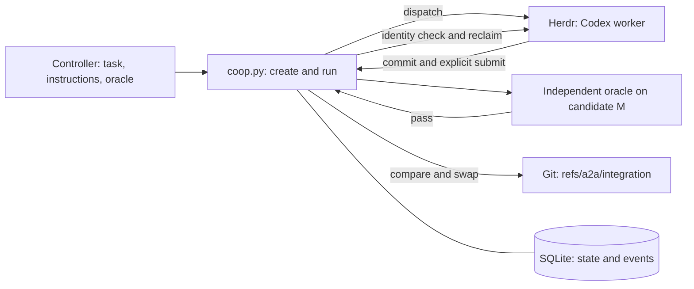

# Herdr A2A: framework, implementation, and operation

Date: 2026-10-06. Source revision: `331718a359e6438dbd13bee62ce20ab839cf921c`.

[Chinese report](herdr-a2a-2026-10-06.zh-CN.md) · [Current project map](../.project-map/MAP.md) · [Current operating reference](../README.md)

This report describes the implementation at the source revision. It is a dated record. The project map identifies the current specifications.

The English follows STE structural rules. The language review excludes a word-by-word check against the official ASD dictionary.
This report does not claim certified ASD-STE100 compliance.

## 1. Result and purpose

The first delivery, recovery, and automatic run milestones passed within their stated scopes: **PASS**. The broader intent remains **INCOMPLETE**.

The core goal is simple: collaboration must not depend on a model continuously remembering the operating manual.
The current program rejects stale identities and unverified candidates through explicit gates.
If a worker forgets to submit, the program does not accept its code.
It preserves evidence and ends the wait at the specified deadline.

The controller still interprets the intent, divides work, and prepares independent acceptance criteria.
The program does not convert an intent into tasks or generate the acceptance oracle.
Automatic operation starts with an already registered task.

| Available now | Current boundary |
| --- | --- |
| Local task records, ownership, and input snapshots | Trusted collaborators under one operating system user |
| A Codex worker through Herdr | Codex CLI `0.160.1` only |
| Explicit submission, independent acceptance, and Git integration | One managed local Git reference |
| Recovery after interrupted acceptance or integration | Explicit recovery commands |
| A complete automatic `run` | No automatic resume after the run process itself stops |
| Events and observations for diagnosis | No permanent monitor service or agent mailbox |

The implementation uses an external Python CLI. It makes no changes to the Herdr core.
It does not implement a distributed scheduler or a standard A2A network protocol.

## 2. Framework and responsibilities



| Component | Responsibility |
| --- | --- |
| `intent.md` and `.project-map/` | Store the goal, decisions, specifications, and development tickets. |
| Controller | Assign bounded work, register tasks, inspect evidence, and handle decision boundaries. |
| `coop.py` | Enforce task gates and coordinate Git, SQLite, Herdr, and the oracle. |
| Herdr | Provide panes, terminals, agent controls, and process observations. |
| Codex worker | Edit its assigned worktree, create a commit, and submit the exact identity. |
| Oracle | Check candidate behavior against independent requirements. |
| Monitor | Observe and report. It cannot claim, submit, integrate, or declare success. |

The controller configuration is `gpt-6-astra` with max reasoning.
The worker configuration is `gpt-6.1-sol` with xhigh reasoning and Fast service.
The monitor configuration is `gpt-6.1-sol` with high reasoning.
The project requests these configurations. The evidence does not independently establish the provider's actual service tier.

The program sets the worker configuration during dispatch.
Controller and monitor roles also depend on project rules.
The program does not start a separate monitor agent.
The automatic run records its own bounded state observations.

These roles do not provide separate operating system permissions.
The worktrees, session identifiers, and SQLite database are not a security sandbox.

**Tracer bullet:** one task crosses dispatch, implementation, submission, acceptance, integration, and reclamation.
**Deep modules:** one CLI hides transactions, Git candidates, and runtime coordination.
**Ubiquitous language:** the [glossary](../CONTEXT.md) defines the same terms for code, tests, and documents.

## 3. Data and identities

The implementation uses Python 3.9 standard libraries, SQLite, Git, Herdr, and Codex.
It has no additional Python runtime dependency.
The operation locks use POSIX `fcntl.flock`.
The current recovery evidence covers macOS/POSIX.

```text
STATE/
  state.sqlite3
  tasks/<task-and-random-id>/
    instructions.txt
    oracle.py
  worktrees/<attempt_id>/
  verification/<verification_id>/
  locks/<task>.lock
  locks/<task>.run.lock
```

SQLite stores `tasks`, `attempts`, and `verifications` as records with JSON data.
The `events` table stores events in sequence order.
State transitions use `BEGIN IMMEDIATE` transactions.
The application appends events and retains previous attempts.
These records are not tamper-proof against another process under the same user.

| Field | Meaning |
| --- | --- |
| `task_id` | The registered unit of work. |
| `attempt_id` | One attempt to perform that task. |
| `session_id` | The coordinator's identity for that attempt. It is not a native Codex session or operating system identity. |
| `fence` | The ownership generation. Each claim increases this number. |
| `spec_rev` | The task's specification version. |
| Candidate commit | The full Git commit identifier that the worker submits. |
| `verification_id` | One execution of independent acceptance. |
| `run_id` | One automatic coordination process. It does not replace task state. |

A claim creates a detached Git worktree.
The worker must use that worktree.
Reclamation closes an owned pane. It retains worktrees, candidates, and evidence.

## 4. Implementation of the gates

The normal task path contains these stable states:

```text
ready -> claimed -> submitted -> verified -> accepted
```

The program also records intermediate states: `creating`, `preparing`, `verifying`, and `integrating`.
An oracle rejection returns the task to `submitted`.
An unknown verification result pauses the task.
Automatic cleanup can revoke a failed attempt and return the task to `ready`.
Historical attempt and verification records retain the failure evidence.

| Gate | Mechanism |
| --- | --- |
| `create` | Check the repository and base. Copy the instructions and oracle into task snapshots. |
| `claim` | Reserve one owner atomically. Allocate identities and a detached worktree. |
| `submit` | Check attempt, session, fence, and specification version. Check the commit, ancestry, worktree HEAD, and clean status. |
| `verify` | Construct candidate M. Execute the frozen oracle in a separate worktree. |
| `integrate` | Persist an integration intent. Update the managed Git reference with compare-and-swap. |
| `reclaim` | Check the recorded runtime identity. Close only the owned pane. |

The program freezes a submitted candidate.
The worker cannot replace it with a different commit in the same attempt.
Submission alone does not imply acceptance.
Terminal states such as `idle` and `done` do not advance the task.

For acceptance, G is the current integration head. C is the submitted candidate. M is the proposed integrated candidate.
If G is an ancestor of C, M equals C.
Otherwise, the program constructs a merge candidate from G and C.
A merge conflict prevents integration.

The program executes this command in a separate worktree for M:

```sh
python3 -I -B SNAPSHOT_ORACLE CANDIDATE_DIRECTORY
```

The oracle has a 60-second timeout.
Only exit code 0 passes acceptance.
The verification record binds the result to the identity, specification, oracle, and G/C/M values.
The oracle's coverage still limits the acceptance claim.

The integration command is:

```sh
git update-ref refs/a2a/integration M G
```

Git updates the reference only if its old value is G.
The program reads the reference again before it records normal completion.
The user's branch does not move. The program does not push.
Later tasks use the managed integration head as their base.

### Recovery mechanics

SQLite and Git do not share one transaction.
The durable integration intent bridges that boundary.
Recovery checks the current identity and the actual reference before it continues.

| Observed condition | Recovery behavior |
| --- | --- |
| An active operation still holds the lock | Refuse a competing operation with `operation_busy`. |
| Acceptance stopped without a complete result | Retain the old verification as interrupted. Execute the oracle again with a new verification identity and worktree. |
| A pending integration still points to G | Continue the same integration intent. |
| A pending integration already points to M | Complete the database record without another Git write. Missing old command results remain unknown. |
| A pending integration points elsewhere or the reference is absent | Return `needs_reconciliation`. Preserve the intent and evidence. |

Lock release does not prove acceptance.
The program retains lock files because replacing a lock file could permit two different locked files.
An accepted task cannot be revoked.

### Herdr identity and automatic operation

Dispatch creates a pane without changing focus.
It records the pane, terminal, shell, Codex process leader, and observable native session.
It sends the task prompt once after the agent is ready.
Unknown startup effects prevent another dispatch.

Identity checks follow the leader of the Codex process group in the foreground.
Normal helper processes do not change that identity.
A different leader causes rejection, even if the original process remains in the process list.

`run` combines dispatch, waiting, acceptance, integration, and reclamation.
It binds every later action to its original attempt.
A replacement attempt causes `run_superseded`.
The old run can reclaim only its own historical pane.

One run lock prevents concurrent runs for the same task.
Phase operations also use the task's operation lock.
The waiting phase releases the operation lock so the controller can inspect or replace an attempt.

## 5. Prepare a task

Use the following prerequisites:

- Python, Git, Herdr, and Codex must be available on `PATH`.
- The installed Codex CLI must report `codex-cli 0.160.1`.
- The controller must run inside a Herdr environment with `HERDR_ENV=1`.
- The target must be a Git repository with a committed base.
- The worker needs the configured model access and a usable Git author identity.
- The controller needs task instructions and an independent Python oracle.

The observed baseline used Herdr client `0.9.3` and server `0.9.1` with compatible protocol `22`.
This observation does not establish compatibility with every Herdr version.

1. Check the local tools.

   ```sh
   python3 --version
   git --version
   codex --version
   test "${HERDR_ENV:-}" = 1
   herdr status
   herdr pane list
   herdr agent list
   ```

2. Select a live parent pane from the current pane list.

3. Set these variables with the task's actual paths and pane identifier.

   ```sh
   A2A_ROOT='/Users/luckye/Documents/Code/a2a'
   A2A_REPO='/absolute/target/repository'
   A2A_STATE='/absolute/state-directory'
   A2A_ORACLE='/absolute/oracle.py'
   A2A_INSTRUCTIONS='/absolute/instructions.txt'
   A2A_TASK='example-001'
   A2A_PARENT='REPLACE_WITH_LIVE_PANE_ID'
   A2A_WORKER='example-worker-001'
   ```

Use the same state directory for all commands for this task.
Keep that directory outside the target worktree.
Use a new task identifier and a worker name that Herdr does not already use.
Do not reuse an inherited pane identifier without checking the current list.

4. Check the target repository.

   ```sh
   git -C "$A2A_REPO" status --short
   git -C "$A2A_REPO" rev-parse --show-toplevel
   git -C "$A2A_REPO" rev-parse --verify --quiet refs/a2a/integration
   ```

5. Select the correct base command.

For the first task, an absent managed reference permits this command:

```sh
A2A_BASE=$(git -C "$A2A_REPO" rev-parse HEAD)
```

If the managed reference already exists, use this command:

```sh
A2A_BASE=$(git -C "$A2A_REPO" rev-parse refs/a2a/integration)
```

Do not substitute HEAD after an unexplained Git failure.
The target path must identify the repository root.
All source changes for the task's starting state must exist in the selected base commit.

6. Prepare the instructions and oracle.

The instructions must state the goal, owned files, constraints, and acceptance behavior.
The oracle receives the candidate directory as its first argument.
It runs with that directory as its working directory.
It must exit with code 0 only when the required behavior passes.
Its location changes when `create` copies it.
Relative imports and resources beside the original oracle need explicit handling.

The [pagination contract](../fixtures/pagination/CONTRACT.md) and [pagination oracle](../acceptance/pagination_oracle.py) provide the existing experiment example.
That oracle checks pagination behavior only.
Use acceptance criteria for the actual task before registration.

## 6. Run and inspect

1. Register the task.

   ```sh
   python3 "$A2A_ROOT/coop.py" --state "$A2A_STATE" create \
     --task "$A2A_TASK" --repo "$A2A_REPO" --base "$A2A_BASE" \
     --oracle "$A2A_ORACLE" --instructions "$A2A_INSTRUCTIONS"
   ```

2. Check that registration returned exit code 0 and `ok=true`.

3. Start the automatic run.

   ```sh
   python3 "$A2A_ROOT/coop.py" --state "$A2A_STATE" run \
     --task "$A2A_TASK" --parent-pane "$A2A_PARENT" \
     --name "$A2A_WORKER" --wait-seconds 600
   ```

`run` performs the claim itself. Do not call `claim` before this command.
The 600-second value limits the wait for explicit submission after successful dispatch.
It is not a total deadline for startup, acceptance, integration, and reclamation.

The worker receives its instructions, identity, workspace, and exact submission command.
The worker must create a commit and submit its full identifier.
A model statement that the task is complete does not satisfy this requirement.

4. Inspect the task after the run returns.

   ```sh
   python3 "$A2A_ROOT/coop.py" --state "$A2A_STATE" status --task "$A2A_TASK"
   python3 "$A2A_ROOT/coop.py" --state "$A2A_STATE" events --task "$A2A_TASK"
   git -C "$A2A_REPO" rev-parse refs/a2a/integration
   git -C "$A2A_REPO" log -1 --oneline refs/a2a/integration
   git -C "$A2A_REPO" diff --stat "$A2A_BASE" refs/a2a/integration
   ```

| Result | Meaning |
| --- | --- |
| Exit 0 and `ok=true` | The requested CLI command succeeded. |
| `task.state=submitted` | The worker delivered a candidate. Acceptance remains pending. |
| `task.state=verified` | Independent acceptance passed. Integration remains pending. |
| `task.state=accepted` | The coordinator recorded successful managed integration. |
| `run.outcome=completed` | The automatic run also reclaimed its owned pane. |
| Exit 1 and `ok=false` | The command refused or failed. Read `error` and the recorded details. |
| Exit 2 | The CLI arguments are invalid. |

Complete automatic success requires `ok=true`, `task.state=accepted`, and `run.outcome=completed`.
Inspect the managed reference to locate the result.
Merging into a user branch or publishing remains a separate action.

## 7. Manual control and recovery

For manual supervision, substitute `dispatch` for `run` after registration:

```sh
python3 "$A2A_ROOT/coop.py" --state "$A2A_STATE" dispatch \
  --task "$A2A_TASK" --parent-pane "$A2A_PARENT" --name "$A2A_WORKER"
python3 "$A2A_ROOT/coop.py" --state "$A2A_STATE" observe --task "$A2A_TASK"
```

Dispatch also performs its own claim.
After explicit submission, the controller can use the following commands separately.
Set `A2A_ATTEMPT` to the identity from that dispatch.
Do not continue to the next command after a refusal.

```sh
A2A_ATTEMPT='REPLACE_WITH_DISPATCH_ATTEMPT_ID'
python3 "$A2A_ROOT/coop.py" --state "$A2A_STATE" verify \
  --task "$A2A_TASK" --attempt "$A2A_ATTEMPT"
python3 "$A2A_ROOT/coop.py" --state "$A2A_STATE" integrate \
  --task "$A2A_TASK" --attempt "$A2A_ATTEMPT"
python3 "$A2A_ROOT/coop.py" --state "$A2A_STATE" reclaim \
  --task "$A2A_TASK" --attempt "$A2A_ATTEMPT"
```

A plain `claim --owner LABEL` creates a worktree without a Herdr pane.
Its response contains the identities needed for `submit`.
Pane reclamation requires a dispatch binding.

| Condition | Operator action |
| --- | --- |
| `operation_busy` or `run_busy` | Inspect the active operation. Retain its lock files. |
| `run_deadline` | Check whether the worker omitted explicit submission. Preserve the attempt evidence. |
| `stale_attempt`, `stale_session`, `stale_fence`, or `stale_spec` | Check the assignment. Do not substitute another attempt's identity. |
| `dirty_worktree` or `workspace_head_mismatch` | Inspect the assigned worktree. Commit the intended changes before submission. |
| `oracle_failed` | Inspect the recorded output. Keep the acceptance criteria unchanged during diagnosis. |
| Startup approval or `run_blocked` | Inspect the actual prompt. Resolve permission questions through the authorized owner. |
| `identity_conflict` or an unknown external effect | Preserve the pane and evidence. Ask the user about the unresolved external state. |
| Interrupted acceptance | Check ownership. Repeat `verify` for that attempt after the active operation stops. |
| Pending integration with the reference at G or M | Repeat `integrate` for that attempt. The program checks the saved intent. |
| `needs_reconciliation` with another reference value | Preserve the intent. Ask the user before changing the integration target. |
| `run_reclaim_failed` | Inspect task state. Retry only the scoped reclamation after the runtime identity is clear. |

After resolving an authorized startup issue, reclaim the old attempt before another dispatch.
Preserve previous output directories when repeating experiments.

`run_reclaim_failed` can accompany an accepted task.
Its run outcome is `integrated_reclaim_failed`.
Do not treat that condition as an unintegrated candidate.

`revoke --reason TEXT` invalidates the current attempt and preserves history.
It does not close the worker pane.
Use scoped `reclaim` when the owned pane also needs closure.

`revise --spec-rev N` increases the version and invalidates the current attempt.
It does not replace the frozen instructions or oracle.
A changed requirement needs the user's decision and a newly registered task with the changed inputs.

If the run process itself stops, inspect task state and events before choosing a recovery command.
Do not blindly repeat `run` to resume an existing attempt.

## 8. Evidence and practical limits

| Milestone | Evidence | Scope |
| --- | --- | --- |
| T-006 delivery | [Results](../evidence/2026-10-06-managed-01/RESULTS.md) | Eight CLI checks, invalid identity cases, oracle rejection, and a real Herdr/Codex delivery. |
| T-007 recovery | [Results](../evidence/2026-10-06-recovery-01/RESULTS.md) | Nine recovery checks with real local processes, SQLite, Git, and injected interruptions. |
| T-008 automatic run | [Results](../evidence/2026-10-06-run-01/RESULTS.md) | Eighteen orchestration checks and one successful real automatic run. |

The T-008 negative orchestration cases use Herdr/Codex substitutes.
Git, SQLite, and the product CLI remain real in those cases.
Those cases do not represent every real model failure mode.
Known-bad variants produced business assertion failures.
Earlier fixture errors remain in the records and do not count as product failure evidence.

The real automatic run used source revision `655b5a332adfc744e8b49d68f5ef368cac962b05`.
It integrated commit `2aea50b94ac460d4d0670f95acc3b28efd4da2c8`.
Twelve independent pagination checks passed.
The evidence includes the actual reference and pane checks in the [saved result](../evidence/2026-10-06-run-01/live-auto-02/result.json).

The suites can reproduce local acceptance checks:

```sh
python3 -B acceptance/test_coop_e2e.py
python3 -B acceptance/test_recovery_e2e.py
python3 -B acceptance/test_run_e2e.py
```

Execute those commands from the project root.
They create new isolated artifacts.
The report preparation did not repeat product tests or start model workers.

Current evidence does not establish:

- Support for a second CLI or general capability adapters.
- Automatic task decomposition, dependency scheduling, or monitor staffing.
- A durable mailbox, lifecycle hooks, leases, or heartbeats.
- Recovery from every Herdr server failure or automatic resume of a stopped run process.
- Isolation from malicious collaborators under the same user.
- Lower costs, greater throughput, or better reliability than a comparison baseline.

The [project map](../.project-map/MAP.md) retains second-CLI selection, numeric budgets, and mailbox/hook/heartbeat scope as open questions.
The existing program provides evidence for the first local workflow.
Those open questions still require separate decisions and acceptance evidence.

## 9. Source guide

| Topic | Source |
| --- | --- |
| Goal and role boundaries | [Intent](../intent.md), [project rules](../AGENTS.md) |
| Current execution contract | [Delivery](../.project-map/specs/managed-delivery-2026-10-06.md), [recovery](../.project-map/specs/recovery-2026-10-06.md), [automatic run](../.project-map/specs/supervised-run-2026-10-06.md) |
| Storage and ownership | [coop.py](../coop.py): `Coop.__init__`, `transaction`, `reserve_claim`, `submit` |
| Acceptance and integration | [coop.py](../coop.py): `verify`, `finish_verification`, `integrate` |
| Runtime identity and operation | [coop.py](../coop.py): `dispatch`, `check_bound_identity`, `reclaim`, `wait_submission`, `run` |
| External acceptance example | [Contract](../fixtures/pagination/CONTRACT.md), [oracle](../acceptance/pagination_oracle.py), [real run harness](../acceptance/live_run.py) |

## 10. Development monitoring and use of experience

Supplement date: 2026-10-06. This section uses saved monitor reports, command logs, and Git history.
It preserves the original observations. Sections 1–9 retain their original source revision.

The controller assigned independent monitors with `gpt-6.1-sol` and high reasoning.
They completed observations at selected stages.
However, complete monitoring and action tracking remain **INCOMPLETE**.
The controller used the records to check progress, preserve anomalies, and limit claims.
The program does not automatically convert observations into changes or acceptance.

### Actual coverage

| Stage | Observer and scope | Saved result |
| --- | --- | --- |
| Initial baseline / T-005 | `trace-monitor` inspected the environment, worker artifacts, and acceptance evidence. | The [baseline report](../evidence/2026-10-05-baseline-01/monitor.md) recorded missing research output and an independent oracle. Its verdict was INCOMPLETE. |
| T-006 delivery development | `a2a-monitor` sampled the implementation and acceptance workers twice. | The [report](../evidence/2026-10-06-managed-01/monitor-phase1.md) and [raw samples](../evidence/2026-10-06-managed-01/monitor-phase1-samples.jsonl) cover 04:53:58 and 04:54:21 UTC. The interval was approximately 22 seconds. |
| T-007 recovery development | `recovery-monitor` sampled the implementation worker twice and inspected failure evidence. | The [report](../evidence/2026-10-06-recovery-01/monitor-phase1.md) and [raw samples](../evidence/2026-10-06-recovery-01/monitor-phase1.jsonl) cover 06:09:37 and 06:10:22 UTC. |
| T-008 automatic run development | The [startup log](../evidence/2026-10-06-run-01/commands.jsonl) records implementation, acceptance, fixture preparation, and review agents. | The saved material contains no independent monitor startup or stage report. Controller logs and program events do not establish independent monitor coverage. |

Each monitor could write only its observation files.
It could not control workers, change product code, change business state, or declare acceptance.
The T-006 and T-007 INCOMPLETE verdicts describe product evidence at the sampled stage.
They do not mean that the monitor failed to deliver its report.

The samples include visible pane output and files from the assigned run.
Sequential `get` and `read` calls do not form an atomic snapshot.
The reports do not cover every hidden action, transient state, or later event.
They cannot prove the absence of unauthorized writes or premature edits throughout development.

### Findings and subsequent actions

| Monitor observation | Controller action and evidence | Actual use |
| --- | --- | --- |
| The baseline lacked the research report and independent acceptance. The controller's `done` statement did not match the final `working` snapshot. | The controller kept T-005 open. It later recorded the source revision, pagination contract, and independent starter/reference results. See [T-005](../.project-map/tickets/T-005-first-seam-and-baseline.md). | The record supported the incomplete verdict. Lifecycle state did not establish business completion. |
| T-006 startup and prompt calls succeeded, but the agents disappeared during a Codex update. Restart then encountered repository trust. | The controller preserved both startup sequences. It inspected trust before another prompt. Later dispatch code pinned the CLI and checked readiness. See the [manifest](../evidence/2026-10-06-managed-01/manifest.md). | The anomaly informed operational constraints. Controller intervention preceded the monitor samples. The monitor supplied a later independent record. |
| T-006 `build-red.json` recorded exit 2 because `coop.py` did not exist. Independent acceptance results were absent. | Later work added gate mutants, independent CLI checks, and a real delivery. See the [results](../evidence/2026-10-06-managed-01/RESULTS.md). | A missing entry point did not count as behavioral evidence for an existing defect. Model statements did not replace acceptance. |
| The first T-007 run contained five fixture errors. The final parent run had four business failures, five passes, and no fixture errors. | The controller authorized implementation after usable parent evidence. The monitor then checked classification and visible order. Later recovery evidence passed 9/9. See the [results](../evidence/2026-10-06-recovery-01/RESULTS.md). | This was an independent process check. Authorization preceded monitor startup. The report did not authorize implementation. |
| T-007 ended with a stale glossary warning and outdated manifest status. The manifest also described all participants as xhigh Fast. | Later commits added recovery terms and updated status. This supplement adds the previously missing configuration correction to the [manifest](../evidence/2026-10-06-recovery-01/manifest.md). | Some issues received prompt attention. The configuration wording remained unresolved until this review. |
| Worker interfaces showed xhigh fast. Monitor interfaces showed high. Native sessions, managed sessions, and historical fixture PIDs described different identities. | Reports distinguished requested settings from provider fulfillment. The glossary distinguished managed identities from native sessions. | These observations limited identity and service claims. They did not provide provider telemetry or cost measurements. |

The baseline also recorded different Herdr client and server versions with a stale server binary.
The protocol remained compatible. The controller preserved the anomaly without restarting the user's server.
The T-006 samples did not expose the UI warning details.
Those samples therefore do not establish the warning causes.

### Evidence that the controller read the observations

All times below use UTC.

1. T-006 [command record 35](../evidence/2026-10-06-managed-01/commands.jsonl) records a monitor read at 04:54:59.
   The output identified missing acceptance, uncertain progress, and unknown provider tier.
   This record establishes that the controller read the observation summary.
2. Record 18 already contained the startup-update setting at 04:52:30.
   That intervention preceded the first monitor sample.
   The monitor mainly supplied later checking and evidence organization for this incident.
3. T-007 [command record 14](../evidence/2026-10-06-recovery-01/commands.jsonl) authorized implementation at 06:08:24.
   Record 17 started the monitor at 06:08:55.
   The monitor checked existing failure evidence and subsequent visible work.
4. Record 22 read the completed monitor summary at 06:17:18, including the stale glossary warning.
   Commit `95cc3a2` added relevant terms and lock rules at 06:18:38.
   Commit `571b45a` updated the manifest status at 06:31:16.
   This sequence supports a corresponding update after the warning read.
   It does not establish the monitor as the sole cause of every related change.

The controller did not save an itemized record that linked each observation to a decision, owner, revision, and subsequent check.
This supplement reconstructs those relationships from the saved material.
It does not claim that development already followed a complete experience process.

### Findings from other sources

- The independent acceptance reviewer found the missing `limit=101` oracle case.
  Later work added checks for 100 and 101.
  The monitor reports did not identify that omission.
- The controller's real T-008 run exposed a false identity rejection when a normal helper shell appeared.
  Later work checked the Codex process leader and added positive, negative, and real-run evidence.
  No independent monitor record establishes discovery of that defect.
- Final product acceptance came from the independent oracle, Git reference checks, known-bad variants, and review of the frozen candidate.
  Monitor opinions did not establish the product PASS verdict.

The [T-006 results](../evidence/2026-10-06-managed-01/RESULTS.md) and [T-008 results](../evidence/2026-10-06-run-01/RESULTS.md) preserve these sources.
They are also development experience, with different discoverers.

### Applied lessons and remaining gaps

Some lessons now appear in code or project rules:

- Check the CLI version and readiness before task delivery.
- Require explicit submission and independent acceptance.
- Distinguish fixture errors from business failures.
- Keep recovery terms current with the implementation.
- Preserve unknown results without a success claim.

The monitors supplied independent checks for some of these matters.
The records do not establish reduced controller effort or greater efficiency from monitoring alone.

The remaining gaps are specific:

- The [T-006 monitor prompt](../evidence/2026-10-06-managed-01/monitor-prompt.txt) promised a second observation task.
  The saved material contains no second-stage report.
  Two early samples cannot represent the entire development run.
- T-008 lacks an independent monitor record.
  Independent observation did not cover all three build stages.
- Individual observations lack complete action and recheck records.
  The configuration wording remained wrong until this supplement.
- The evidence lacks continuous edit records, complete model costs, and a comparison experiment.
  It cannot quantify monitoring benefits or prove compliance throughout development.

A proposed next process would assign observations at startup, material failures, and before delivery.
Actionable findings would link to existing project-map tickets and close with subsequent checks.
The user would still decide changes to goals, permissions, or acceptance.
These are proposals from this review.
This update adds documentation and a historical correction only. It does not start a new monitoring or implementation process.

## 11. Supplement from original session records

On 2026-10-06, the user requested a broader review of the actual work records.
The subsequent scan covered 20 a2a sessions and related tool calls and changes.
The [session retrospective](a2a-session-retrospective-2026-10-06.en.md) adds findings about fixture scope, child agents, controller handoffs, and evidence collection.
It records five pending tasks. It does not establish independent monitoring that was absent during development.
