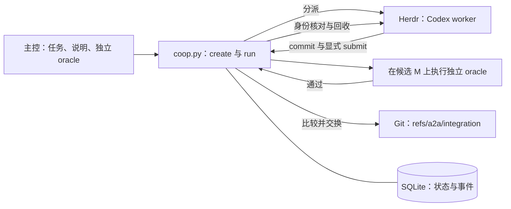

# Herdr A2A：框架、实现方式与操作说明

日期：2026-10-06。源码基准：`331718a359e6438dbd13bee62ce20ab839cf921c`。

[简明英文版](herdr-a2a-2026-10-06.en.md) · [当前项目地图](../.project-map/MAP.md) · [当前操作参考](../README.md)

本报告用于审阅上述版本的实际实现，是一份日期记录。后续规格与进展以项目地图为索引。

英文版按 `asd-ste100` 的结构规则编写，中文版本保留相同事实、条件和操作含义。未逐词核对 ASD 官方词典，因此不宣称获得 ASD-STE100 合规认证。

## 1. 结论与目标

**首轮受管交付、中断恢复和自动运行：PASS，仅限各自已验收范围。完整 intent：INCOMPLETE。**

核心目标是：**让协作不依赖模型持续记住操作手册。** 当前程序已把身份、候选、验收和集成条件放入程序门禁。worker 即使忘记交付，程序也不会因为它说“完成了”而接受代码。程序保留证据，并在指定的等待期限到达后结束等待。

目前，理解 intent、拆分任务、准备独立验收标准仍由主控负责。程序尚未实现“读入一份 intent，自动拆任务并生成验收标准”。自动运行从已经注册的 task 开始。

| 已具备的能力 | 当前边界 |
| --- | --- |
| 持久任务记录、所有权和输入快照 | 同一操作系统用户下的可信协作者 |
| 通过 Herdr 启动 Codex worker | 固定 Codex CLI `0.160.1` |
| 显式交付、独立验收、Git 集成 | 写入一个本地受管 Git 引用 |
| 验收或集成中断后的恢复 | 通过明确的恢复命令处理 |
| 一次完整的自动 `run` | run 进程自身中断后，不会自动续跑 |
| 供诊断使用的事件和观察记录 | 尚无常驻监控服务或 agent 持久邮箱 |

具体落地形式是 Herdr 外部的 Python CLI，当前未修改 Herdr 内核。项目尚未实现分布式调度，也没有实现标准 A2A 网络协议。

## 2. 框架与职责



| 部件 | 职责 |
| --- | --- |
| `intent.md` 与 `.project-map/` | 保存目标、决策、规格和开发 ticket。 |
| 主控 controller | 分配有边界的工作、注册任务、核对证据，并处理重大决策。 |
| `coop.py` | 执行任务门禁，协调 Git、SQLite、Herdr 和 oracle。 |
| Herdr | 提供 pane、terminal、agent 控制和进程观察能力。 |
| Codex worker | 修改自己的 worktree，创建 commit，携带准确身份进行 submit。 |
| Oracle | 根据独立需求检查候选代码的行为。 |
| Monitor | 只读观察与报告，不能 claim、submit、integrate 或宣布成功。 |

主控配置为 `gpt-6-astra`、max reasoning。worker 配置为 `gpt-6.1-sol`、xhigh reasoning、Fast。monitor 配置为 `gpt-6.1-sol`、high reasoning。这些是项目要求的请求配置，已有证据不能独立证明供应商实际提供的 service tier。

程序在 dispatch 时设置 worker 配置。主控和 monitor 的职责也依赖项目规则。当前 `run` 自身会记录有界的状态观察，但不会另外启动一个 monitor agent。

这些角色没有独立的操作系统权限。worktree、session 标识和 SQLite 都不是安全沙箱。

三个设计原则在当前实现中的对应关系：

- **Tracer bullet**：先跑通一个任务的分派、实现、交付、验收、集成和回收。
- **Deep modules**：用一个 CLI 入口封装事务、Git 候选与运行时协调。
- **Ubiquitous language**：代码、测试和文档使用[术语表](../CONTEXT.md)中的统一概念。

## 3. 数据与身份

运行依赖是 Python 3.9 标准库、SQLite、Git、Herdr 和 Codex，没有新增 Python 运行时依赖。操作锁使用 POSIX `fcntl.flock`，当前恢复验收覆盖 macOS/POSIX。

```text
STATE/
  state.sqlite3
  tasks/<task-and-random-id>/
    instructions.txt
    oracle.py
  worktrees/<attempt_id>/
  verification/<verification_id>/
  locks/<task>.lock
  locks/<task>.run.lock
```

SQLite 的 `tasks`、`attempts`、`verifications` 表保存带 JSON 数据的记录。`events` 表按序保存事件。状态变更使用 `BEGIN IMMEDIATE` 事务。应用追加事件，并保留历史 attempt，但这些记录不能抵御同一用户下其他进程的恶意篡改。

| 字段 | 含义 |
| --- | --- |
| `task_id` | 已注册的业务工作项。 |
| `attempt_id` | 该任务的一次执行尝试。 |
| `session_id` | 协调层为本次 attempt 分配的身份，不等于 Codex 原生会话或操作系统身份。 |
| `fence` | 所有权代次，每次 claim 递增。 |
| `spec_rev` | 当前任务的规格版本。 |
| Candidate commit | worker 明确提交的完整 Git commit 标识。 |
| `verification_id` | 一次独立验收的执行身份。 |
| `run_id` | 一次自动协调过程的身份，不能替代 task 状态。 |

claim 为 attempt 创建 detached Git worktree，worker 必须在该目录中工作。回收只关闭归属明确的 pane，工作目录、代码候选和证据继续保留。

## 4. 门禁如何实现

正常任务路径包含以下稳定状态：

```text
ready -> claimed -> submitted -> verified -> accepted
```

程序还会记录 `creating`、`preparing`、`verifying`、`integrating` 等中间状态。oracle 拒绝时，task 回到 `submitted`。验收结果未知时，task 进入暂停。自动清理可能撤销失败的 attempt，使 task 回到 `ready`；历史 attempt 和 verification 仍保留失败证据。

| 门禁 | 实现方式 |
| --- | --- |
| `create` | 核对仓库与基线，将 instructions 和 oracle 复制为任务快照。 |
| `claim` | 原子保留一个有效执行者，分配身份并创建 detached worktree。 |
| `submit` | 核对 attempt、session、fence、spec_rev；核对 commit、祖先关系、worktree HEAD 和干净状态。 |
| `verify` | 构造候选 M，在独立 worktree 中执行冻结的 oracle。 |
| `integrate` | 先持久记录 integration intent，再用比较并交换更新受管 Git 引用。 |
| `reclaim` | 核对已记录的运行时身份，只关闭自己拥有的 pane。 |

submit 后候选冻结，同一个 attempt 不能偷偷换成另一个 commit。submit 只代表交付，不代表通过验收。终端的 `idle`、`done` 不会推进任务状态。

验收中，G 表示当前受管集成头，C 表示 worker 交付的候选，M 表示准备集成的候选。如果 G 是 C 的祖先，M 就是 C。否则程序从 G 和 C 构造合并候选；出现合并冲突时不能集成。

程序在 M 的独立 worktree 中执行：

```sh
python3 -I -B SNAPSHOT_ORACLE CANDIDATE_DIRECTORY
```

oracle 的超时为 60 秒，退出码为 0 才通过。verification 将结果与身份、规格版本、oracle 和 G/C/M 绑定。验收结论的范围仍取决于 oracle 实际检查的行为。

集成实际执行：

```sh
git update-ref refs/a2a/integration M G
```

只有引用的旧值仍为 G，Git 才允许更新。程序再次读取引用，核对成功后记录正常完成。用户的工作分支不会移动，程序不会 push。后续任务以受管集成头作为基线。

### 中断恢复

SQLite 和 Git 不在同一个事务里。程序先保存 integration intent，以便中断后结合真实 Git 引用核对。恢复前仍要检查当前身份和验收记录。

| 观察到的情况 | 恢复行为 |
| --- | --- |
| 原操作仍持锁 | 竞争调用返回 `operation_busy`。 |
| 验收执行中断，缺少完整结果 | 将旧 verification 保留为 interrupted，使用新身份和新 worktree 完整重跑 oracle。 |
| pending integration 的真实引用仍为 G | 继续原 integration intent。 |
| pending integration 的真实引用已为 M | 只补记数据库，不再次写 Git；原命令缺失的结果仍标为未知。 |
| pending integration 的真实引用为其他值，或引用消失 | 返回 `needs_reconciliation`，保留 intent 和证据。 |

锁释放不代表验收通过。锁文件保留，因为替换锁文件可能使两个执行者分别锁住不同文件。已经 accepted 的任务不能撤销。

### Herdr 身份与自动运行

dispatch 创建不抢焦点的 pane，记录 pane、terminal、shell、Codex 进程组领导者，以及可观察的 native session。agent 准备好后，程序只发送一次任务 prompt。启动副作用未知时，程序拒绝再次 dispatch。

身份检查跟踪 Codex 前台进程组领导者。正常辅助进程的出现不会被当作身份更换。领导者改变时，即使旧进程仍在清单中，程序也会拒绝。

`run` 串起分派、等待、验收、集成和回收，后续动作始终绑定原 attempt。如果主控替换了 attempt，旧 run 返回 `run_superseded`，最多清理自己历史 attempt 的 pane。

同一 task 的 run 锁阻止并发 run。具体阶段还会取得 task 操作锁。等待 submit 时释放操作锁，使主控可以核对或替换 attempt。

## 5. 准备任务

运行前应具备以下条件：

- `PATH` 中可找到 Python、Git、Herdr 和 Codex。
- Codex CLI 的版本输出必须是 `codex-cli 0.160.1`。
- 主控位于 `HERDR_ENV=1` 的 Herdr 环境。
- 目标是已有提交基线的 Git 仓库。
- worker 能使用指定模型，并有可用的 Git 作者身份。
- 主控已准备任务说明和独立 Python oracle。

已有基线观察到 Herdr client `0.9.3`、server `0.9.1`、兼容协议 `22`。这份观察不能推广为所有 Herdr 版本都兼容。

1. 检查本地工具。

   ```sh
   python3 --version
   git --version
   codex --version
   test "${HERDR_ENV:-}" = 1
   herdr status
   herdr pane list
   herdr agent list
   ```

2. 从当前 pane 清单选择一个 live 父 pane。

3. 将以下变量替换为本次任务的实际路径和 pane 标识。

   ```sh
   A2A_ROOT='/Users/luckye/Documents/Code/a2a'
   A2A_REPO='/absolute/target/repository'
   A2A_STATE='/absolute/state-directory'
   A2A_ORACLE='/absolute/oracle.py'
   A2A_INSTRUCTIONS='/absolute/instructions.txt'
   A2A_TASK='example-001'
   A2A_PARENT='REPLACE_WITH_LIVE_PANE_ID'
   A2A_WORKER='example-worker-001'
   ```

同一 task 的所有命令使用同一个 state 目录。state 放在目标 worktree 外。task 标识使用新值，worker 名称不能与 Herdr 现有 agent 重名。继承环境中的 pane 标识可能过期，必须核对当前清单。

4. 检查目标仓库。

   ```sh
   git -C "$A2A_REPO" status --short
   git -C "$A2A_REPO" rev-parse --show-toplevel
   git -C "$A2A_REPO" rev-parse --verify --quiet refs/a2a/integration
   ```

5. 根据受管引用是否已存在，选择基线命令。

第一个任务确认尚无受管引用时，使用：

```sh
A2A_BASE=$(git -C "$A2A_REPO" rev-parse HEAD)
```

如果受管引用已存在，使用：

```sh
A2A_BASE=$(git -C "$A2A_REPO" rev-parse refs/a2a/integration)
```

不要在 Git 失败原因不明时自行退回 HEAD。目标路径必须是仓库根目录。任务起点所需的源码改动必须已经包含在选定的基线 commit 中。

6. 准备 instructions 和 oracle。

instructions 写明目标、负责的文件、约束和验收行为。oracle 的第一个参数是候选目录，运行时工作目录也是该目录。只有要求的行为通过时，oracle 才能退出 0。

`create` 会复制 oracle，因此它的文件位置会改变。依赖原文件旁边的资源或相对导入时，需要明确处理路径。

现有实验示例是[分页契约](../fixtures/pagination/CONTRACT.md)与[分页 oracle](../acceptance/pagination_oracle.py)。该 oracle 只检查分页行为。注册其他任务之前，应准备该任务自己的验收条件。

## 6. 执行与检查

1. 注册任务。

   ```sh
   python3 "$A2A_ROOT/coop.py" --state "$A2A_STATE" create \
     --task "$A2A_TASK" --repo "$A2A_REPO" --base "$A2A_BASE" \
     --oracle "$A2A_ORACLE" --instructions "$A2A_INSTRUCTIONS"
   ```

2. 确认注册返回退出码 0 和 `ok=true`。

3. 启动自动运行。

   ```sh
   python3 "$A2A_ROOT/coop.py" --state "$A2A_STATE" run \
     --task "$A2A_TASK" --parent-pane "$A2A_PARENT" \
     --name "$A2A_WORKER" --wait-seconds 600
   ```

`run` 会自行 claim，不要提前手动 claim。示例中的 600 秒只约束成功投递后等待显式 submit 的阶段，不是启动、验收、集成和回收的总时限。

worker 会收到任务说明、身份、工作目录和精确 submit 命令。它必须创建 commit，并交付完整标识。模型口头说“完成”不能替代 submit。

4. run 返回后检查任务。

   ```sh
   python3 "$A2A_ROOT/coop.py" --state "$A2A_STATE" status --task "$A2A_TASK"
   python3 "$A2A_ROOT/coop.py" --state "$A2A_STATE" events --task "$A2A_TASK"
   git -C "$A2A_REPO" rev-parse refs/a2a/integration
   git -C "$A2A_REPO" log -1 --oneline refs/a2a/integration
   git -C "$A2A_REPO" diff --stat "$A2A_BASE" refs/a2a/integration
   ```

| 结果 | 含义 |
| --- | --- |
| 退出 0，且 `ok=true` | 本条 CLI 命令成功。 |
| `task.state=submitted` | 已交付候选，仍待验收。 |
| `task.state=verified` | 独立验收通过，仍待集成。 |
| `task.state=accepted` | 协调层已记录受管集成成功。 |
| `run.outcome=completed` | 自动运行还完成了自己 pane 的回收。 |
| 退出 1，且 `ok=false` | 本条命令拒绝或失败，需要读 `error` 和记录中的细节。 |
| 退出 2 | CLI 参数语法错误。 |

完整自动成功要求同时满足 `ok=true`、`task.state=accepted`、`run.outcome=completed`。结果代码位于受管 Git 引用。合入用户分支或对外发布属于后续独立操作。

## 7. 手动控制与恢复

需要逐步监督时，在 create 后用 `dispatch` 替代 `run`：

```sh
python3 "$A2A_ROOT/coop.py" --state "$A2A_STATE" dispatch \
  --task "$A2A_TASK" --parent-pane "$A2A_PARENT" --name "$A2A_WORKER"
python3 "$A2A_ROOT/coop.py" --state "$A2A_STATE" observe --task "$A2A_TASK"
```

dispatch 也会自行 claim。worker 显式 submit 后，主控可以逐条执行下列命令。`A2A_ATTEMPT` 必须来自那次 dispatch。如果某一步拒绝，不继续下一步。

```sh
A2A_ATTEMPT='REPLACE_WITH_DISPATCH_ATTEMPT_ID'
python3 "$A2A_ROOT/coop.py" --state "$A2A_STATE" verify \
  --task "$A2A_TASK" --attempt "$A2A_ATTEMPT"
python3 "$A2A_ROOT/coop.py" --state "$A2A_STATE" integrate \
  --task "$A2A_TASK" --attempt "$A2A_ATTEMPT"
python3 "$A2A_ROOT/coop.py" --state "$A2A_STATE" reclaim \
  --task "$A2A_TASK" --attempt "$A2A_ATTEMPT"
```

单独调用 `claim --owner LABEL` 只创建 worktree，不创建 Herdr pane。返回值包含 submit 所需身份。回收 pane 则必须有 dispatch 绑定。

| 情况 | 处置 |
| --- | --- |
| `operation_busy` 或 `run_busy` | 核对仍在执行的操作，保留锁文件。 |
| `run_deadline` | 检查 worker 是否漏掉显式 submit，保留该 attempt 的证据。 |
| `stale_attempt`、`stale_session`、`stale_fence`、`stale_spec` | 核对任务分配，不替换成别人的身份强行交付。 |
| `dirty_worktree`、`workspace_head_mismatch` | 检查已分配的 worktree，将准备交付的改动形成 commit 后再 submit。 |
| `oracle_failed` | 检查记录中的输出，诊断过程中保持验收标准不变。 |
| 启动权限提示或 `run_blocked` | 查看真实提示，由已授权负责人处理权限问题。 |
| `identity_conflict` 或外部副作用未知 | 保留 pane 和证据，就无法核对的外部状态询问用户。 |
| 验收中断 | 核对所有权，等活跃操作结束后，对该 attempt 重新调用 `verify`。 |
| pending integration，引用仍为 G 或已为 M | 对该 attempt 重新调用 `integrate`，由程序核对原 intent。 |
| `needs_reconciliation`，引用为其他值 | 保留 intent，改变集成目标前询问用户。 |
| `run_reclaim_failed` | 先读 task 状态，身份核对清楚后只重试指定 attempt 的回收。 |

在授权范围内解决启动问题后，先回收旧 attempt，再重新 dispatch。重复实验时保留先前的输出目录。

`run_reclaim_failed` 可能与 accepted task 同时出现，此时 run outcome 是 `integrated_reclaim_failed`。代码已经集成，只是回收未完成，不能把它当作尚未集成的候选。

`revoke --reason TEXT` 使当前 attempt 失效，并保留历史；它不会关闭 worker pane。需要同时关闭所属 pane 时，使用指定 attempt 的 `reclaim`。

`revise --spec-rev N` 递增版本并使当前 attempt 失效，**不会替换冻结的 instructions 或 oracle**。如果需求确实改变，应先经过用户决策，再用新输入注册新任务。

run 进程自身中断时，先读取 task 状态和 events，再选择恢复命令。不要直接重复 `run` 来尝试续接已有 attempt。

## 8. 验收证据与实际限制

| 里程碑 | 证据 | 范围 |
| --- | --- | --- |
| T-006 受管交付 | [结果记录](../evidence/2026-10-06-managed-01/RESULTS.md) | 8 项 CLI 检查、非法身份、oracle 拒绝，以及真实 Herdr/Codex 交付。 |
| T-007 中断恢复 | [结果记录](../evidence/2026-10-06-recovery-01/RESULTS.md) | 9 项恢复检查，使用真实本地进程、SQLite、Git 和中断注入。 |
| T-008 自动运行 | [结果记录](../evidence/2026-10-06-run-01/RESULTS.md) | 18 项编排检查，以及一次成功的真实自动运行。 |

T-008 的编排负例使用 Herdr/Codex 替身，Git、SQLite 和产品 CLI 为真。这些负例不能代表全部真实模型失败模式。已知坏变体确实触发业务断言失败。早期夹具错误也保留在记录中，但不计作产品失败证据。

真实自动运行使用源码 `655b5a332adfc744e8b49d68f5ef368cac962b05`，集成 commit 为 `2aea50b94ac460d4d0670f95acc3b28efd4da2c8`。12 项独立分页检查通过，另有真实引用和 pane 的读回核对，见[保存的结果](../evidence/2026-10-06-run-01/live-auto-02/result.json)。

在项目根目录执行以下命令，可以重新运行本地验收套件。套件会创建新的隔离产物。

```sh
python3 -B acceptance/test_coop_e2e.py
python3 -B acceptance/test_recovery_e2e.py
python3 -B acceptance/test_run_e2e.py
```

本次报告编写没有重跑产品测试，也没有启动模型 worker。

当前证据尚不能证明：

- 第二种 CLI 或通用能力适配器已经可用。
- 程序能够自动拆任务、调度依赖或配置 monitor 人员。
- 已经具备持久邮箱、全生命周期 hook、租约或心跳。
- 能恢复所有 Herdr server 故障，或自动续跑中断的 run 进程。
- 能隔离同一用户下的恶意协作者。
- 相比对照基线降低了成本、提高了吞吐或可靠性。

[项目地图](../.project-map/MAP.md)仍将第二 CLI 的选择、数值预算，以及邮箱、hook、心跳的范围列为未展开问题。现有程序为首个本地工作流程提供了证据；上述问题仍需独立决策和验收。

## 9. 源码与规范索引

| 阅读目的 | 入口 |
| --- | --- |
| 目标与角色边界 | [Intent](../intent.md)、[项目规则](../AGENTS.md) |
| 当前执行契约 | [交付规格](../.project-map/specs/managed-delivery-2026-10-06.md)、[恢复规格](../.project-map/specs/recovery-2026-10-06.md)、[自动运行规格](../.project-map/specs/supervised-run-2026-10-06.md) |
| 存储与所有权 | [coop.py](../coop.py)：`Coop.__init__`、`transaction`、`reserve_claim`、`submit` |
| 验收与集成 | [coop.py](../coop.py)：`verify`、`finish_verification`、`integrate` |
| 运行时身份与操作 | [coop.py](../coop.py)：`dispatch`、`check_bound_identity`、`reclaim`、`wait_submission`、`run` |
| 外部验收示例 | [分页契约](../fixtures/pagination/CONTRACT.md)、[oracle](../acceptance/pagination_oracle.py)、[真实运行入口](../acceptance/live_run.py) |
